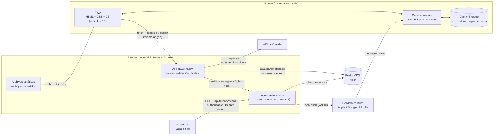

# Arquitectura — Recetas Nevera PWA

| | |
|---|---|
| **Estado** | Fase A **aprobada** el 19 de octubre de 2026 |
| **Fecha** | 19 de octubre de 2026 |
| **Especificación funcional** | App Expo "Recetas Nevera" (Fases 0–5 aprobadas), de solo lectura |
| **Qué cambia** | De app nativa con SQLite local a **PWA instalable** con **API REST en Node** y **PostgreSQL en un servidor** |

Convenciones del documento:
- **[sin verificar]**: no lo he podido confirmar en una fuente oficial. Se comprueba en la fase indicada antes de escribir código que dependa de ello.
- **D-xx**: una decisión tomada (sección 11). **P-xx**: una propuesta que espera tu "ok" (sección 11.2).

---

## 1. Objetivo y alcance

**Objetivo:** recrear Recetas Nevera como PWA instalable en el iPhone, con:
- el inventario y el resto de datos en una base de datos real en un servidor;
- cuentas de usuario y hogares compartidos;
- avisos por Web Push.

Se mantienen las mismas reglas, constantes y prompts que en la app Expo.

### 1.1 Funcionalidades y su equivalencia

| Funcionalidad | App Expo | PWA |
|---|---|---|
| **Inventario** (Nevera, Despensa, Congelador) | SQLite local; añadir, editar, mover y borrar | Igual, a través de la API (`/api/productos`), en PostgreSQL y compartido por el hogar |
| **"¿Dónde lo guardas?"** | `ubicacionesPosibles()`: con varias ubicaciones no se propone ninguna | El mismo módulo, portado a `compartido/ubicaciones.js` |
| **Tuppers con aviso** | Notificación local el día anterior al límite a las 10:00, con botón "Marcar como consumido" | **Web Push** enviado por el servidor a las 10:00 (hora del hogar). **Sin botón en el aviso** (iOS no lo admite, R-03): al tocarlo se abre la ficha del tupper con el botón visible, que era el plan B de Expo |
| **Escaneo de tickets** | Foto, galería o PDF → Claude → revisión línea a línea → transacción | Igual. La foto y el PDF van **al servidor**, que llama a Claude. La key nunca llega al navegador |
| **Recetas con IA** | `NUMERO_RECETAS = 3`, `PERSONAS = 2`, priorizando lo que caduca antes | Mismo prompt **tal cual** (`docs/PROMPTS.md` §1.3); el servidor lee el inventario él mismo |
| **"Qué me falta"** | Calculado en el momento con `estadoIngrediente()` | Igual, en el navegador, con `compartido/cocina.js` y el inventario recién pedido. No se guarda |
| **"La he cocinado"** | Transacción SQLite: descuenta productos y consume tuppers | **Una transacción PostgreSQL** con bloqueo de filas (`FOR UPDATE`), porque ahora varias personas pueden tocar el mismo inventario a la vez |
| **Planificador semanal** | Comida y cena de lunes a domingo; aviso la noche anterior a una hora configurable (21:00 por defecto) | Igual, compartido por el hogar; el aviso lo envía el servidor por Web Push |
| **Ajustes** | API key de Claude y hora del aviso | **Ya no hay API key** (está en el servidor, D-05). Hora del aviso, hogar e invitaciones, avisos de este dispositivo y cerrar sesión |
| **Cuentas y hogar** | No existían | Registro, inicio de sesión, hogar compartido con invitación (D-01, D-03, D-04) |
| **Sin conexión** | Siempre funcionaba (todo era local) | Solo lectura con la última copia guardada (D-09) |

### 1.2 Fuera de alcance de la primera versión
- Escribir sin conexión y sincronizar después (descartado en D-09).
- Varios hogares por usuario (P-01).
- Recuperar la contraseña por email hasta la fase 8 (P-10).
- Analíticas, temas personalizados y cualquier cosa que no esté en la app Expo.

### 1.3 Diferencias de comportamiento respecto a la app Expo

| # | Diferencia | Motivo |
|---|---|---|
| DIF-01 | El aviso del tupper no trae el botón "Marcar como consumido": se pulsa en la ficha | R-03: iOS no admite acciones en las notificaciones web |
| DIF-02 | Los avisos llegan **hasta 5 minutos tarde** (10:00–10:05) | D-07: el programador se dispara cada 5 min |
| DIF-03 | Los avisos solo llegan si la PWA está **instalada en la pantalla de inicio** y se han activado en ese dispositivo | R-01 y R-02 |
| DIF-04 | Sin red solo se puede consultar | D-09 |
| DIF-05 | Hay que tener cuenta e iniciar sesión | D-01 y D-04 |
| DIF-06 | Si otra persona del hogar gasta un producto mientras revisas "La he cocinado", el servidor rechaza el descuento (409) y te pide revisar | P-07: el inventario es compartido |
| DIF-07 | Llamadas a la IA limitadas a 10 por persona y día | D-05 y D-15 |
| DIF-08 | Antes del primer escaneo se muestra un aviso de privacidad que hay que aceptar | SEC-04, ahora obligatorio porque la app es abierta |

---

## 2. Restricciones de la plataforma (verificadas)

| ID | Restricción | Fuente | Cómo afecta al diseño |
|---|---|---|---|
| R-01 | En iOS/iPadOS, Web Push solo funciona en **web apps añadidas a la pantalla de inicio** (desde iOS 16.4), y el manifest debe declarar `display` como `standalone` o `fullscreen`. Una web sin ese manifest se guarda como marcador y se abre en el navegador | [WebKit: Web Push for Web Apps on iOS and iPadOS](https://webkit.org/blog/13878/web-push-for-web-apps-on-ios-and-ipados/) | `manifest.webmanifest` con `"display": "standalone"`. En Safari sin instalar, Ajustes muestra cómo instalarla en lugar del botón de activar avisos |
| R-02 | El permiso de notificaciones se pide **en respuesta a una acción del usuario**, como pulsar un botón de "suscribirse" | Misma fuente | Botón "Activar avisos en este dispositivo" en Ajustes y en el primer uso. Nunca se pide al cargar la página |
| R-03 | Safari, también el de iOS, **no admite `actions`** (botones) en `showNotification()` | [caniuse: options.actions](https://caniuse.com/mdn-api_serviceworkerregistration_shownotification_options_actions_parameter) · [MDN: showNotification](https://developer.mozilla.org/en-US/docs/Web/API/ServiceWorkerRegistration/showNotification) | DIF-01. El aviso abre `/tupper/:id`, cuya acción principal es "Marcar como consumido". Lo mismo resuelve SEC-07 |
| R-04 | **Declarative Web Push** (iOS/iPadOS 18.4+): JSON con `"web_push": 8030`, un objeto `notification` con `title` obligatorio y la URL `navigate`. Se puede suscribir con `window.pushManager` sin Service Worker. Si hay Service Worker se dispara `push` igualmente, y si no muestra su propio aviso a tiempo **se usa el declarativo como respaldo** | [WebKit: Meet Declarative Web Push](https://webkit.org/blog/16535/meet-declarative-web-push/) | D-13: un único formato de mensaje. Entre iOS 16.4 y 18.3 lo muestra el Service Worker. **[sin verificar]** la posición exacta de `navigate` y `app_badge` en el JSON: se comprueba en el *explainer* en la fase 4 |
| R-05 | La API de Badging (`setAppBadge`) existe en las web apps de iOS | [WebKit 13878](https://webkit.org/blog/13878/web-push-for-web-apps-on-ios-and-ipados/) | No se usa en la v1 (la app Expo tampoco ponía globo: `shouldSetBadge: false`) |
| R-06 | Una web app de la pantalla de inicio tiene las mismas cuotas de almacenamiento que el navegador. Si no se usa en un tiempo, sus datos **pueden borrarse**; `navigator.storage.persist()` se concede según heurísticas, como estar instalada | [WebKit: Updates to Storage Policy](https://webkit.org/blog/14403/updates-to-storage-policy/) | La caché local es **solo una copia**: la fuente de verdad es el servidor. Si iOS la borra no se pierde nada. Se llama a `persist()` como mejora |
| R-07 | Unión Europea: Apple anunció que quitaría las web apps de la pantalla de inicio en iOS 17.4, pero **se echó atrás** y las mantiene | Prensa de marzo de 2024: [9to5Mac](https://9to5mac.com/2024/02/08/ios-17-4-web-app-eu/), [iMore](https://imore.com/ios/apple-backtracks-ios-174-web-app-changes-in-eu-just-weeks-after-citing-security-and-privacy-concerns). **[sin verificar en fuente oficial actual]**: la [página de Apple sobre la DMA](https://developer.apple.com/support/dma-and-apps-in-the-eu/) ya no lo menciona | Se comprueba en la fase 3 instalándola en tu iPhone (estás en España). Si fallara, avisaría antes de seguir |
| R-08 | Cámara: `<input type="file" accept="image/*" capture="environment">` abre la cámara trasera en móviles | **[sin verificar]** en MDN y en iOS actual: se comprueba en la fase 5 | El ticket se elige con un `<input type="file">` de toda la vida: cámara, galería o archivo, sin librerías |
| R-09 | **Render gratis:** el servicio se duerme tras 15 min sin tráfico y tarda **unos 50 segundos en despertar**; 750 h/mes por workspace | [Render: Free instances](https://render.com/docs/free) | D-07: el ping cada 5 min lo mantiene despierto. Un mes de 31 días son 744 h (< 750), pero **solo cabe un servicio gratuito** en el workspace. Si aun así está dormido, el frontend muestra "Despertando el servidor…" |
| R-10 | **Render gratis:** el Postgres caduca a los 30 días | [Render: Free instances](https://render.com/docs/free) | Descartado como base de datos (D-06) |
| R-11 | **Neon gratis:** 1 GB por proyecto y 100 CU-h al mes; se suspende tras 5 min sin uso (no se puede desactivar); despierta "en unos cientos de milisegundos"; al agotar las CU-h la base de datos se para hasta el mes siguiente sin borrar datos | [Neon: Plans](https://neon.com/docs/introduction/plans) · [Neon: Scale to zero](https://neon.com/docs/introduction/scale-to-zero) | D-14: **el ping no toca la base de datos** salvo cuando hay que avisar. Si no, 744 h × 0,25 CU ≈ 186 CU-h > 100 |
| R-12 | **cron-job.org:** gratis; como mucho una vez por minuto; tiempo máximo de respuesta de 30 s; admite cabeceras propias | [cron-job.org: FAQ](https://cron-job.org/en/faq/) | `POST /api/tareas/avisos` responde siempre en < 30 s. Las horas las calcula el servidor (la zona horaria de cron-job.org da igual) |
| R-13 | **Vercel Hobby:** cron una vez al día con ±59 min. **GitHub Actions:** cada 5 min como mínimo, en UTC, con retrasos en hora punta | [Vercel Cron](https://vercel.com/docs/cron-jobs/usage-and-pricing) · [GitHub Actions schedule](https://docs.github.com/en/actions/writing-workflows/choosing-when-your-workflow-runs/events-that-trigger-workflows#schedule) | Descartados como programador (D-07) |
| R-14 | **Supabase gratis:** el proyecto se pausa tras 1 semana sin actividad | [Supabase: Pricing](https://supabase.com/pricing) | Descartado (D-06) |
| R-15 | **PostgreSQL:** los `CHECK` no admiten subconsultas ni miran otras filas. `ON DELETE SET NULL (columna)` pone a NULL solo las columnas indicadas de una clave foránea compuesta | [PostgreSQL: CREATE TABLE](https://www.postgresql.org/docs/current/sql-createtable.html) (**desde PostgreSQL 15**, verificado el 2026-10-27 en las [notas de la versión 15](https://www.postgresql.org/docs/release/15.0/); Neon admite las versiones 14 a 18 según su [política de versiones](https://neon.com/docs/postgresql/postgres-version-policy)) | Las reglas entre tablas (que la receta sea del mismo hogar) se resuelven con una **FK compuesta** (§4.1). Ninguna regla de negocio va en un CHECK que no pueda funcionar |
| R-16 | Web Push exige un **contexto seguro**: HTTPS, o `http://localhost` en desarrollo | **[sin verificar]** en MDN (Secure contexts): se comprueba en la fase 3 | En el PC se desarrolla en `http://localhost`. El iPhone se prueba **contra el despliegue HTTPS de Render**, así que no hace falta abrir el firewall (SEC-01) |
| R-17 | **API de Claude:** la misma petición que en Expo (`output_config.format` con `json_schema`, beta `server-side-fallback-2026-07-01`, `stop_reason`) | Código de `lib/claude.ts`. **[sin verificar de nuevo]** en la documentación actual: se comprueba en la fase 5 | Se porta tal cual a `server/servicios/claude.js` |

---

## 3. Diagrama de la arquitectura



**Cómo leerlo:**
- El navegador **solo** habla con Render, y siempre en el mismo origen: sin CORS. La base de datos y Claude solo son accesibles desde el servidor.
- El Service Worker hace tres cosas: guarda la app y la última copia de los datos para usarlos sin red, recibe los push y abre la pantalla correcta al tocar el aviso.
- cron-job.org solo despierta a la agenda. La agenda consulta la base de datos **únicamente** cuando ha llegado la hora del próximo aviso (D-14).

---

## 4. Modelo de datos

### 4.1 Esquema SQL (estado final, tras todas las migraciones)

Criterios comunes y por qué:
- **`BIGINT GENERATED ALWAYS AS IDENTITY`** en lugar de `SERIAL`: es la forma estándar SQL y no permite insertar ids a mano por error.
- **Los nombres de columnas de las 6 tablas originales se mantienen** (`fecha_alta`, `agotado`, `created_at`…), para portar `lib/*.ts` casi línea a línea.
- **`BOOLEAN`** en lugar de `INTEGER CHECK (x IN (0,1))`: PostgreSQL tiene booleanos de verdad.
- **`DATE`** para fechas sin hora (caducidad, fecha límite) y **`TIMESTAMPTZ`** para instantes (altas, envíos). Así "el día" no depende de UTC.
- **`NUMERIC(9,3)`** en lugar de `REAL` para cantidades. Es decimal exacto (0,1 + 0,2 = 0,3), coherente con `redondear()` a 3 decimales, y cabe el máximo de 100 000. Ojo: `pg` devuelve `NUMERIC` **como texto**; la capa de servicios lo convierte con `Number()`.
- **Los límites de SEC-05 se repiten como `CHECK`.** Si un día falla la validación de la API, la base de datos sigue sin aceptar datos absurdos (defensa en profundidad).
- **PostgreSQL no crea índices en las claves foráneas por sí solo**, así que se crean a mano donde se filtra o se hace JOIN.
- **Cada tabla de datos lleva `hogar_id`** (D-03). Todas las consultas filtran por el hogar **de la sesión**, nunca por uno que envíe el cliente.

```sql
-- ===================== Cuentas y hogares =====================

-- Personas registradas. El email se guarda siempre en minúsculas (lo
-- normaliza la API; el CHECK lo garantiza) para que UNIQUE funcione.
CREATE TABLE usuarios (
  id                    BIGINT GENERATED ALWAYS AS IDENTITY PRIMARY KEY,
  email                 TEXT NOT NULL UNIQUE
                        CHECK (char_length(email) BETWEEN 3 AND 254 AND email = lower(email)),
  nombre                TEXT NOT NULL CHECK (char_length(btrim(nombre)) BETWEEN 1 AND 80),
  hash_contrasena       TEXT NOT NULL,          -- "scrypt$N$r$p$sal$hash" (D-04)
  aviso_ia_aceptado_en  TIMESTAMPTZ,            -- SEC-04: NULL = aún no ha aceptado
  created_at            TIMESTAMPTZ NOT NULL DEFAULT now()
);

-- Una casa: comparte inventario, tuppers, recetas y plan.
-- Sustituye a la tabla clave/valor `ajustes` (ver nota abajo).
CREATE TABLE hogares (
  id               BIGINT GENERATED ALWAYS AS IDENTITY PRIMARY KEY,
  nombre           TEXT NOT NULL CHECK (char_length(btrim(nombre)) BETWEEN 1 AND 80),
  zona_horaria     TEXT NOT NULL DEFAULT 'Europe/Madrid',   -- la valida la API (lista IANA)
  hora_aviso_plan  TIME NOT NULL DEFAULT '21:00'
                   CHECK (date_part('second', hora_aviso_plan) = 0),
  created_at       TIMESTAMPTZ NOT NULL DEFAULT now()
);

-- Quién vive en cada hogar. PRIMARY KEY (usuario_id): una persona está en
-- UN solo hogar (P-01). Al borrar el hogar o la persona, se borra la fila.
CREATE TABLE miembros (
  usuario_id  BIGINT PRIMARY KEY REFERENCES usuarios(id) ON DELETE CASCADE,
  hogar_id    BIGINT NOT NULL REFERENCES hogares(id) ON DELETE CASCADE,
  rol         TEXT NOT NULL CHECK (rol IN ('propietario', 'miembro')),
  unido_en    TIMESTAMPTZ NOT NULL DEFAULT now()
);
CREATE INDEX miembros_hogar_idx ON miembros (hogar_id);

-- Códigos para unirse a un hogar. Se guarda el HASH (SHA-256), no el código:
-- si alguien lee la base de datos, no puede usarlos. Un solo uso; caducan.
CREATE TABLE invitaciones (
  codigo_hash  TEXT PRIMARY KEY,
  hogar_id     BIGINT NOT NULL REFERENCES hogares(id) ON DELETE CASCADE,
  creada_por   BIGINT REFERENCES usuarios(id) ON DELETE SET NULL,
  caduca_en    TIMESTAMPTZ NOT NULL,
  usada_en     TIMESTAMPTZ
);
CREATE INDEX invitaciones_hogar_idx ON invitaciones (hogar_id);

-- Sesiones abiertas. La cookie lleva un token aleatorio; aquí solo su hash.
CREATE TABLE sesiones (
  token_hash  TEXT PRIMARY KEY,
  usuario_id  BIGINT NOT NULL REFERENCES usuarios(id) ON DELETE CASCADE,
  created_at  TIMESTAMPTZ NOT NULL DEFAULT now(),
  caduca_en   TIMESTAMPTZ NOT NULL
);
CREATE INDEX sesiones_usuario_idx ON sesiones (usuario_id);

-- ===================== Las 6 tablas de la app Expo =====================

-- Productos del inventario. Igual que en Expo: el mismo alimento en dos
-- sitios son dos filas. El CHECK final hace imposible "agotado con cantidad"
-- o "disponible con 0".
CREATE TABLE productos (
  id               BIGINT GENERATED ALWAYS AS IDENTITY PRIMARY KEY,
  hogar_id         BIGINT NOT NULL REFERENCES hogares(id) ON DELETE CASCADE,
  nombre           TEXT NOT NULL CHECK (char_length(btrim(nombre)) BETWEEN 1 AND 80),
  cantidad         NUMERIC(9,3) NOT NULL CHECK (cantidad BETWEEN 0 AND 100000),
  unidad           TEXT NOT NULL CHECK (unidad IN ('g', 'kg', 'ml', 'l', 'unidades')),
  ubicacion        TEXT NOT NULL CHECK (ubicacion IN ('nevera', 'despensa', 'congelador')),
  fecha_alta       TIMESTAMPTZ NOT NULL DEFAULT now(),
  fecha_caducidad  DATE,
  agotado          BOOLEAN NOT NULL DEFAULT false,
  CHECK ((agotado AND cantidad = 0) OR (NOT agotado AND cantidad > 0))
);
-- Índice PARCIAL: solo los no agotados, que son los que se listan
-- (WHERE hogar_id = $1 AND ubicacion = $2 AND NOT agotado ORDER BY fecha_caducidad).
CREATE INDEX productos_listado_idx ON productos (hogar_id, ubicacion, fecha_caducidad)
  WHERE NOT agotado;

-- Tuppers. `notification_id` (id del aviso local en Expo) desaparece:
-- ahora el servidor marca `aviso_enviado_en` cuando lo envía, y así nunca
-- avisa dos veces del mismo tupper.
CREATE TABLE tuppers (
  id                BIGINT GENERATED ALWAYS AS IDENTITY PRIMARY KEY,
  hogar_id          BIGINT NOT NULL REFERENCES hogares(id) ON DELETE CASCADE,
  nombre            TEXT NOT NULL CHECK (char_length(btrim(nombre)) BETWEEN 1 AND 80),
  ubicacion         TEXT NOT NULL CHECK (ubicacion IN ('nevera', 'despensa', 'congelador')),
  fecha_alta        TIMESTAMPTZ NOT NULL DEFAULT now(),
  dias_maximos      INTEGER NOT NULL CHECK (dias_maximos BETWEEN 1 AND 365),
  fecha_limite      DATE NOT NULL,       -- hoy (en la zona del hogar) + dias_maximos
  consumido         BOOLEAN NOT NULL DEFAULT false,
  aviso_enviado_en  TIMESTAMPTZ
);
CREATE INDEX tuppers_listado_idx ON tuppers (hogar_id, ubicacion, fecha_limite)
  WHERE NOT consumido;
-- Lo que busca el programador: tuppers vivos cuyo aviso no se ha enviado.
CREATE INDEX tuppers_avisos_idx ON tuppers (fecha_limite)
  WHERE NOT consumido AND aviso_enviado_en IS NULL;

-- Recetas guardadas. UNIQUE (id, hogar_id) parece redundante (id ya es
-- único), pero es lo que permite la FK compuesta del planificador.
-- 15 029 = 30 pasos × 500 caracteres + 29 saltos de línea (SEC-05).
CREATE TABLE recetas (
  id             BIGINT GENERATED ALWAYS AS IDENTITY PRIMARY KEY,
  hogar_id       BIGINT NOT NULL REFERENCES hogares(id) ON DELETE CASCADE,
  nombre         TEXT NOT NULL CHECK (char_length(btrim(nombre)) BETWEEN 1 AND 80),
  instrucciones  TEXT NOT NULL CHECK (char_length(instrucciones) BETWEEN 1 AND 15029),
  created_at     TIMESTAMPTZ NOT NULL DEFAULT now(),
  UNIQUE (id, hogar_id)
);
CREATE INDEX recetas_hogar_idx ON recetas (hogar_id, created_at DESC);

-- Ingredientes. No necesitan hogar_id: pertenecen a una receta que ya lo tiene.
CREATE TABLE receta_ingredientes (
  id         BIGINT GENERATED ALWAYS AS IDENTITY PRIMARY KEY,
  receta_id  BIGINT NOT NULL REFERENCES recetas(id) ON DELETE CASCADE,
  nombre     TEXT NOT NULL CHECK (char_length(btrim(nombre)) BETWEEN 1 AND 80),
  cantidad   NUMERIC(9,3) NOT NULL CHECK (cantidad > 0 AND cantidad <= 100000),
  unidad     TEXT NOT NULL CHECK (unidad IN ('g', 'kg', 'ml', 'l', 'unidades'))
);
CREATE INDEX receta_ingredientes_receta_idx ON receta_ingredientes (receta_id);

-- Planificador semanal: una fila por hogar + día + comida/cena.
-- FK COMPUESTA (receta_id, hogar_id): la receta tiene que ser DEL MISMO HOGAR
-- (un CHECK no podría mirar la tabla recetas, R-15). Al borrar la receta,
-- SET NULL (receta_id) vacía solo receta_id y deja hogar_id intacto.
-- Si receta_id es NULL, la FK no se comprueba (MATCH SIMPLE, por defecto).
-- NO se pone CHECK (receta_id IS NOT NULL OR texto_libre IS NOT NULL):
-- haría FALLAR el borrado de una receta asignada sin texto. Como en Expo,
-- los huecos que quedan vacíos se ignoran al listar.
CREATE TABLE planificador_semanal (
  id           BIGINT GENERATED ALWAYS AS IDENTITY PRIMARY KEY,
  hogar_id     BIGINT NOT NULL REFERENCES hogares(id) ON DELETE CASCADE,
  dia_semana   TEXT NOT NULL CHECK (dia_semana IN
                 ('lunes', 'martes', 'miercoles', 'jueves', 'viernes', 'sabado', 'domingo')),
  tipo_comida  TEXT NOT NULL CHECK (tipo_comida IN ('comida', 'cena')),
  receta_id    BIGINT,
  texto_libre  TEXT CHECK (texto_libre IS NULL OR char_length(btrim(texto_libre)) BETWEEN 1 AND 80),
  UNIQUE (hogar_id, dia_semana, tipo_comida),
  CHECK (receta_id IS NULL OR texto_libre IS NULL),      -- nunca las dos cosas a la vez
  FOREIGN KEY (receta_id, hogar_id) REFERENCES recetas (id, hogar_id)
    ON DELETE SET NULL (receta_id)
);

-- ===================== Avisos, IA y operaciones =====================

-- Una suscripción push por dispositivo y navegador. `endpoint` es la URL
-- del servicio de push (Apple, Google…), único en el mundo.
CREATE TABLE suscripciones_push (
  id          BIGINT GENERATED ALWAYS AS IDENTITY PRIMARY KEY,
  usuario_id  BIGINT NOT NULL REFERENCES usuarios(id) ON DELETE CASCADE,
  endpoint    TEXT NOT NULL UNIQUE
              CHECK (char_length(endpoint) <= 1000 AND endpoint LIKE 'https://%'),
  p256dh      TEXT NOT NULL CHECK (char_length(p256dh) <= 200),
  auth        TEXT NOT NULL CHECK (char_length(auth) <= 100),
  created_at  TIMESTAMPTZ NOT NULL DEFAULT now()
);
CREATE INDEX suscripciones_usuario_idx ON suscripciones_push (usuario_id);

-- Qué avisos del plan se han enviado ya. Insertar aquí con ON CONFLICT
-- DO NOTHING es la forma de "reclamar" el envío una sola vez.
CREATE TABLE avisos_plan_enviados (
  hogar_id    BIGINT NOT NULL REFERENCES hogares(id) ON DELETE CASCADE,
  fecha       DATE NOT NULL,          -- el día del plan ("mañana" en la zona del hogar)
  enviado_en  TIMESTAMPTZ NOT NULL DEFAULT now(),
  PRIMARY KEY (hogar_id, fecha)
);

-- Cuota diaria de llamadas a Claude por persona (D-05, D-15).
CREATE TABLE uso_ia (
  usuario_id  BIGINT NOT NULL REFERENCES usuarios(id) ON DELETE CASCADE,
  fecha       DATE NOT NULL,          -- en la zona horaria del hogar
  llamadas    INTEGER NOT NULL CHECK (llamadas >= 0),
  PRIMARY KEY (usuario_id, fecha)
);

-- Idempotencia (P-06): si el móvil repite "Guardar ticket" o "La he cocinado"
-- porque se cortó la red tras guardar, el servidor devuelve la respuesta
-- guardada en vez de aplicarlo dos veces.
CREATE TABLE operaciones (
  clave       UUID PRIMARY KEY,       -- crypto.randomUUID() en el navegador
  usuario_id  BIGINT NOT NULL REFERENCES usuarios(id) ON DELETE CASCADE,
  respuesta   JSONB NOT NULL,
  created_at  TIMESTAMPTZ NOT NULL DEFAULT now()
);

-- Recetas sugeridas por Claude que aún no se han guardado (D-31). Se guardan
-- ENTERAS en JSONB porque ya vienen validadas por validarRecetas() y son
-- provisionales: no se consultan por ingrediente ni se planifican. Cada nueva
-- generación sustituye a la anterior del hogar (en una transacción) y la
-- tarea de avisos borra las de más de 7 días.
CREATE TABLE sugerencias (
  id          BIGINT GENERATED ALWAYS AS IDENTITY PRIMARY KEY,
  hogar_id    BIGINT NOT NULL REFERENCES hogares(id) ON DELETE CASCADE,
  posicion    SMALLINT NOT NULL CHECK (posicion BETWEEN 0 AND 4),   -- como mucho 5 (SEC-05)
  receta      JSONB NOT NULL,          -- { nombre, pasos[], ingredientes[] } = RecetaCompleta
  created_at  TIMESTAMPTZ NOT NULL DEFAULT now(),
  UNIQUE (hogar_id, posicion)
);

-- Control de migraciones (§4.3).
CREATE TABLE schema_migrations (
  version     INTEGER PRIMARY KEY,
  nombre      TEXT NOT NULL,
  aplicada_en TIMESTAMPTZ NOT NULL DEFAULT now()
);
```

**Nota sobre `ajustes`.** En Expo era una tabla clave/valor (`hora_aviso_plan = '21:00'` como texto) y la hora se validaba con `validarHora()`. Ahora la hora es una **columna tipada** de `hogares` (`TIME`, con valor por defecto y CHECK) porque:
- el aviso es del plan, que es del hogar;
- la base de datos no admite una hora mal escrita;
- el programador puede hacer cálculos con ella en SQL.

`validarHora()` y `formatearHora()` se siguen usando en la API y en el formulario.

**Consultas clave que justifican los índices:**

| Consulta | Índice |
|---|---|
| Listar una ubicación: `WHERE hogar_id = $1 AND ubicacion = $2 AND NOT agotado ORDER BY fecha_caducidad NULLS LAST, nombre` | `productos_listado_idx` |
| Tuppers de una ubicación, por fecha límite | `tuppers_listado_idx` |
| Programador: tuppers con el aviso pendiente | `tuppers_avisos_idx` |
| Recetas del hogar, más recientes primero | `recetas_hogar_idx` |
| Ingredientes de una receta (JOIN) | `receta_ingredientes_receta_idx` |
| A quién avisar: miembros del hogar → sus suscripciones | `miembros_hogar_idx`, `suscripciones_usuario_idx` |

### 4.2 Qué vive en el servidor y qué en el dispositivo

| Dato | Dónde | Por qué |
|---|---|---|
| Todas las tablas de §4.1 | **PostgreSQL (servidor)** | D-02: fuente de verdad única, transacciones y avisos |
| Archivos de la app (HTML, CSS, JS, iconos) | Cache Storage del Service Worker | Abrir la app sin red (D-09) |
| Última respuesta de cada `GET /api/...` | Cache Storage (`api-v1`) | Consultar sin red. **Se borra al cerrar sesión** (privacidad en dispositivos compartidos) |
| Sesión | Cookie `HttpOnly` | JavaScript no puede leerla (protege de XSS) |
| Recetas sugeridas sin guardar | **PostgreSQL**, tabla `sugerencias` (D-31) | Cada generación gasta cuota de IA: no se pierden al recargar ni al cambiar de dispositivo, y las ve todo el hogar. Expo las perdía al cerrar la app |
| API key de Claude, claves VAPID, conexión a la base de datos | **Solo variables de entorno del servidor** | SEC-02 y sección 9.10 |

Nada sensible va a `localStorage`.

### 4.3 Estrategia de migraciones

- **Archivos versionados:** `server/migraciones/NNN_descripcion.sql` (001, 002…). **Una migración aplicada no se edita nunca**: cualquier cambio es un archivo nuevo. Es el equivalente a los bloques `if (currentVersion === N)` de `lib/database.ts`.
- **Script `server/bd/migrar.js`:**
  1. Abre una conexión y toma un **bloqueo consultivo**, `SELECT pg_advisory_lock(<número fijo>)`, para que dos arranques a la vez no migren en paralelo.
  2. Lee `schema_migrations`.
  3. Por cada archivo pendiente, en orden: `BEGIN` → ejecutar el SQL → `INSERT INTO schema_migrations` → `COMMIT`. En PostgreSQL **los cambios de esquema también son transaccionales**: si falla a medias, `ROLLBACK` y el esquema queda como estaba.
  4. Libera el bloqueo.
- **Cuándo se ejecuta:** al arrancar el servidor, **antes** de aceptar peticiones. También a mano con `npm run migrar`.
- **Crecer sin borrar datos:** solo se añade: `CREATE TABLE`, `ADD COLUMN` con `DEFAULT`, índices nuevos. Si algún día hay que quitar algo, se hace en dos pasos (dejar de usarlo y borrarlo en otra versión).
- **Reparto por fases** (cada fase añade solo lo que necesita, así practicas migraciones reales):

| Migración | Fase | Contenido |
|---|---|---|
| `001_hogares_productos.sql` | 1 | `hogares` (id, nombre, created_at) y `productos`. **Sin datos**: el hogar de desarrollo lo crea `npm run semilla` (D-39) |
| `002_cuentas.sql` | 2 | `usuarios`, `miembros`, `invitaciones`, `sesiones` |
| `003_tuppers_push.sql` | 4 | `tuppers`, `suscripciones_push`, `ALTER TABLE hogares ADD COLUMN zona_horaria …` |
| `004_ia.sql` | 5 | `uso_ia`, `operaciones`, `ALTER TABLE usuarios ADD COLUMN aviso_ia_aceptado_en …` |
| `005_recetas.sql` | 6 | `recetas`, `receta_ingredientes`, `sugerencias` |
| `006_planificador.sql` | 7 | `planificador_semanal`, `avisos_plan_enviados`, `ALTER TABLE hogares ADD COLUMN hora_aviso_plan …` |

---

## 5. Diseño de la API REST

### 5.1 Convenciones

- **Base:** `/api`. Entrada y salida en JSON (`Content-Type: application/json`). Los nombres de los campos JSON van en **camelCase** (`fechaCaducidad`); el servicio los traduce a las columnas *snake_case*.
- **Autenticación:** cookie `sesion`. Todas las rutas la exigen salvo `/api/auth/registro`, `/api/auth/login`, `/api/salud` y `/api/tareas/avisos` (que usa su propio secreto).
- **Autorización:** el `hogar_id` sale **siempre de la sesión**. Si se pide un id de otro hogar, se responde **404** (no 403) para no revelar que existe.
- **Formato de error** (los mensajes son los textos en español de la app Expo):

```json
{ "error": { "codigo": "VALIDACION", "mensaje": "Revisa los campos marcados.",
             "campos": { "cantidad": "Debe ser un número mayor que 0." },
             "reintentable": false } }
```

- **Códigos HTTP:**

| Código | Cuándo |
|---|---|
| 200 / 201 / 204 | Correcto / creado / sin contenido |
| 400 `VALIDACION` | Algún campo no es válido |
| 401 `SIN_SESION` | Falta la sesión o ha caducado |
| 403 `PROHIBIDO` | Origen no permitido o falta aceptar el aviso de IA |
| 404 `NO_EXISTE` | No existe o es de otro hogar |
| 409 `CONFLICTO` | El email ya existe, el inventario ha cambiado o la invitación ya se usó |
| 413 `DEMASIADO_GRANDE` | Cuerpo o archivo demasiado grande |
| 415 `TIPO_NO_ADMITIDO` | No es JSON, o el archivo no es imagen ni PDF |
| 429 `DEMASIADAS_PETICIONES` / `CUOTA_IA` | Límite de peticiones o de IA |
| 500 `INTERNO` | Error inesperado; nunca se envía la traza |
| 502 `ERROR_IA` / 504 `IA_TARDA` | Fallo o tiempo agotado de Claude, con `reintentable` como en `ErrorClaude` |

- **Validación:** todas las rutas validan el cuerpo, los parámetros y la query **en el servidor**, con validadores propios (sin librerías) que devuelven errores por campo:
  - tipos y valores permitidos (`UNIDADES`, `UBICACIONES`, `DIAS_SEMANA`, `TIPOS_COMIDA`);
  - textos con `trim()` y de 1 a 80 caracteres;
  - números finitos y dentro de rango;
  - ids enteros positivos;
  - fechas `AAAA-MM-DD` que existan, comprobadas con la misma idea que `textoAIso()`.
- **Tamaño del cuerpo:** 100 KB por defecto. 34 MB **solo** en `POST /api/ia/ticket`, porque un PDF de 25 MB ocupa unos 33,4 MB en base64.

### 5.2 Endpoints

Leyenda: **TX** = transacción (o todo, o nada). 🔑 = exige sesión.

#### Salud y tareas

| Método y ruta | Cuerpo | Respuesta | Errores | Notas |
|---|---|---|---|---|
| `GET /api/salud` | — | 200 `{ ok: true }` | — | No toca la base de datos (para el *health check* de Render) |
| `POST /api/tareas/avisos` | — | 200 `{ revisado: bool, enviados: n }` | 401 si el secreto no coincide | Cabecera `Authorization: Bearer <CRON_SECRETO>`, comparada con `crypto.timingSafeEqual`. Si no ha llegado la hora del próximo aviso, responde sin tocar la base de datos (§7.3) |

#### Cuentas y sesión

| Método y ruta | Cuerpo | Respuesta | Errores | Validación / TX |
|---|---|---|---|---|
| `POST /api/auth/registro` | `{ email, nombre, contrasena }` | 201 `{ usuario, hogar }` + cookie | 400, 409 (email existente), 429 | Email en minúsculas, ≤ 254, con formato básico; nombre de 1 a 80; contraseña de 10 a 128 (P-02). **TX:** `usuarios` + `hogares` ("Casa de {nombre}") + `miembros` (propietario) + `sesiones` |
| `POST /api/auth/login` | `{ email, contrasena }` | 200 `{ usuario, hogar }` + cookie | 400, **401 genérico** ("Email o contraseña incorrectos"), 429 | Se calcula el hash aunque el email no exista, para no revelar qué emails existen por el tiempo de respuesta. Límite: 10 intentos / 15 min por IP y 5 por email |
| `POST /api/auth/logout` 🔑 | — | 204 + cookie borrada | — | Borra la fila de `sesiones` |
| `GET /api/yo` 🔑 | — | 200 `{ usuario, hogar, miembros, cuotaIa: { usadas, limite }, avisoIaAceptado }` | 401 | — |
| `DELETE /api/yo` 🔑 | `{ contrasena }` | 204 | 400, 401 | **TX:** si la persona era la única del hogar, se borra el hogar (`CASCADE` borra sus datos); si había más y era propietaria, se pasa la propiedad al miembro más antiguo. Después se borra el usuario |

#### Hogar

| Método y ruta | Cuerpo | Respuesta | Errores | Validación / TX |
|---|---|---|---|---|
| `PATCH /api/hogar` 🔑 | `{ nombre?, horaAvisoPlan?, zonaHoraria? }` | 200 `{ hogar }` | 400 | `validarHora()`; zona dentro de `Intl.supportedValuesOf('timeZone')`. Recalcula la agenda |
| `POST /api/hogar/invitaciones` 🔑 | — | 201 `{ codigo, caducaEn }` | 429 | Código aleatorio de 8 caracteres legibles; se guarda su SHA-256; caduca a las 48 h |
| `POST /api/hogar/unirse` 🔑 | `{ codigo, confirmarBorrado? }` | 200 `{ hogar }` | 400, 404 (código no válido o caducado), 409 (ya usado), 409 `CONFIRMAR_BORRADO` | **TX** con `SELECT … FOR UPDATE` sobre la invitación. Marca `usada_en`. Si tu hogar actual se quedaría vacío y tiene datos, exige `confirmarBorrado: true` (P-01) |
| `POST /api/hogar/salir` 🔑 | — | 200 `{ hogar }` | 409 si eres la única persona | **TX:** quita al miembro y le crea un hogar nuevo vacío |

#### Inventario

| Método y ruta | Cuerpo | Respuesta | Errores | Validación / TX |
|---|---|---|---|---|
| `GET /api/productos?ubicacion=nevera` 🔑 | — | 200 `{ productos: [...] }` | 400 | Ubicación de la lista. Mismo orden que `listarProductos()` |
| `GET /api/productos/:id` 🔑 | — | 200 `{ producto }` | 404 | id entero positivo |
| `POST /api/productos` 🔑 | `{ nombre, cantidad, unidad, ubicacion, fechaCaducidad }` | 201 `{ producto }` | 400 | Como `FormularioProducto`: nombre de 1 a 80, cantidad > 0 y ≤ 100 000, fecha válida o `null` |
| `POST /api/productos/lote` 🔑 | `{ clave, productos: [ ... ≤ 100 ] }` | 201 `{ creados: n }` | 400, 409 | **TX** (guardar ticket); idempotente por `clave` (P-06) |
| `PUT /api/productos/:id` 🔑 | los 5 campos | 200 `{ producto }` | 400, 404 | — |
| `PATCH /api/productos/:id` 🔑 | `{ ubicacion }` | 200 `{ producto }` | 400, 404 | Mover |
| `DELETE /api/productos/:id` 🔑 | — | 204 | 404 | — |
| `GET /api/inventario` 🔑 | — | 200 `{ productos, tuppers }` (no agotados ni consumidos) | — | Para "qué me falta" y "La he cocinado" (`leerInventarioCompleto()`) |

#### Tuppers

| Método y ruta | Cuerpo | Respuesta | Errores | Validación / TX |
|---|---|---|---|---|
| `GET /api/tuppers?ubicacion=` 🔑 | — | 200 `{ tuppers }` | 400 | — |
| `GET /api/tuppers/:id` 🔑 | — | 200 `{ tupper }` | 404 | También devuelve los consumidos (la ficha muestra "✓ Consumido") |
| `POST /api/tuppers` 🔑 | `{ nombre, ubicacion, diasMaximos }` | 201 `{ tupper, avisoActivo }` | 400 | Días enteros de 1 a 365. `fecha_limite` = hoy **en la zona del hogar** + días. `avisoActivo` = algún miembro tiene una suscripción push (para el mensaje "Tupper guardado sin aviso"). Recalcula la agenda |
| `POST /api/tuppers/:id/consumir` 🔑 | — | 200 `{ tupper }` | 404 | **Idempotente**: si ya estaba consumido, devuelve 200 igual. Recalcula la agenda |

#### IA (Claude) — todas: 🔑, cuota diaria (D-15) y una sola petición a la vez por persona

| Método y ruta | Cuerpo | Respuesta | Errores | Validación |
|---|---|---|---|---|
| `POST /api/ia/aviso-aceptado` 🔑 | — | 204 | — | SEC-04: guarda `aviso_ia_aceptado_en` |
| `POST /api/ia/ticket` 🔑 | `{ archivo: { base64, mimeType } }` | 200 `{ productos: ProductoTicket[] }` | 403 `AVISO_IA_PENDIENTE`, 413, 415, 422 `NO_ES_TICKET` / `SIN_ALIMENTOS` / `DEMASIADOS_PRODUCTOS`, 429 `CUOTA_IA`, 502, 504 | Tipo permitido **y firma del archivo** (los primeros bytes de PDF, JPEG, PNG, GIF o WebP); imagen ≤ 5 MB, PDF ≤ 25 MB (como en `ticket.ts`). Prompt y esquema **tal cual**. `validarRespuestaTicket()` portado. El archivo **no se guarda ni se registra** |
| `POST /api/ia/recetas` 🔑 | `{}` | 200 `{ sugerencias: [{ id, receta }] }` | 422 `INVENTARIO_VACIO`, 429, 502, 504 | El servidor lee el inventario del hogar (no se fía del cliente), usa `describirInventario()` y valida con `validarRecetas()`. **TX:** borra las sugerencias anteriores del hogar e inserta las nuevas (D-31) |

**Cuota atómica en una sola sentencia:**

```sql
INSERT INTO uso_ia (usuario_id, fecha, llamadas) VALUES ($1, $2, 1)
ON CONFLICT (usuario_id, fecha) DO UPDATE SET llamadas = uso_ia.llamadas + 1
WHERE uso_ia.llamadas < $3          -- $3 = CUOTA_IA_DIARIA (10)
RETURNING llamadas;                 -- 0 filas = cuota agotada → 429
```

La llamada se cuenta **antes** de llamar a Claude. Si Claude falla con un error reintentable de su lado (red, 5xx o 529), la llamada se devuelve (`llamadas - 1`) para no penalizar a quien la hizo.

#### Recetas y "La he cocinado"

| Método y ruta | Cuerpo | Respuesta | Errores | Validación / TX |
|---|---|---|---|---|
| `GET /api/recetas` 🔑 | — | 200 `{ recetas: [{ id, nombre, createdAt }] }` | — | — |
| `GET /api/recetas/:id` 🔑 | — | 200 `{ receta: { id, nombre, pasos, ingredientes } }` | 404 | — |
| `POST /api/recetas` 🔑 | `{ nombre, pasos, ingredientes }` | 201 `{ id }` | 400 | Mismos límites que `validarRecetas()`. **TX:** receta + ingredientes |
| `DELETE /api/recetas/:id` 🔑 | — | 204 | 404 | `CASCADE` borra los ingredientes y `SET NULL (receta_id)` vacía los huecos del plan. Recalcula la agenda |
| `GET /api/sugerencias` 🔑 | — | 200 `{ sugerencias: [{ id, receta }] }` | — | Las de la última generación del hogar, ordenadas por `posicion` |
| `GET /api/sugerencias/:id` 🔑 | — | 200 `{ sugerencia: { id, receta } }` | 404 | — |
| `POST /api/sugerencias/:id/guardar` 🔑 | — | 201 `{ recetaId }` | 404 (ya guardada o sustituida) | **TX:** inserta receta + ingredientes y **borra la sugerencia**, así no se puede guardar dos veces (como `establecerSugerencias(...filter)` en Expo) |
| `POST /api/cocinar` 🔑 | `{ clave, descuentos: [{ productoId, cantidad }], tuppersConsumidos: [id] }` | 200 `{ agotados: [nombre] }` | 400, 404, **409 `INVENTARIO_CAMBIADO`** | **TX**, ver abajo. Idempotente por `clave` |

**Transacción de `POST /api/cocinar`:**

```sql
BEGIN;
-- 1. Bloquea las filas que se van a tocar. ORDER BY id siempre en el mismo
--    orden: dos transacciones simultáneas nunca se esperan en círculo (deadlock).
SELECT id, nombre, cantidad FROM productos
 WHERE hogar_id = $1 AND id = ANY($2::bigint[]) AND NOT agotado
 ORDER BY id FOR UPDATE;
-- 2. En JS: ¿están todos? ¿cantidad ≤ disponible? Si no → ROLLBACK + 409.
-- 3. Por cada descuento (restante = redondear(cantidad - descuento)):
UPDATE productos SET cantidad = $1, agotado = ($1 = 0) WHERE id = $2;
-- 4. Tuppers del hogar:
UPDATE tuppers SET consumido = true WHERE hogar_id = $1 AND id = ANY($2::bigint[]);
-- 5. Respuesta guardada para la idempotencia:
INSERT INTO operaciones (clave, usuario_id, respuesta) VALUES ($1, $2, $3);
COMMIT;
```

#### Planificador

| Método y ruta | Cuerpo | Respuesta | Errores | Validación / TX |
|---|---|---|---|---|
| `GET /api/plan` 🔑 | — | 200 `{ platos: Plato[] }` | — | La misma consulta que `listarPlan()`, filtrada por hogar |
| `GET /api/plan/:dia` 🔑 | — | 200 `{ dia, platos: [{ tipo, plato, receta \| null }] }` | 400 | Lo que abre el aviso: platos con su receta completa |
| `PUT /api/plan/:dia/:tipo` 🔑 | `{ recetaId }` o `{ texto }` (uno de los dos) | 200 `{ plato }` | 400, 404 (receta de otro hogar) | `INSERT … ON CONFLICT (hogar_id, dia_semana, tipo_comida) DO UPDATE`. Recalcula la agenda |
| `DELETE /api/plan/:dia/:tipo` 🔑 | — | 204 | 400 | Recalcula la agenda |

#### Push

| Método y ruta | Cuerpo | Respuesta | Errores | Validación |
|---|---|---|---|---|
| `GET /api/push/clave-publica` 🔑 | — | 200 `{ clave }` | — | La clave **pública** VAPID; no es secreta |
| `POST /api/push/suscripciones` 🔑 | `{ endpoint, keys: { p256dh, auth } }` | 201 | 400 | `endpoint` en HTTPS y su host en una **lista de servicios permitidos** (sección 9.8, SSRF). *Upsert* por `endpoint` (si el dispositivo cambia de cuenta, pasa a la nueva) |
| `DELETE /api/push/suscripciones` 🔑 | `{ endpoint }` | 204 | — | Solo las del propio usuario |
| `POST /api/push/prueba` 🔑 | — | 200 `{ enviados }` | 429 (3 por hora) | Aviso de prueba a tus dispositivos, para comprobar el iPhone |

---

## 6. Estructura de carpetas y módulos

```
recetas-nevera-pwa/
├── .gitignore                 .env, .env.*, node_modules/ (desde el primer commit, SEC-10)
├── .env.ejemplo               Nombres de las variables SIN valores (sí va al repo)
├── package.json               "type": "module", scripts (start, dev, migrar, test), engines.node
├── README.md
├── docs/                      ARQUITECTURA.md, DISENO_UI.md
│
├── compartido/                Módulos ES PUROS (sin DOM, sin Node): los usan el navegador Y el servidor
│   ├── constantes.js          UNIDADES, UBICACIONES, DIAS_SEMANA, TIPOS_COMIDA, límites SEC-05,
│   │                          NUMERO_RECETAS = 3, PERSONAS = 2, HORA_AVISO_TUPPER = 10,
│   │                          HORA_AVISO_PLAN_POR_DEFECTO = '21:00'
│   ├── texto.js               normalizar()                                ← lib/texto.ts
│   ├── fechas.js              textoAIso, isoATexto, sumarDias, diasHasta ← lib/fechas.ts
│   ├── horas.js               validarHora, formatearHora                  ← lib/ajustes.ts
│   ├── ubicaciones.js         ETIQUETAS_UBICACION, ubicacionesPosibles    ← lib/ubicaciones.ts
│   ├── cocina.js              convertir, redondear, buscarProductos, buscarTupper,
│   │                          estadoIngrediente, cantidadPropuesta        ← lib/cocina.ts
│   ├── formato.js             formatearCantidad                           ← lib/inventario.ts
│   └── planificador.js        ETIQUETAS_DIA, nombrePlato, textoAviso      ← lib/planificador.ts
│
├── server/
│   ├── index.js               Arranque: config → migraciones → agenda → listen
│   ├── app.js                 Express: helmet + CSP, trust proxy, JSON, estáticos, rutas, errores
│   ├── config.js              Lee y COMPRUEBA las variables de entorno; si falta alguna, no arranca
│   ├── log.js                 logError(): nunca cuerpos, cabeceras, cookies ni archivos (SEC-09)
│   ├── bd/
│   │   ├── pool.js            new Pool({ connectionString, ssl }) de pg
│   │   ├── transaccion.js     conTransaccion(async (cliente) => …): BEGIN / COMMIT / ROLLBACK
│   │   └── migrar.js          §4.3
│   ├── migraciones/           001_…sql, 002_…sql …
│   ├── middlewares/
│   │   ├── sesion.js          Lee la cookie, busca la sesión y pone req.usuario y req.hogarId
│   │   ├── exigirSesion.js    401 si no hay sesión
│   │   ├── origen.js          En POST, PUT, PATCH y DELETE exige Origin == APP_ORIGEN (CSRF)
│   │   ├── limite.js          Límite de peticiones en memoria por IP o por clave
│   │   └── errores.js         Convierte los errores al formato §5.1; nunca envía trazas
│   ├── validacion/            Validadores por endpoint (devuelven errores por campo)
│   ├── rutas/                 Solo HTTP: leen req, validan, llaman al servicio y responden
│   │   └── auth.js hogar.js productos.js tuppers.js recetas.js sugerencias.js
│   │       cocinar.js plan.js ia.js push.js tareas.js
│   ├── servicios/             Lógica + SQL. No saben nada de HTTP
│   │   ├── contrasenas.js     scrypt + timingSafeEqual
│   │   ├── usuarios.js  sesiones.js  hogares.js  invitaciones.js
│   │   ├── inventario.js  tuppers.js  recetas.js  cocina.js  planificador.js
│   │   ├── claude.js          ← lib/claude.ts (fetch + ErrorClaude), con la key del entorno
│   │   ├── ticket.js          ← lib/ticket.ts: prompt, esquema y validación TAL CUAL
│   │   ├── generadorRecetas.js ← lib/recetas.ts: prompt, describirInventario, validarRecetas
│   │   ├── cuotaIa.js  operaciones.js
│   │   ├── push.js            web-push: enviar(suscripción, mensaje); 404/410 → borrar
│   │   ├── agenda.js          Próximo aviso en memoria (§7.3)
│   │   └── avisos.js          Reclamar y enviar avisos de tuppers y del plan
│   └── pruebas/               node --test (incluido en Node: sin paquetes, P-05)
│
└── web/                       Se sirve en / (express.static)
    ├── index.html             Un solo HTML; las pantallas las pinta el JS
    ├── manifest.webmanifest   name, short_name, start_url, display: standalone, iconos, colores
    ├── sw.js                  EN LA RAÍZ, para que su alcance sea toda la app
    ├── iconos/                PNG 192 y 512, apple-touch-icon 180
    ├── css/                   tokens.css (← constants/tema.ts), base.css, componentes.css
    └── js/
        ├── app.js             Arranque: registra el SW, comprueba la sesión, arranca el router
        ├── router.js          Rutas → pantallas; valida los parámetros (SEC-06)
        ├── api.js             fetch con errores en español, tiempo máximo y "Sin conexión"
        ├── conexion.js        Estado online/offline y aviso "Sin conexión"
        ├── avisos.js          Instalación, permiso, suscripción push (§7.1)
        ├── componentes/       Equivalentes a components/ui (se diseñan en la fase B)
        └── pantallas/         inventario, producto, tupper, ticket, recetas, receta,
                               sugerencia, cocinar, semana, plan-dia, asignar, ajustes,
                               entrar, registro, privacidad
```

**Reglas de capas** (igual que en `COMPONENTES.md`: cada capa solo importa de las de abajo):
- **Servidor:** `rutas → servicios → bd`. Las rutas no escriben SQL; los servicios no conocen `req` ni `res`.
- **Navegador:** `pantallas → componentes → css/tokens`. Las pantallas piden datos solo a través de `api.js`.
- **`compartido/`** no importa nada de fuera de `compartido/`. Express lo sirve en `/compartido/`, así que el navegador y Node ejecutan **el mismo archivo** (P-04). Una regla, un solo sitio.

---

## 7. Flujos de las notificaciones

### 7.1 Común: alta del dispositivo y suscripción

1. **Instalación.** En el iPhone, la PWA tiene que estar en la pantalla de inicio (R-01). `avisos.js` lo detecta con `matchMedia('(display-mode: standalone)')` (**[sin verificar]** en iOS: se comprueba en la fase 3). Si no está instalada, Ajustes explica cómo hacerlo en lugar de mostrar el botón.
2. **Comprobación de capacidad** (por función, no por navegador, como recomienda WebKit): `'serviceWorker' in navigator && 'PushManager' in window`.
3. **Permiso**, dentro del clic en "Activar avisos en este dispositivo" (R-02): `Notification.requestPermission()`.
4. **Suscripción:** `registration.pushManager.subscribe({ userVisibleOnly: true, applicationServerKey })`, con la clave pública de `GET /api/push/clave-publica`.
5. **Registro:** `POST /api/push/suscripciones` con `endpoint` y `keys`. Cada dispositivo tiene **su propia** suscripción; un miembro puede tener varias (iPhone y PC).
6. Al **cerrar sesión**, el dispositivo borra su suscripción (`DELETE`) para que no siga recibiendo avisos de esa cuenta.

### 7.2 Aviso del tupper (día anterior a su límite a las 10:00, hora del hogar)

| Paso | Qué pasa |
|---|---|
| **Alta** | `POST /api/tuppers` → `fecha_limite = hoy (zona del hogar) + dias_maximos`. Ejemplo: alta el lunes con 3 días → límite el jueves → aviso el **miércoles a las 10:00** (igual que `momentoAvisoTupper()`). La respuesta incluye `avisoActivo`; si es `false`, la pantalla dice "Tupper guardado sin aviso" y enlaza a Ajustes |
| **Programación** | No se programa nada en el dispositivo. El servicio llama a `agenda.recalcular()` (§7.3) |
| **Envío** | Cuando llega la hora, `avisos.js` **reclama** los tuppers en una sola sentencia atómica (más abajo), busca las suscripciones de **todos los miembros** del hogar y envía con `web-push` |
| **Mensaje** | `{ "web_push": 8030, "notification": { "title": "Tu tupper de Cocido caduca pronto", "body": "Cómetelo antes del 22/10/2026. Toca para marcarlo como consumido.", "navigate": "https://<app>/tupper/12", "lang": "es-ES", "tag": "tupper-12" } }`. Los textos son los de `programarAvisoTupper()`, salvo **"Toca para marcarlo"** (DIF-01). Estructura exacta a verificar (R-04) |
| **Recepción** | iOS 18.4+: si el Service Worker no muestra el aviso, se usa el declarativo. iOS 16.4–18.3 y el resto de navegadores: el evento `push` del SW lee el mismo JSON y llama a `showNotification(title, { body, tag, lang, data: { url: navigate } })` |
| **Toque** | `notificationclick` → si la app ya está abierta, la enfoca y navega a la URL; si no, `clients.openWindow(url)`. **Solo se abren URLs del propio origen** (SEC-06) |
| **Pantalla** | `/tupper/12` → `GET /api/tuppers/12` (con sesión) → ficha con **"Marcar como consumido"** como acción principal → `POST /api/tuppers/12/consumir` |
| **Errores** | El servicio de push responde 404/410 → se borra esa suscripción. Otro error → se registra y se sigue con las demás. Si el tupper ya está consumido o caducado antes de avisar, la consulta no lo selecciona |

**Reclamar el envío** (si dos ejecuciones coinciden, solo una gana):

```sql
UPDATE tuppers t SET aviso_enviado_en = now()
  FROM hogares h
 WHERE h.id = t.hogar_id
   AND NOT t.consumido AND t.aviso_enviado_en IS NULL
   AND now() >= ((t.fecha_limite - 1) + time '10:00') AT TIME ZONE h.zona_horaria
RETURNING t.id, t.nombre, t.fecha_limite, t.hogar_id;
```

`(fecha - 1) + time '10:00'` es "el día anterior a las 10:00" **sin zona horaria**; `AT TIME ZONE h.zona_horaria` lo convierte al instante real de esa zona. Así el cambio de hora de verano lo resuelve PostgreSQL. Si el momento ya ha pasado al crear el tupper (límite mañana), se avisa en el siguiente ping (≤ 5 min), igual que los "5 segundos" de Expo.

**Se elige enviar "como mucho una vez":** se marca *antes* de enviar. Si el envío fallara por completo, ese aviso se pierde (queda en el log) en lugar de repetirse cada 5 minutos.

### 7.3 Agenda: el próximo aviso en memoria (D-14)

- **Variable:** `proximaRevision` (un instante, o `null` si no hay nada pendiente).
- **`agenda.recalcular()`**, una consulta que devuelve el mínimo de:
  - los tuppers pendientes: `((fecha_limite - 1) + time '10:00') AT TIME ZONE zona_horaria`;
  - en cada hogar **que tenga algo planificado**, la próxima vez que llegue su `hora_aviso_plan` local: hoy si aún no ha pasado y el aviso de mañana no está enviado, y si no, mañana.
- **Se llama** al arrancar, tras crear o consumir tuppers, en "La he cocinado", al cambiar el plan, la hora o la zona, al borrar una receta y después de cada envío.
- **El ping** (`POST /api/tareas/avisos`) comprueba `proximaRevision !== null && Date.now() >= proximaRevision`:
  - **no** → responde `{ revisado: false }` sin tocar la base de datos, y Neon sigue dormido;
  - **sí** → envía lo pendiente y recalcula.
- **Si Render reinicia:** la variable se pierde, pero `index.js` llama a `avisos.enviarPendientes()` y a `recalcular()` al arrancar. Lo atrasado se envía entonces.
- **Coste estimado:** Neon se despierta solo cuando alguien usa la app y en cada aviso (unos 5 min por despertar), muy por debajo de las 100 CU-h.

### 7.4 Aviso del plan (la noche anterior a `hora_aviso_plan`, 21:00 por defecto)

| Paso | Qué pasa |
|---|---|
| **Alta** | `PUT /api/plan/:dia/:tipo` o cambio de hora en Ajustes → `agenda.recalcular()` |
| **Envío** | Cuando llega la hora, por cada hogar cuya hora local ya ha llegado: se calcula *mañana* en su zona y su día de la semana (`EXTRACT(ISODOW …)`: 1 = lunes … 7 = domingo → `DIAS_SEMANA`). Si mañana tiene comida o cena, **se reclama** con `INSERT INTO avisos_plan_enviados (hogar_id, fecha) … ON CONFLICT DO NOTHING RETURNING` y se envía a todos los miembros |
| **Ventana** | Se envía desde la hora configurada **hasta medianoche** local. Si el servidor estuvo caído a las 21:00, el aviso sale al volver; pasada la medianoche ya no tiene sentido |
| **Mensaje** | `title` = `textoAviso(comida, cena)` ("Mañana comes lentejas y cenas tortilla de patatas"); `body` = "¿Tienes todos los ingredientes? Toca para comprobarlo."; `navigate` = `https://<app>/plan/martes`; `tag` = `plan-2026-10-21` |
| **Toque** | `notificationclick` → `/plan/martes` |
| **Pantalla** | `GET /api/plan/martes` + `GET /api/inventario` → "qué tengo y qué me falta" calculado en el navegador con `estadoIngrediente()` (como `plan/[dia].tsx`, también para los platos escritos a mano) |

---

## 8. Sin conexión y errores de red

### 8.1 Service Worker (`web/sw.js`)

| Qué | Estrategia | Por qué |
|---|---|---|
| Archivos de la app (`/`, `/index.html`, `/css/*`, `/js/*`, `/compartido/*`, iconos, manifest) | **Precaché** al instalar, en una caché con versión (`app-v1`) que se sirve primero desde la caché. Al activarse, borra las versiones antiguas | Abre al instante y sin red. Al cambiar la versión se actualiza |
| `GET /api/...` | **Primero la red** (con tiempo máximo de 8 s). Si va bien, guarda una copia en `api-v1`; si falla, devuelve la copia con la cabecera `X-Desde-Cache: <fecha>` | Siempre datos frescos si hay red; la última copia si no la hay |
| `POST`, `PUT`, `PATCH`, `DELETE` | **Nunca** se guardan ni se encolan | D-09: nada de datos a medias |
| Navegación a `/tupper/12`, etc. | Devuelve `index.html` desde la caché | La app se monta y el router pinta la pantalla |

### 8.2 Qué ve el usuario

- **Sin red con datos guardados:** franja "Sin conexión · datos de las 18:42", con el anuncio a lectores de pantalla que ya hacía `Aviso`. Los botones que escriben quedan **deshabilitados con el motivo** ("Necesitas conexión para guardar").
- **Sin red y sin copia de esa pantalla:** estado vacío "Sin conexión" con "Reintentar".
- **Se recupera la red** (evento `online`): desaparece la franja y la pantalla recarga sus datos.

### 8.3 `api.js`: un único sitio para los errores

| Situación | Detección | Mensaje y acción |
|---|---|---|
| Sin red | `fetch` lanza `TypeError` | "No hay conexión a internet. Comprueba la red e inténtalo de nuevo." (texto de `claude.ts`) + **Reintentar** |
| Servidor dormido | No responde en 3 s | Mientras se espera: "Despertando el servidor… puede tardar un minuto" (R-09) |
| Tiempo agotado | `AbortController` (15 s; 120 s en las rutas de IA, como `TIEMPO_MAXIMO_MS`) | "El servidor está tardando demasiado." + Reintentar |
| 401 | Código | Va a `/entrar` y, al entrar, vuelve a la pantalla en la que estaba |
| 409 `INVENTARIO_CAMBIADO` | Código | "Alguien de tu casa ha cambiado el inventario. Revisa las cantidades." → recarga los datos |
| 429 / `CUOTA_IA` | Código | El mensaje del servidor ("Has usado tus 10 consultas de hoy…") |
| 5xx | Código | "Algo ha fallado en el servidor." + Reintentar si `reintentable` |

### 8.4 Operaciones que no se pueden aplicar dos veces

- **Doble pulsación:** el botón pasa a `cargando` y se bloquea, como el `Boton` de Expo.
- **Reintento tras un corte** (el servidor guardó, pero la respuesta no llegó): `POST /api/productos/lote` y `POST /api/cocinar` llevan una **`clave` UUID** generada al abrir la pantalla. Si el servidor ya la tiene en `operaciones`, devuelve la respuesta guardada sin aplicar nada (P-06). Las claves de más de 7 días se borran en la tarea de avisos.
- **El resto** es idempotente por naturaleza (`PUT`, `DELETE`, `consumir`) o crearía un duplicado visible que se puede borrar (crear un producto suelto).

---

## 9. Seguridad

### 9.1 Hallazgos de la auditoría de la app Expo

| ID | Hallazgo original | Cómo queda resuelto en el diseño |
|---|---|---|
| SEC-01 | Firewall que abre Node a toda la red | En desarrollo, el servidor escucha **solo en `127.0.0.1`**. El iPhone se prueba contra el despliegue HTTPS de Render (R-16), así que **no hace falta ninguna regla de firewall**. Recomendación pendiente en tu PC: borrar la regla amplia (el comando está en la auditoría) |
| SEC-02 | API key en el dispositivo, sin límite de gasto | La key está **solo en `ANTHROPIC_API_KEY`** del servidor (D-05); el navegador nunca la ve. Cuenta autenticada, cuota de 10 al día por persona (D-15), una petición de IA a la vez por persona, tamaño de los archivos validado, workspace propio con **límite de gasto mensual** en la consola, y uso registrado en `uso_ia` |
| SEC-03 | Keychain compartido en Expo Go | **Ya no aplica:** no se guarda ningún secreto en el dispositivo. La sesión va en una cookie `HttpOnly` que JavaScript no puede leer |
| SEC-04 | Fotos de tickets enviadas a un tercero sin aviso | **Obligatorio:** aviso antes del primer escaneo; el servidor lo **exige** (403 `AVISO_IA_PENDIENTE` sin `aviso_ia_aceptado_en`). Página `/privacidad` enlazada desde Ajustes y el registro. Archivos procesados en memoria, sin guardarlos ni registrarlos. Se recomienda recortar la foto |
| SEC-05 | Respuestas de la IA sin límites | Los mismos límites (100 productos, 80 caracteres, 100 000, 5 recetas, 30 ingredientes, 30 pasos de 500), en `compartido/constantes.js`, validados en el **servidor** con `validarRespuestaTicket()` y `validarRecetas()` portados, y repetidos como `CHECK` (§4.1). Los esquemas JSON enviados a Claude se mantienen tal cual |
| SEC-06 | Enlaces profundos y dependencia vulnerable | El router valida cada parámetro (`Number.isInteger`, listas cerradas de días y comidas, ubicaciones) y muestra "Esta pantalla no existe" si no encaja. Las URLs de los avisos las construye el servidor y el SW solo abre las del propio origen. Pocas dependencias (9.9) |
| SEC-07 | Acción de la notificación sin autenticación | No hay acciones (R-03). Tocar el aviso solo **abre** una pantalla, y cualquier cambio exige sesión |
| SEC-08 | Vulnerabilidades en dependencias | 4 dependencias directas (`express`, `pg`, `web-push`, `helmet`). `npm audit` al cerrar cada fase, `package-lock.json` en el repo y Dependabot en GitHub |
| SEC-09 | Logs sin control | `server/log.js`: en producción solo el mensaje del error y un id de petición; **nunca** cuerpos, cabeceras, cookies, archivos ni la key. El frontend no registra nada en producción |
| SEC-10 | Sin bloqueo y `.env` sin ignorar | `.env` y `.env.*` en `.gitignore` **en el primer commit**, con `.env.ejemplo` sin valores. Las sesiones caducan (P-02) y se puede cerrar sesión. Face ID no existe en la web |

### 9.2 Autenticación
- **Contraseñas:** `crypto.scrypt` con sal aleatoria de 16 bytes y comparación con `crypto.timingSafeEqual`. Los parámetros N, r y p salen de la *OWASP Password Storage Cheat Sheet*, ajustados a los 512 MB de RAM de Render (**[sin verificar]** los valores concretos: se comprueban en la fase 2). El hash guarda sus parámetros (`scrypt$N$r$p$sal$hash`) para poder endurecerlos más adelante.
- **Sesión:** token de `crypto.randomBytes(32)` en base64url; en la base de datos solo su SHA-256. Cookie `sesion` con `HttpOnly; Secure; SameSite=Lax; Path=/; Max-Age=30 días`.
- **Ciclo de vida:** se crea una sesión nueva al iniciar sesión (contra la fijación de sesión), se borra al cerrarla y se borran todas al cambiar la contraseña o borrar la cuenta.
- **Login:** mensaje genérico; el hash se calcula siempre (mismo tiempo de respuesta exista o no el email); límites por IP y por email (9.5).

### 9.3 Autorización (que nadie vea datos de otro hogar)
- `hogar_id` **siempre** de `req.hogarId` (la sesión), **nunca** del cuerpo ni de la URL.
- Todas las consultas de datos llevan `WHERE hogar_id = $1`. En los ingredientes, a través del JOIN con `recetas`.
- Los ids ajenos devuelven 404.
- **Prueba obligatoria (fase 2):** dos cuentas de hogares distintos, y `GET`/`PUT`/`DELETE` del producto del otro → 404.

### 9.4 CORS y CSRF
- **CORS:** el frontend y la API comparten origen, así que **no se envía ninguna cabecera CORS**. El navegador impide que otra web lea las respuestas.
- **CSRF:**
  - `SameSite=Lax` en la cookie;
  - en `POST`, `PUT`, `PATCH` y `DELETE`, la cabecera `Origin` tiene que ser igual a `APP_ORIGEN` (si no, 403);
  - solo se acepta `Content-Type: application/json` (415). Un formulario HTML de otra web no puede enviarlo.

### 9.5 Límite de peticiones
- **En memoria** (un solo servidor; se reinicia con él, y se acepta):
  - general: 300 peticiones / 15 min por IP;
  - `login`: 10 / 15 min por IP y 5 / 15 min por email;
  - `registro`: 5 / hora por IP;
  - invitaciones y `push/prueba`: 3 / hora.
- `app.set('trust proxy', 1)`: Render pone un proxy delante, y sin esto **todas** las peticiones parecerían venir de la misma IP.
- **IA:** cuota diaria en la base de datos (atómica, §5.2) y una petición a la vez por persona.
- **Tarea de avisos:** protegida por `CRON_SECRETO`.

### 9.6 Inyección SQL
- **Siempre** `pool.query('… WHERE id = $1', [id])`, sin concatenar ni usar *template strings* con datos. La única consulta "dinámica", el orden de los listados, es fija en el código.
- Revisión: en cada fase se busca `` query(` `` con `${` dentro.
- Las migraciones no llevan datos de usuarios.

### 9.7 XSS (nuevo: en React Native no existía, en la web sí)
- **Nunca** se usa `innerHTML` con datos: siempre `textContent` y `createElement`. Los nombres de productos, recetas y pasos pueden venir de Claude, y un ticket manipulado podría intentar colar `` (inyección de prompt → XSS).
- **CSP con `helmet`:** `default-src 'self'; script-src 'self'; style-src 'self'; img-src 'self' data: blob:; connect-src 'self'; object-src 'none'; base-uri 'self'; frame-ancestors 'none'`. Sin scripts en línea.
- **Otras cabeceras de `helmet`:** HSTS, `X-Content-Type-Options: nosniff`, `Referrer-Policy`.

### 9.8 Validación de entradas y SSRF
- Toda entrada se valida en el servidor (§5.1), aunque el formulario ya lo haga.
- **Archivos del ticket:** tipo declarado + firma real + tamaño, antes de enviarlos a Claude.
- **SSRF** (*Server-Side Request Forgery*): el servidor hace peticiones al `endpoint` de cada suscripción. Si aceptara cualquier URL, un atacante podría hacer que el servidor llamara a direcciones internas. Por eso solo se aceptan endpoints HTTPS de servicios de push conocidos: `*.push.apple.com` (citado por [WebKit](https://webkit.org/blog/13878/web-push-for-web-apps-on-ios-and-ipados/)), `fcm.googleapis.com`, `updates.push.services.mozilla.com` y `*.notify.windows.com`. Las tres últimas están **[sin verificar]** en fuente oficial (fase 4).

### 9.9 Dependencias

| Paquete | Para qué | Decisión |
|---|---|---|
| `express` | Servidor HTTP | D-10 |
| `pg` | PostgreSQL | D-08 |
| `web-push` | VAPID y cifrado | D-11 |
| `helmet` | Cabeceras de seguridad | D-12 |

El **frontend no tiene dependencias**. Las pruebas usan `node:test` y las variables de entorno se cargan con `node --env-file`, ambos incluidos en Node. Cada instalación se hace **tras preguntarte**, como hasta ahora.

### 9.10 Secretos y configuración

| Variable | Contenido |
|---|---|
| `DATABASE_URL` | Cadena de conexión de Neon (con `sslmode=require`) |
| `ANTHROPIC_API_KEY` | Key del workspace de esta app, con límite de gasto |
| `VAPID_PUBLICA` / `VAPID_PRIVADA` / `VAPID_SUJETO` | Claves VAPID (`npx web-push generate-vapid-keys`) y `mailto:` de contacto |
| `CRON_SECRETO` | Cadena aleatoria larga, compartida solo con cron-job.org |
| `APP_ORIGEN` | `http://localhost:3000` en desarrollo y la URL de Render en producción |
| `NODE_ENV`, `PORT` | Entorno y puerto |

- En el PC van en `.env`, que está ignorado por git. En Render, en el panel *Environment*.
- **Copia de los secretos de desarrollo en Bitwarden** (D-34): una nota segura `recetas-pwa · .env desarrollo` con el `.env` completo, que se actualiza cada vez que se añade un secreto. Sirve para montar el proyecto en otro ordenador (`git clone` → `npm install` → pegar la nota en `.env`). Los secretos de producción viven en Render.
- `config.js` **no arranca** si falta alguna variable y nunca imprime sus valores.
- Si una variable se filtra: se rota (key nueva en la consola, claves VAPID nuevas, que obligan a volver a suscribir los dispositivos, o secreto nuevo en cron-job.org).

---

## 10. Plan de implementación

Cada fase sigue el `<modo_mentor>`: te explico, escribes tú, reviso el archivo y lo probamos. Al cerrar cada fase: ✅ lo que funciona, 🧪 cómo probarlo y ⚠️ lo que queda pendiente, y espero tu "ok".

### Fase 0 — Proyecto y servidor mínimo
- `git init`, `.gitignore` (con `.env` desde el primer commit) y `.env.ejemplo`.
- `package.json` con `"type": "module"`.
- Instalar `express`, **preguntándote antes**.
- `config.js`, `app.js` e `index.js`; `GET /api/salud`; Express sirve `web/index.html`.

**Hecho cuando:**
- `npm run dev` arranca en `http://localhost:3000` y escucha solo en `127.0.0.1`;
- `GET /api/salud` → 200 `{"ok":true}`;
- el navegador muestra `index.html`;
- `git status` no muestra `.env`;
- si se borra una variable obligatoria, el servidor no arranca y dice cuál falta.

### Fase 1 — Base de datos y CRUD del inventario, de extremo a extremo
- Cuenta en **Neon** (preguntándote antes) e instalar `pg`.
- `pool.js`, `transaccion.js`, `migrar.js` y `001_hogares_productos.sql`.
- `compartido/` con constantes, texto, fechas, ubicaciones y formato.
- Rutas y validación de `/api/productos` y `/api/productos/lote`.
- Frontend mínimo: tokens CSS, pantalla Inventario con el selector de ubicación, alta y edición con "¿Dónde lo guardas?", mover, borrar, y los 4 estados.
- **Hogar de desarrollo:** como aún no hay cuentas, `npm run semilla` (que se niega a ejecutarse en producción, D-39) crea un hogar de prueba y un middleware usa ese hogar **solo si `NODE_ENV=development`**; en producción falla. La fase 2 lo sustituye. No se despliega nada hasta la fase 3.

**Hecho cuando:**
- `npm run migrar` crea las tablas, y ejecutarlo otra vez no hace nada;
- los `curl` de ejemplo crean, listan, editan, mueven y borran;
- `POST` con `unidad: "litros"` → 400 con el error por campo, y un `INSERT` directo con `cantidad = -1` lo rechaza el `CHECK`;
- en el navegador, "Pechuga de pollo" pregunta Nevera o Congelador y no deja guardar sin elegir;
- `node --test` pasa las pruebas de `ubicaciones`, `fechas` y de los validadores;
- no hay ninguna consulta con `${` dentro.

### Fase 2 — Cuentas, sesiones y hogar compartido
- `002_cuentas.sql`; registro, login y logout; `sesion`, `exigirSesion`, `origen`, `limite`; `helmet` con CSP.
- Invitaciones, unirse, salir y borrar la cuenta.
- Pantallas Entrar, Registro y la parte de Ajustes del hogar.

**Hecho cuando:**
- se puede registrar, entrar, salir y la cookie es `HttpOnly`;
- **la cuenta A no puede ver ni tocar el producto de la cuenta B** (404);
- B se une al hogar de A con un código y ven el mismo inventario;
- un `POST` con un `Origin` ajeno → 403;
- el sexto login fallido → 429;
- `GET` sin cookie → 401.

### Fase 3 — PWA instalable, sin conexión y primer despliegue
- Manifest, iconos, `sw.js` (precaché + primero la red en la API), franja "Sin conexión" y escrituras deshabilitadas.
- Cuenta en **Render** y despliegue con las variables de entorno, preguntándote antes de cada paso.

**Hecho cuando:**
- la URL de Render abre con HTTPS;
- en el iPhone, "Añadir a pantalla de inicio" abre la app **sin la barra de Safari** (y se comprueba R-07);
- con el modo avión se ve el inventario guardado con la fecha y los botones de guardar deshabilitados;
- al quitar el modo avión, recarga;
- al subir la versión del SW, la app se actualiza.

### Fase 4 — Tuppers y avisos Web Push
- `003_tuppers_push.sql`; claves VAPID; instalar `web-push` (preguntándote antes).
- Rutas de tuppers y push; `agenda.js`, `avisos.js` y `/api/tareas/avisos`.
- Tarea en **cron-job.org** (preguntándote antes); `push` y `notificationclick` en el SW.
- Pantallas de tuppers y "Activar avisos". Verificar R-04 y la lista de 9.8.

**Hecho cuando:**
- "Aviso de prueba" llega al iPhone con la PWA instalada;
- un tupper de 1 día avisa en ≤ 5 min y, al tocarlo, se abre su ficha;
- "Marcar como consumido" funciona y no vuelve a avisar;
- el ping sin secreto → 401;
- con el ping cada 5 min y nada pendiente, Neon **se suspende** (se ve en su panel);
- una suscripción caducada se borra sola.

### Fase 5 — Escaneo de tickets con Claude
- `004_ia.sql`; portar `claude.js` y `ticket.js` **tal cual**; cuota, aviso de privacidad y página `/privacidad`.
- Pantalla Ticket (cámara, galería o archivo) con revisión línea a línea; guardado con `lote` idempotente.

**Hecho cuando:**
- un ticket real se lee y se revisa, la carne pregunta la ubicación y se guarda todo o nada;
- una foto que no es un ticket da "Eso no parece un ticket de compra";
- la undécima llamada del día → 429;
- en la pestaña Red del navegador no aparece la key **en ninguna petición**;
- las pruebas de `validarRespuestaTicket()` cubren el límite exacto y un elemento de más (como SEC-05).

### Fase 6 — Recetas con IA y "La he cocinado"
- `005_recetas.sql`; portar `generadorRecetas.js`; sugerencias, guardar receta (TX), detalle con "qué me falta" y `/api/cocinar` (TX con `FOR UPDATE` e idempotente).

**Hecho cuando:**
- se generan 3 recetas para 2 personas, priorizando lo que caduca antes;
- "La he cocinado" convierte g↔kg y ml↔l, pregunta si las unidades no cuadran y marca como agotado lo que llega a 0;
- si falla una fila, no se descuenta nada;
- con dos navegadores del mismo hogar, si uno gasta antes → el otro recibe 409 y revisa;
- repetir la misma `clave` no descuenta dos veces.

### Fase 7 — Planificador semanal y aviso de la noche anterior
- `006_planificador.sql` (con el `ALTER TABLE hogares` de la hora); cuadrante, asignar, quitar y plan del día; hora en Ajustes; aviso del plan en `avisos.js`.

**Hecho cuando:**
- con la hora puesta 5 minutos más tarde, llega "Mañana comes…", y al tocarlo se abre `/plan/<día>` con lo que tienes y lo que te falta;
- no llega dos veces;
- borrar una receta asignada deja su hueco vacío sin error.

### Fase 8 — Cierre
- Recuperar la contraseña por email (P-10; decisión del proveedor en ese momento).
- Revisión de accesibilidad, `npm audit`, README del proyecto y actualización de la auditoría con los hallazgos nuevos.

**Hecho cuando:**
- se puede recuperar la contraseña con un enlace de un solo uso que caduca;
- `npm audit` sin vulnerabilidades altas;
- el README permite levantar el proyecto desde cero.

---

## 11. Registro de decisiones

| # | Fecha | Decisión | Opción elegida | Motivo |
|---|---|---|---|---|
| D-01 | 2026-10-18 | Quién usa la app | **Abierta a cualquiera**: registro e inicio de sesión | Proyecto de portfolio que se pueda enseñar y usar por otras personas. Implica autenticación completa, aislamiento de datos entre usuarios, RGPD (SEC-04) y control del gasto de Claude. |
| D-02 | 2026-10-18 | Qué datos van al servidor | **Todo**: las 6 tablas del esquema original | "La he cocinado" y "guardar receta" son una transacción SQL real; el programador de avisos lee tuppers, plan y hora del aviso de la propia base de datos; mismos datos en todos los dispositivos. |
| D-03 | 2026-10-18 | De quién es cada dato | **Por hogar compartido**: tablas `hogares` y `miembros`; los datos llevan `hogar_id`; se invita con un código | Refleja el uso real (una casa, `PERSONAS = 2`): una nevera compartida y avisos para cada miembro. Implica invitaciones, salir del hogar y qué pasa al borrar una cuenta. |
| D-04 | 2026-10-18 | Identificación de usuarios | **Email + contraseña propios**: hash con `crypto.scrypt` (incluido en Node), sesión en tabla `sesiones` con cookie `HttpOnly`, `Secure` y `SameSite`; recuperación por email en una fase posterior | Sin dependencias para la parte crítica y entendible de punta a punta, así que se puede defender en una entrevista. |
| D-05 | 2026-10-18 | Quién paga las llamadas a Claude | **Key del servidor + cuota por usuario**: key en variable de entorno, workspace con límite de gasto en la consola y cuota diaria por usuario en la base de datos | Resuelve SEC-02 tal como recomienda la auditoría; gasto con techo; la key nunca llega al navegador. |
| D-06 | 2026-10-18 | Motor de base de datos y alojamiento | **PostgreSQL en Neon** (plan gratuito) | Postgres real con transacciones, CHECK, FK, UNIQUE y ON DELETE CASCADE / SET NULL, igual que el esquema original. El plan gratuito no caduca (el de Render caduca a los 30 días). Se suspende tras 5 min sin uso, lo que se acepta. |
| D-07 | 2026-10-18 | Hosting del backend y del frontend; programador de avisos | **Un servicio Node en Render** (gratuito) que sirve la API y el frontend **en el mismo origen**, más **cron-job.org** llamando a `POST /api/tareas/avisos` con un secreto cada 5 min | 0 €; sin CORS; esas llamadas evitan que Render se duerma (se duerme a los 15 min); los avisos llegan como mucho 5 min tarde. |
| D-08 | 2026-10-18 | Acceso a la base de datos | **SQL directo con `pg`**: consultas parametrizadas, transacciones `BEGIN`/`COMMIT`/`ROLLBACK` explícitas y migraciones `.sql` numeradas con tabla `schema_migrations` | Todo el SQL es visible y se puede explicar línea a línea; un solo paquete. |
| D-09 | 2026-10-18 | Funcionamiento sin conexión | **Solo lectura con caché**: el Service Worker guarda la estructura de la app y la última copia de los datos consultados; sin red, las escrituras se deshabilitan explicando por qué | Nunca hay datos a medias ni conflictos entre miembros del hogar; "La he cocinado" sigue siendo atómico. |
| D-10 | 2026-10-18 | Servidor HTTP | **Express 5** | Estándar de facto y muy documentado; trae el límite de tamaño del cuerpo y los archivos estáticos; captura los errores de las funciones `async`. |
| D-11 | 2026-10-18 | Envío de Web Push | **Paquete `web-push`** (VAPID + cifrado RFC 8291) | La criptografía no es el núcleo de la app; la librería de referencia devuelve 404/410 para borrar las suscripciones caducadas. |
| D-12 | 2026-10-18 | Utilidades de seguridad | **`helmet`** para las cabeceras HTTP (con una CSP propia); **código propio** para leer la cookie de sesión y para el límite de peticiones; variables de entorno con `node --env-file` (sin `dotenv`) | Cabeceras probadas en producción; el resto son pocas líneas que se pueden explicar. |
| D-13 | 2026-10-18 | Formato de los avisos push | **Declarative Web Push** (`web_push: 8030`, `notification`, `navigate`) **+ Service Worker que lee el mismo JSON** | En iOS 18.4+ el aviso se ve aunque falle el Service Worker; en el resto de navegadores lo muestra el Service Worker. Un solo formato para todos. |
| D-14 | 2026-10-19 | Evitar agotar las horas de cómputo de Neon | **Próximo aviso en memoria** (§7.3): el ping solo consulta la base de datos cuando toca avisar | Consultar la base de datos cada 5 min la mantendría despierta 744 h/mes (≈ 186 CU-h > 100 gratis). Así Neon duerme casi todo el día y se mantiene la precisión de 5 min. |
| D-15 | 2026-10-19 | Cuota diaria de IA | **10 llamadas por persona y día** (`CUOTA_IA_DIARIA`), además del límite de gasto mensual en la consola | Sobra para un uso normal (un ticket y algunas tandas de recetas) y pone techo al gasto aunque alguien abuse. |
| D-16 | 2026-10-19 | Hogares por persona | P-01 aceptada: **un solo hogar**; al unirse a otro, el hogar anterior se borra si se queda vacío (con confirmación) | Ver P-01 |
| D-17 | 2026-10-19 | Contraseña y sesión | P-02 aceptada: **10–128 caracteres**, sesión de **30 días** | Ver P-02 |
| D-18 | 2026-10-19 | Envío del ticket | P-03 aceptada: **base64 en JSON**, foto reducida con `<canvas>` | Ver P-03 |
| D-19 | 2026-10-19 | Código compartido | P-04 aceptada: carpeta **`compartido/`** con módulos ES | Ver P-04 |
| D-20 | 2026-10-19 | Pruebas | P-05 aceptada: **`node:test`** | Ver P-05 |
| D-21 | 2026-10-19 | Idempotencia | P-06 aceptada: **`clave` UUID** en lote y cocinar | Ver P-06 |
| D-22 | 2026-10-19 | Descuento mayor que lo disponible | P-07 aceptada: **409** y revisión | Ver P-07 |
| D-23 | 2026-10-19 | A quién avisar | P-08 aceptada: **todos los dispositivos de todos los miembros** | Ver P-08 |
| D-24 | 2026-10-19 | Pruebas en el iPhone | P-09 aceptada: **contra Render (HTTPS)** | Ver P-09 |
| D-25 | 2026-10-19 | Recuperar contraseña | P-10 aceptada: **fase 8** | Ver P-10 |
| D-26 | 2026-10-19 | Tareas de cron-job.org | P-11 aceptada: **una sola tarea cada 5 min** | Ver P-11 |
| D-27 | 2026-10-19 | Navegación entre pestañas (fase B) | **Barra inferior en el móvil; barra lateral desde 768 px** | Patrón de iOS en el móvil; en tablet y PC aprovecha el ancho sin barra abajo. |
| D-28 | 2026-10-19 | Pantallas que eran modales (fase B) | **Páginas con URL propia y "‹ Atrás"**; solo las confirmaciones (los `Alert` de Expo) usan `<dialog>` con `showModal()` | Funcionan el gesto atrás y el botón del navegador, se abren desde un aviso y el navegador gestiona el foco, `Esc` y el fondo inerte. |
| D-29 | 2026-10-19 | Tipografía (fase B) | **Fuente del sistema** (`system-ui`, San Francisco en iPhone) con los tamaños de `tema.ts` y el tamaño de texto de iOS | 0 KB, funciona sin red y no envía datos a terceros. |
| D-30 | 2026-10-19 | Iconos (fase B) | **SVG propios en línea** con `currentColor`, siempre con texto y `aria-hidden` | Toman el color del tema y no hay dependencias. |
| D-31 | 2026-10-19 | Recetas sugeridas sin guardar (fase B, era P-12) | **En el servidor**: tabla `sugerencias` (JSONB) por hogar; cada generación sustituye a la anterior; caducan a los 7 días | Cada generación gasta cuota de IA: no se pierden al recargar, se ven en todos los dispositivos y las comparte el hogar. |
| D-32 | 2026-10-19 | Fecha de caducidad (fase B, era P-12) | **`<input type="date">` nativo** + botón "Quitar fecha"; validación igual en el servidor | Rueda nativa en iOS, sin errores de formato ni librerías; el motivo de Expo (no añadir dependencias de calendario) desaparece en la web. |
| D-33 | 2026-10-22 | Nombre de la carpeta del backend (fase 0) | **`server/`** en lugar de `servidor/`; las subcarpetas y los archivos siguen en español | Preferencia del autor. Se actualizan los scripts de `package.json` y las rutas de esta documentación. |
| D-34 | 2026-10-22 | Dónde guardar los secretos de desarrollo para usarlos en varios ordenadores | **Bitwarden** (plan gratuito), nota segura con el `.env`, contraseña maestra única y verificación en dos pasos con app de autenticación | Gestor probado y auditado en lugar de uno propio; sincroniza entre los PC y el iPhone; los secretos nunca pasan por git, el email ni la mensajería. |
| D-35 | 2026-10-27 | Estilo de comillas en JavaScript | **Comillas simples** (`'texto'`) en todo el proyecto; *template literals* (`` `…${x}…` ``) solo cuando hay variables dentro. JSON sigue con dobles porque su formato lo exige | Un solo estilo en todo el código; es el que ya usaban la app Expo y `server/config.js`. |
| D-36 | 2026-10-27 | Región de Neon (fase 1) | **Frankfurt** (`aws-eu-central-1`) | Dentro de la UE (RGPD) y la más cercana a España que ofrece Neon. No se puede cambiar después sin migrar. |
| D-37 | 2026-10-27 | Versión de PostgreSQL (fase 1) | **PostgreSQL 18** | La más reciente que admite Neon, con más años de soporte. Cumple el mínimo de PostgreSQL 15 que exige `ON DELETE SET NULL (receta_id)`. |
| D-38 | 2026-10-27 | Conexión a Neon: *pooled* o directa (fase 1) | **Directa para todo**: una sola `DATABASE_URL`, sin `-pooler` | La conexión *pooled* de Neon usa PgBouncer en modo transacción, donde no funcionan los bloqueos consultivos de sesión (`migrar.js`) ni `SET` ([Neon: connection pooling](https://neon.com/docs/connect/connection-pooling)). Un solo servidor con su `pg.Pool` usa muy pocas de las 97 conexiones directas disponibles a 0,25 CU. |
| D-39 | 2026-10-27 | Hogar de desarrollo de la fase 1 | **Script de semilla aparte** (`npm run semilla`) que crea el hogar de prueba si no existe y se niega a ejecutarse con `NODE_ENV=production`; la migración 001 solo crea tablas | Separa el esquema (que va a todas las bases de datos) de los datos de prueba (solo en desarrollo): una migración aplicada no se puede editar, y un hogar falso se quedaría para siempre en producción. |

### 11.2 Propuestas (aceptadas el 2026-10-19 como D-16 a D-26; P-12 pasa a la fase B)

| # | Propuesta | Por qué la recomiendo | Alternativa principal |
|---|---|---|---|
| P-01 | Cada persona está en **un solo hogar**. Al unirse a otro, si estaba sola en el suyo y tiene datos, se le pide confirmar y **su hogar anterior se borra** | Modelo simple (`PRIMARY KEY (usuario_id)` en `miembros`) y sin datos huérfanos | Varios hogares por persona, con un selector de hogar (complejidad alta) |
| P-02 | Contraseña de 10 a 128 caracteres, sin reglas de "mayúscula + símbolo"; sesión de 30 días | Longitud > complejidad; no obliga a entrar a cada rato en el iPhone | Sesión de 7 días (más segura, más incómoda) |
| P-03 | El ticket viaja como **base64 dentro de JSON** (sin paquetes de *multipart*), con los mismos límites de 5 MB y 25 MB. La foto se reduce en el navegador con `<canvas>` antes de enviarla | Igual que Expo (`quality: 0.5` y base64), sin dependencias | `multipart/form-data` con `multer` (+1 paquete, menos memoria) |
| P-04 | Una carpeta `compartido/` con módulos ES que ejecutan **a la vez** el navegador y Node | Las reglas (unidades, límites, "qué me falta") existen una sola vez: paridad garantizada | Duplicar el código en frontend y backend |
| P-05 | Pruebas con `node:test` (incluido en Node) | Sin paquetes; suficiente para la lógica pura y los validadores | Jest o Vitest (+ paquetes y configuración) |
| P-06 | **Idempotencia** con `clave` UUID en "Guardar ticket" y "La he cocinado" (tabla `operaciones`) | Un corte de red tras guardar no duplica el ticket ni descuenta dos veces | Aceptar el riesgo de duplicados |
| P-07 | El servidor **rechaza (409)** un descuento mayor que lo disponible en ese momento, en lugar de recortarlo en silencio | Con un hogar compartido, otra persona puede haber gastado el producto; decide el usuario, no la app | Recortar a lo disponible, como hacía `Math.min` en el cliente de Expo |
| P-08 | Los avisos de tuppers y del plan llegan a **todos los dispositivos de todos los miembros** del hogar | Es la nevera de los dos | Avisar solo a quien creó el tupper |
| P-09 | Desarrollo en `http://localhost`; **las pruebas del iPhone se hacen contra Render** (HTTPS) | Web Push exige HTTPS; evita abrir el firewall (SEC-01) | Túnel HTTPS al PC (exige instalar algo y exponerlo) |
| P-10 | Recuperación de contraseña en la **fase 8**; el proveedor de correo se decide entonces | No bloquea nada anterior y añade una cuenta externa más | Hacerla en la fase 2 |
| P-11 | Una sola tarea de cron-job.org cada 5 min (despierta Render y revisa la agenda) | Una sola pieza externa | Dos tareas (una para mantener despierto y otra para avisar) |
| P-12 | *(Para la fase B)* Dónde guardar las recetas sugeridas sin guardar (memoria o `sessionStorage`) y el campo de fecha (texto DD/MM/AAAA como en Expo, o `<input type="date">`) | Son decisiones de UX: te las plantearé con opciones en `DISENO_UI.md` | — |
