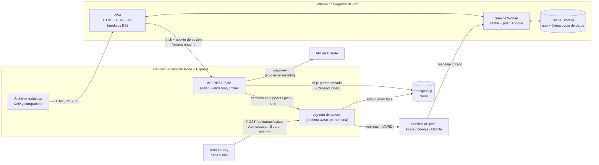

# Arquitectura — Vigía (antes Recetas Nevera PWA)

| | |
|---|---|
| **Estado** | Fase A **aprobada** el 19 de octubre de 2026 |
| **Fecha** | 19 de octubre de 2026 |
| **Especificación funcional** | App Expo "Recetas Nevera" (Fases 0–5 aprobadas), de solo lectura |
| **Qué cambia** | De app nativa con SQLite local a **PWA instalable** con **API REST en Node** y **PostgreSQL en un servidor** |

Convenciones del documento:
- **[sin verificar]**: no lo he podido confirmar en una fuente oficial. Se comprueba en la fase indicada antes de escribir código que dependa de ello.
- **D-xx**: una decisión tomada (sección 11). **P-xx**: una propuesta que espera tu "ok" (sección 11.2).

---

## 1. Objetivo y alcance

**Objetivo:** recrear Recetas Nevera como PWA instalable en el iPhone, con:
- el inventario y el resto de datos en una base de datos real en un servidor;
- cuentas de usuario y hogares compartidos;
- avisos por Web Push.

Se mantienen las mismas reglas, constantes y prompts que en la app Expo.

### 1.1 Funcionalidades y su equivalencia

| Funcionalidad | App Expo | PWA |
|---|---|---|
| **Inventario** (Nevera, Despensa, Congelador) | SQLite local; añadir, editar, mover y borrar | Igual, a través de la API (`/api/productos`), en PostgreSQL y compartido por el hogar |
| **"¿Dónde lo guardas?"** | `ubicacionesPosibles()`: con varias ubicaciones no se propone ninguna | El mismo módulo, portado a `compartido/ubicaciones.js` |
| **Tuppers con aviso** | Notificación local el día anterior al límite a las 10:00, con botón "Marcar como consumido" | **Web Push** enviado por el servidor a las 10:00 (hora del hogar). **Sin botón en el aviso** (iOS no lo admite, R-03): al tocarlo se abre la ficha del tupper con el botón visible, que era el plan B de Expo |
| **Escaneo de tickets** | Foto, galería o PDF → Claude → revisión línea a línea → transacción | Igual. La foto y el PDF van **al servidor**, que llama a Claude. La key nunca llega al navegador |
| **Recetas con IA** | `NUMERO_RECETAS = 3`, `PERSONAS = 2`, priorizando lo que caduca antes | Mismo prompt **tal cual** (`docs/PROMPTS.md` §1.3); el servidor lee el inventario él mismo |
| **"Qué me falta"** | Calculado en el momento con `estadoIngrediente()` | Igual, en el navegador, con `compartido/cocina.js` y el inventario recién pedido. No se guarda |
| **"La he cocinado"** | Transacción SQLite: descuenta productos y consume tuppers | **Una transacción PostgreSQL** con bloqueo de filas (`FOR UPDATE`), porque ahora varias personas pueden tocar el mismo inventario a la vez |
| **Planificador semanal** | Comida y cena de lunes a domingo; aviso la noche anterior a una hora configurable (21:00 por defecto) | Igual, compartido por el hogar; el aviso lo envía el servidor por Web Push |
| **Ajustes → Perfil** | API key de Claude y hora del aviso | **Ya no hay API key** (está en el servidor, D-05). **Perfil** (fase 9, D-52), que se abre con tu avatar desde la cabecera: datos personales, seguridad (contraseña y sesiones), hogar e invitaciones, avisos y cuota de IA |
| **Lista de la compra** | No existía | Compartida por el hogar; se añade sola cuando un producto baja al 10 % y se tacha sola al volver al inventario (fase 12, D-54) |
| **Cuentas y hogar** | No existían | Registro, inicio de sesión, hogar compartido con invitación (D-01, D-03, D-04) |
| **Sin conexión** | Siempre funcionaba (todo era local) | Solo lectura con la última copia guardada (D-09) |

### 1.2 Fuera de alcance de la primera versión
- Escribir sin conexión y sincronizar después (descartado en D-09).
- Varios hogares por usuario (P-01).
- Recuperar la contraseña por email hasta la fase 10 (P-10; movida por D-52 y D-53).
- Analíticas, temas personalizados y cualquier cosa que no esté en la app Expo.
  Excepciones que decidió el autor el 2026-11-18: el perfil con avatar (D-52),
  las animaciones (D-56) y la lista de la compra (D-54).
- Las ideas de la versión 2 (consejos de cocina, productos de temporada):
  apuntadas en §10, "Versión 2".

### 1.3 Diferencias de comportamiento respecto a la app Expo

| # | Diferencia | Motivo |
|---|---|---|
| DIF-01 | El aviso del tupper no trae el botón "Marcar como consumido": se pulsa en la ficha | R-03: iOS no admite acciones en las notificaciones web |
| DIF-02 | Los avisos llegan **hasta 5 minutos tarde** (10:00–10:05) | D-07: el programador se dispara cada 5 min |
| DIF-03 | Los avisos solo llegan si la PWA está **instalada en la pantalla de inicio** y se han activado en ese dispositivo | R-01 y R-02 |
| DIF-04 | Sin red solo se puede consultar | D-09 |
| DIF-05 | Hay que tener cuenta e iniciar sesión | D-01 y D-04 |
| DIF-06 | Si otra persona del hogar gasta un producto mientras revisas "La he cocinado", el servidor rechaza el descuento (409) y te pide revisar | P-07: el inventario es compartido |
| DIF-07 | Llamadas a la IA limitadas a 10 por persona y día | D-05 y D-15 |
| DIF-08 | Antes del primer escaneo se muestra un aviso de privacidad que hay que aceptar | SEC-04, ahora obligatorio porque la app es abierta |

---

## 2. Restricciones de la plataforma (verificadas)

| ID | Restricción | Fuente | Cómo afecta al diseño |
|---|---|---|---|
| R-01 | En iOS/iPadOS, Web Push solo funciona en **web apps añadidas a la pantalla de inicio** (desde iOS 16.4), y el manifest debe declarar `display` como `standalone` o `fullscreen`. Una web sin ese manifest se guarda como marcador y se abre en el navegador | [WebKit: Web Push for Web Apps on iOS and iPadOS](https://webkit.org/blog/13878/web-push-for-web-apps-on-ios-and-ipados/) | `manifest.webmanifest` con `"display": "standalone"`. En Safari sin instalar, Ajustes muestra cómo instalarla en lugar del botón de activar avisos |
| R-02 | El permiso de notificaciones se pide **en respuesta a una acción del usuario**, como pulsar un botón de "suscribirse" | Misma fuente | Botón "Activar avisos en este dispositivo" en Ajustes y en el primer uso. Nunca se pide al cargar la página |
| R-03 | Safari, también el de iOS, **no admite `actions`** (botones) en `showNotification()` | [caniuse: options.actions](https://caniuse.com/mdn-api_serviceworkerregistration_shownotification_options_actions_parameter) · [MDN: showNotification](https://developer.mozilla.org/en-US/docs/Web/API/ServiceWorkerRegistration/showNotification) | DIF-01. El aviso abre `/tupper/:id`, cuya acción principal es "Marcar como consumido". Lo mismo resuelve SEC-07 |
| R-04 | **Declarative Web Push** (iOS/iPadOS 18.4+): JSON con `"web_push": 8030`, un objeto `notification` con `title` obligatorio y la URL `navigate`. Se puede suscribir con `window.pushManager` sin Service Worker. Si hay Service Worker se dispara `push` igualmente, y si no muestra su propio aviso a tiempo **se usa el declarativo como respaldo** | [WebKit: Meet Declarative Web Push](https://webkit.org/blog/16535/meet-declarative-web-push/) | D-13: un único formato de mensaje. Entre iOS 16.4 y 18.3 lo muestra el Service Worker. Comprobado el 2026-11-08 en el blog (el *explainer* es un borrador anterior): `navigate` y `app_badge` van **dentro** de `notification`; `title` y `navigate` son obligatorios. `tag` no se cita, pero es de `NotificationOptions`. Con SW, iOS lanza `push` y usa el declarativo solo si el SW no muestra su aviso |
| R-05 | La API de Badging (`setAppBadge`) existe en las web apps de iOS | [WebKit 13878](https://webkit.org/blog/13878/web-push-for-web-apps-on-ios-and-ipados/) | No se usa en la v1 (la app Expo tampoco ponía globo: `shouldSetBadge: false`) |
| R-06 | Una web app de la pantalla de inicio tiene las mismas cuotas de almacenamiento que el navegador. Si no se usa en un tiempo, sus datos **pueden borrarse**; `navigator.storage.persist()` se concede según heurísticas, como estar instalada | [WebKit: Updates to Storage Policy](https://webkit.org/blog/14403/updates-to-storage-policy/) | La caché local es **solo una copia**: la fuente de verdad es el servidor. Si iOS la borra no se pierde nada. Se llama a `persist()` como mejora |
| R-07 | Unión Europea: Apple anunció que quitaría las web apps de la pantalla de inicio en iOS 17.4, pero **se echó atrás** y las mantiene | Prensa de marzo de 2024: [9to5Mac](https://9to5mac.com/2024/02/08/ios-17-4-web-app-eu/), [iMore](https://imore.com/ios/apple-backtracks-ios-174-web-app-changes-in-eu-just-weeks-after-citing-security-and-privacy-concerns). **[sin verificar en fuente oficial actual]**: la [página de Apple sobre la DMA](https://developer.apple.com/support/dma-and-apps-in-the-eu/) ya no lo menciona | Comprobado: la app está instalada en la pantalla de inicio de mi iPhone, en España, desde la fase 3 |
| R-08 | Cámara: `<input type="file" accept="image/*" capture="environment">` abre la cámara trasera en móviles | Verificado en MDN (2026-11-09): `capture` no funciona en todos los navegadores y, si funciona, abre solo la cámara. **No se usa**; en iOS se comprueba el menú del input en el paso 6 | El ticket se elige con un `<input type="file">` de toda la vida: cámara, galería o archivo, sin librerías |
| R-09 | **Render gratis:** el servicio se duerme tras 15 min sin tráfico y tarda **unos 50 segundos en despertar**; 750 h/mes por workspace | [Render: Free instances](https://render.com/docs/free) | D-07: el ping cada 5 min lo mantiene despierto. Un mes de 31 días son 744 h (< 750), pero **solo cabe un servicio gratuito** en el workspace. Si aun así está dormido, el frontend muestra "Despertando el servidor…" |
| R-10 | **Render gratis:** el Postgres caduca a los 30 días | [Render: Free instances](https://render.com/docs/free) | Descartado como base de datos (D-06) |
| R-11 | **Neon gratis:** 1 GB por proyecto y 100 CU-h al mes; se suspende tras 5 min sin uso (no se puede desactivar); despierta "en unos cientos de milisegundos"; al agotar las CU-h la base de datos se para hasta el mes siguiente sin borrar datos | [Neon: Plans](https://neon.com/docs/introduction/plans) · [Neon: Scale to zero](https://neon.com/docs/introduction/scale-to-zero) | D-14: **el ping no toca la base de datos** salvo cuando hay que avisar. Si no, 744 h × 0,25 CU ≈ 186 CU-h > 100 |
| R-12 | **cron-job.org:** gratis; como mucho una vez por minuto; tiempo máximo de respuesta de 30 s; admite cabeceras propias | [cron-job.org: FAQ](https://cron-job.org/en/faq/) | `POST /api/tareas/avisos` responde siempre en < 30 s. Las horas las calcula el servidor (la zona horaria de cron-job.org da igual) |
| R-13 | **Vercel Hobby:** cron una vez al día con ±59 min. **GitHub Actions:** cada 5 min como mínimo, en UTC, con retrasos en hora punta | [Vercel Cron](https://vercel.com/docs/cron-jobs/usage-and-pricing) · [GitHub Actions schedule](https://docs.github.com/en/actions/writing-workflows/choosing-when-your-workflow-runs/events-that-trigger-workflows#schedule) | Descartados como programador (D-07) |
| R-14 | **Supabase gratis:** el proyecto se pausa tras 1 semana sin actividad | [Supabase: Pricing](https://supabase.com/pricing) | Descartado (D-06) |
| R-15 | **PostgreSQL:** los `CHECK` no admiten subconsultas ni miran otras filas. `ON DELETE SET NULL (columna)` pone a NULL solo las columnas indicadas de una clave foránea compuesta | [PostgreSQL: CREATE TABLE](https://www.postgresql.org/docs/current/sql-createtable.html) (**desde PostgreSQL 15**, verificado el 2026-10-27 en las [notas de la versión 15](https://www.postgresql.org/docs/release/15.0/); Neon admite las versiones 14 a 18 según su [política de versiones](https://neon.com/docs/postgresql/postgres-version-policy)) | Las reglas entre tablas (que la receta sea del mismo hogar) se resuelven con una **FK compuesta** (§4.1). Ninguna regla de negocio va en un CHECK que no pueda funcionar |
| R-16 | Web Push exige un **contexto seguro**: HTTPS, o `http://localhost` en desarrollo | Comprobado en la fase 4: los avisos llegan al iPhone con la app de Render (HTTPS) | En el PC se desarrolla en `http://localhost`. El iPhone se prueba **contra el despliegue HTTPS de Render**, así que no hace falta abrir el firewall (SEC-01) |
| R-17 | **API de Claude:** la misma petición que en Expo (`output_config.format` con `json_schema`, beta `server-side-fallback-2026-07-01`, `stop_reason`) | Código de `lib/claude.ts`. Verificado (2026-11-09) contra la documentación actual: `fallbacks: 'default'` con `server-side-fallback-2026-07-01` es la forma válida en `claude-sonnet-5-5`; Sonnet 5.5 añade bloques `thinking` (vacíos), que el filtro `type === 'text'` ya descarta | Se porta tal cual a `server/servicios/claude.js` |

---

## 3. Diagrama de la arquitectura



**Cómo leerlo:**
- El navegador **solo** habla con Render, y siempre en el mismo origen: sin CORS. La base de datos y Claude solo son accesibles desde el servidor.
- El Service Worker hace tres cosas: guarda la app y la última copia de los datos para usarlos sin red, recibe los push y abre la pantalla correcta al tocar el aviso.
- cron-job.org solo despierta a la agenda. La agenda consulta la base de datos **únicamente** cuando ha llegado la hora del próximo aviso (D-14).

---

## 4. Modelo de datos

### 4.1 Esquema SQL (estado final, tras todas las migraciones)

Criterios comunes y por qué:
- **`BIGINT GENERATED ALWAYS AS IDENTITY`** en lugar de `SERIAL`: es la forma estándar SQL y no permite insertar ids a mano por error.
- **Los nombres de columnas de las 6 tablas originales se mantienen** (`fecha_alta`, `agotado`, `created_at`…), para portar `lib/*.ts` casi línea a línea.
- **`BOOLEAN`** en lugar de `INTEGER CHECK (x IN (0,1))`: PostgreSQL tiene booleanos de verdad.
- **`DATE`** para fechas sin hora (caducidad, fecha límite) y **`TIMESTAMPTZ`** para instantes (altas, envíos). Así "el día" no depende de UTC.
- **`NUMERIC(9,3)`** en lugar de `REAL` para cantidades. Es decimal exacto (0,1 + 0,2 = 0,3), coherente con `redondear()` a 3 decimales, y cabe el máximo de 100 000. Ojo: `pg` devuelve `NUMERIC` **como texto**; la capa de servicios lo convierte con `Number()`.
- **Los límites de SEC-05 se repiten como `CHECK`.** Si un día falla la validación de la API, la base de datos sigue sin aceptar datos absurdos (defensa en profundidad).
- **PostgreSQL no crea índices en las claves foráneas por sí solo**, así que se crean a mano donde se filtra o se hace JOIN.
- **Cada tabla de datos lleva `hogar_id`** (D-03). Todas las consultas filtran por el hogar **de la sesión**, nunca por uno que envíe el cliente.

```sql
-- ===================== Cuentas y hogares =====================

-- Personas registradas. El email se guarda siempre en minúsculas (lo
-- normaliza la API; el CHECK lo garantiza) para que UNIQUE funcione.
CREATE TABLE usuarios (
  id                    BIGINT GENERATED ALWAYS AS IDENTITY PRIMARY KEY,
  email                 TEXT NOT NULL UNIQUE
                        CHECK (char_length(email) BETWEEN 3 AND 254 AND email = lower(email)),
  nombre                TEXT NOT NULL CHECK (char_length(btrim(nombre)) BETWEEN 1 AND 80),
  hash_contrasena       TEXT NOT NULL,          -- "scrypt$N$r$p$sal$hash" (D-04)
  aviso_ia_aceptado_en  TIMESTAMPTZ,            -- SEC-04: NULL = aún no ha aceptado
  aviso_chat_aceptado_en TIMESTAMPTZ,           -- D-51: el aviso propio del chat
  -- D-52: de esta semilla sale SIEMPRE el mismo avatar (lo dibuja blobatar).
  -- 32 cifras hexadecimales al azar; "Otro avatar" la cambia.
  avatar_semilla        TEXT NOT NULL DEFAULT replace(gen_random_uuid()::text, '-', '')
                        CHECK (avatar_semilla ~ '^[0-9a-f]{32}$'),
  created_at            TIMESTAMPTZ NOT NULL DEFAULT now()
);

-- Una casa: comparte inventario, tuppers, recetas y plan.
-- Sustituye a la tabla clave/valor `ajustes` (ver nota abajo).
CREATE TABLE hogares (
  id               BIGINT GENERATED ALWAYS AS IDENTITY PRIMARY KEY,
  nombre           TEXT NOT NULL CHECK (char_length(btrim(nombre)) BETWEEN 1 AND 80),
  zona_horaria     TEXT NOT NULL DEFAULT 'Europe/Madrid'    -- la valida la API (lista IANA)
                   CHECK (char_length(zona_horaria) BETWEEN 1 AND 64),
  hora_aviso_plan  TIME NOT NULL DEFAULT '21:00'
                   CHECK (date_part('second', hora_aviso_plan) = 0),
  created_at       TIMESTAMPTZ NOT NULL DEFAULT now()
);

-- Quién vive en cada hogar. PRIMARY KEY (usuario_id): una persona está en
-- UN solo hogar (P-01). Al borrar el hogar o la persona, se borra la fila.
CREATE TABLE miembros (
  usuario_id  BIGINT PRIMARY KEY REFERENCES usuarios(id) ON DELETE CASCADE,
  hogar_id    BIGINT NOT NULL REFERENCES hogares(id) ON DELETE CASCADE,
  rol         TEXT NOT NULL CHECK (rol IN ('propietario', 'miembro')),
  unido_en    TIMESTAMPTZ NOT NULL DEFAULT now()
);
CREATE INDEX miembros_hogar_idx ON miembros (hogar_id);

-- Códigos para unirse a un hogar. Se guarda el HASH (SHA-256), no el código:
-- si alguien lee la base de datos, no puede usarlos. Un solo uso; caducan.
CREATE TABLE invitaciones (
  codigo_hash  TEXT PRIMARY KEY,
  hogar_id     BIGINT NOT NULL REFERENCES hogares(id) ON DELETE CASCADE,
  creada_por   BIGINT REFERENCES usuarios(id) ON DELETE SET NULL,
  caduca_en    TIMESTAMPTZ NOT NULL,
  usada_en     TIMESTAMPTZ
);
CREATE INDEX invitaciones_hogar_idx ON invitaciones (hogar_id);

-- Sesiones abiertas. La cookie lleva un token aleatorio; aquí solo su hash.
CREATE TABLE sesiones (
  token_hash  TEXT PRIMARY KEY,
  usuario_id  BIGINT NOT NULL REFERENCES usuarios(id) ON DELETE CASCADE,
  created_at  TIMESTAMPTZ NOT NULL DEFAULT now(),
  caduca_en   TIMESTAMPTZ NOT NULL
);
CREATE INDEX sesiones_usuario_idx ON sesiones (usuario_id);

-- Enlaces que se envían por correo (D-53): "¿Has olvidado la contraseña?"
-- (tipo 'recuperar', 30 min) y confirmar un email nuevo (tipo 'email', 24 h).
-- Como las sesiones: el token va en el enlace y aquí solo su SHA-256.
-- Un enlace sirve UNA vez (usada_en).
CREATE TABLE enlaces_correo (
  token_hash   TEXT PRIMARY KEY,
  usuario_id   BIGINT NOT NULL REFERENCES usuarios(id) ON DELETE CASCADE,
  tipo         TEXT NOT NULL CHECK (tipo IN ('recuperar', 'email')),
  -- Solo en los de tipo 'email': la dirección que hay que confirmar.
  email_nuevo  TEXT CHECK (char_length(email_nuevo) BETWEEN 3 AND 254 AND email_nuevo = lower(email_nuevo)),
  created_at   TIMESTAMPTZ NOT NULL DEFAULT now(),
  caduca_en    TIMESTAMPTZ NOT NULL,
  usada_en     TIMESTAMPTZ,
  CHECK ((tipo = 'email') = (email_nuevo IS NOT NULL))
);
CREATE INDEX enlaces_correo_usuario_idx ON enlaces_correo (usuario_id, tipo);

-- ===================== Las 6 tablas de la app Expo =====================

-- Productos del inventario. Igual que en Expo: el mismo alimento en dos
-- sitios son dos filas. El CHECK final hace imposible "agotado con cantidad"
-- o "disponible con 0".
CREATE TABLE productos (
  id               BIGINT GENERATED ALWAYS AS IDENTITY PRIMARY KEY,
  hogar_id         BIGINT NOT NULL REFERENCES hogares(id) ON DELETE CASCADE,
  nombre           TEXT NOT NULL CHECK (char_length(btrim(nombre)) BETWEEN 1 AND 80),
  cantidad         NUMERIC(9,3) NOT NULL CHECK (cantidad BETWEEN 0 AND 100000),
  unidad           TEXT NOT NULL CHECK (unidad IN ('g', 'kg', 'ml', 'l', 'unidades')),
  ubicacion        TEXT NOT NULL CHECK (ubicacion IN ('nevera', 'despensa', 'congelador')),
  fecha_alta       TIMESTAMPTZ NOT NULL DEFAULT now(),
  fecha_caducidad  DATE,
  agotado          BOOLEAN NOT NULL DEFAULT false,
  CHECK ((agotado AND cantidad = 0) OR (NOT agotado AND cantidad > 0))
);
-- Índice PARCIAL: solo los no agotados, que son los que se listan
-- (WHERE hogar_id = $1 AND ubicacion = $2 AND NOT agotado ORDER BY fecha_caducidad).
CREATE INDEX productos_listado_idx ON productos (hogar_id, ubicacion, fecha_caducidad)
  WHERE NOT agotado;

-- Tuppers. `notification_id` (id del aviso local en Expo) desaparece:
-- ahora el servidor marca `aviso_enviado_en` cuando lo envía, y así nunca
-- avisa dos veces del mismo tupper.
CREATE TABLE tuppers (
  id                BIGINT GENERATED ALWAYS AS IDENTITY PRIMARY KEY,
  hogar_id          BIGINT NOT NULL REFERENCES hogares(id) ON DELETE CASCADE,
  nombre            TEXT NOT NULL CHECK (char_length(btrim(nombre)) BETWEEN 1 AND 80),
  ubicacion         TEXT NOT NULL CHECK (ubicacion IN ('nevera', 'despensa', 'congelador')),
  fecha_alta        TIMESTAMPTZ NOT NULL DEFAULT now(),
  dias_maximos      INTEGER NOT NULL CHECK (dias_maximos BETWEEN 1 AND 365),
  fecha_limite      DATE NOT NULL,       -- hoy (en la zona del hogar) + dias_maximos
  consumido         BOOLEAN NOT NULL DEFAULT false,
  aviso_enviado_en  TIMESTAMPTZ
);
CREATE INDEX tuppers_listado_idx ON tuppers (hogar_id, ubicacion, fecha_limite)
  WHERE NOT consumido;
-- Lo que busca el programador: tuppers vivos cuyo aviso no se ha enviado.
CREATE INDEX tuppers_avisos_idx ON tuppers (fecha_limite)
  WHERE NOT consumido AND aviso_enviado_en IS NULL;

-- Recetas guardadas. UNIQUE (id, hogar_id) parece redundante (id ya es
-- único), pero es lo que permite la FK compuesta del cuadrante.
-- 15 029 = 30 pasos × 500 caracteres + 29 saltos de línea (SEC-05).
CREATE TABLE recetas (
  id             BIGINT GENERATED ALWAYS AS IDENTITY PRIMARY KEY,
  hogar_id       BIGINT NOT NULL REFERENCES hogares(id) ON DELETE CASCADE,
  nombre         TEXT NOT NULL CHECK (char_length(btrim(nombre)) BETWEEN 1 AND 80),
  raciones       SMALLINT CHECK (raciones BETWEEN 1 AND 20),   -- opcional (D-49)
  instrucciones  TEXT NOT NULL CHECK (char_length(instrucciones) BETWEEN 1 AND 15029),
  created_at     TIMESTAMPTZ NOT NULL DEFAULT now(),
  UNIQUE (id, hogar_id)
);
CREATE INDEX recetas_hogar_idx ON recetas (hogar_id, created_at DESC);

-- Ingredientes. No necesitan hogar_id: pertenecen a una receta que ya lo tiene.
CREATE TABLE receta_ingredientes (
  id         BIGINT GENERATED ALWAYS AS IDENTITY PRIMARY KEY,
  receta_id  BIGINT NOT NULL REFERENCES recetas(id) ON DELETE CASCADE,
  nombre     TEXT NOT NULL CHECK (char_length(btrim(nombre)) BETWEEN 1 AND 80),
  cantidad   NUMERIC(9,3) NOT NULL CHECK (cantidad > 0 AND cantidad <= 100000),
  unidad     TEXT NOT NULL CHECK (unidad IN ('g', 'kg', 'ml', 'l', 'unidades'))
);
CREATE INDEX receta_ingredientes_receta_idx ON receta_ingredientes (receta_id);

-- Cuadrante por fechas (D-48, D-50): una fila por hogar + fecha + comida/cena.
-- Las semanas empiezan vacías: solo hay fila si alguien ha planificado algo.
-- Cada hueco lleva UNA de tres cosas: una receta, un plato escrito a mano
-- ("Lentejas con chorizo") o "fuera de casa", que puede llevar una NOTA en
-- texto_libre ("Comida aniversario"); y, si no es "fuera de casa", un grupo
-- de alimentos OPCIONAL (lista cerrada GRUPOS_ALIMENTOS de compartido/).
-- FK COMPUESTA (receta_id, hogar_id): la receta tiene que ser DEL MISMO HOGAR
-- (un CHECK no podría mirar la tabla recetas, R-15). Al borrar la receta,
-- SET NULL (receta_id) vacía solo receta_id y deja hogar_id intacto.
-- Si receta_id es NULL, la FK no se comprueba (MATCH SIMPLE, por defecto).
-- NO se exige "receta, texto o fuera de casa": haría FALLAR el borrado de
-- una receta asignada. Una fila sin ninguna de las tres es un hueco VACÍO
-- (aunque le quede el grupo): no se lista, no cuenta para el equilibrio
-- ni para el aviso. El margen de fechas (un año atrás y uno adelante) lo
-- valida la API: un CHECK con current_date no vale (no es inmutable). La
-- tarea de avisos borra las filas de hace más de un año.
CREATE TABLE cuadrante (
  id             BIGINT GENERATED ALWAYS AS IDENTITY PRIMARY KEY,
  hogar_id       BIGINT NOT NULL REFERENCES hogares(id) ON DELETE CASCADE,
  fecha          DATE NOT NULL,
  tipo_comida    TEXT NOT NULL CHECK (tipo_comida IN ('comida', 'cena')),
  receta_id      BIGINT,
  texto_libre    TEXT CHECK (texto_libre IS NULL OR char_length(btrim(texto_libre)) BETWEEN 1 AND 80),
  fuera_de_casa  BOOLEAN NOT NULL DEFAULT false,
  grupo          TEXT CHECK (grupo IS NULL OR grupo IN ('legumbres', 'pescado', 'huevos',
                   'carne_blanca', 'carne_roja', 'verduras', 'pasta_arroz', 'otro')),
  UNIQUE (hogar_id, fecha, tipo_comida),                 -- también sirve para leer una semana
  CHECK (receta_id IS NULL OR texto_libre IS NULL),      -- nunca las dos cosas a la vez
  CHECK (NOT fuera_de_casa OR (receta_id IS NULL AND grupo IS NULL)),   -- su texto es la nota
  FOREIGN KEY (receta_id, hogar_id) REFERENCES recetas (id, hogar_id)
    ON DELETE SET NULL (receta_id)
);

-- ===================== Avisos, IA y operaciones =====================

-- Una suscripción push por dispositivo y navegador. `endpoint` es la URL
-- del servicio de push (Apple, Google…), único en el mundo.
CREATE TABLE suscripciones_push (
  id          BIGINT GENERATED ALWAYS AS IDENTITY PRIMARY KEY,
  usuario_id  BIGINT NOT NULL REFERENCES usuarios(id) ON DELETE CASCADE,
  endpoint    TEXT NOT NULL UNIQUE
              CHECK (char_length(endpoint) <= 1000 AND endpoint LIKE 'https://%'),
  p256dh      TEXT NOT NULL CHECK (char_length(p256dh) <= 200),
  auth        TEXT NOT NULL CHECK (char_length(auth) <= 100),
  created_at  TIMESTAMPTZ NOT NULL DEFAULT now()
);
CREATE INDEX suscripciones_usuario_idx ON suscripciones_push (usuario_id);

-- Qué avisos del plan se han enviado ya. Insertar aquí con ON CONFLICT
-- DO NOTHING es la forma de "reclamar" el envío una sola vez. La tarea de
-- avisos borra las de más de 7 días.
CREATE TABLE avisos_plan_enviados (
  hogar_id    BIGINT NOT NULL REFERENCES hogares(id) ON DELETE CASCADE,
  fecha       DATE NOT NULL,          -- el día del plan ("mañana" en la zona del hogar)
  enviado_en  TIMESTAMPTZ NOT NULL DEFAULT now(),
  PRIMARY KEY (hogar_id, fecha)
);

-- Cuota diaria de IA por persona (D-05, D-15): `llamadas` es la del ticket y
-- `mensajes_chat` la del chat (D-51), cada una con su límite. La limpieza
-- diaria borra las filas de más de 30 días.
CREATE TABLE uso_ia (
  usuario_id     BIGINT NOT NULL REFERENCES usuarios(id) ON DELETE CASCADE,
  fecha          DATE NOT NULL,          -- en la zona horaria del hogar
  llamadas       INTEGER NOT NULL CHECK (llamadas >= 0),
  mensajes_chat  INTEGER NOT NULL DEFAULT 0 CHECK (mensajes_chat >= 0),
  PRIMARY KEY (usuario_id, fecha)
);

-- Idempotencia (P-06): si el móvil repite "Guardar ticket" o "La he cocinado"
-- porque se cortó la red tras guardar, el servidor devuelve la respuesta
-- guardada en vez de aplicarlo dos veces.
CREATE TABLE operaciones (
  clave       UUID PRIMARY KEY,       -- crypto.randomUUID() en el navegador
  usuario_id  BIGINT NOT NULL REFERENCES usuarios(id) ON DELETE CASCADE,
  respuesta   JSONB NOT NULL,
  created_at  TIMESTAMPTZ NOT NULL DEFAULT now()
);

-- ===================== Chat ayudante (D-48, D-51) =====================
-- (La tabla `sugerencias` de D-31 nunca llegó a crearse: las propuestas de
-- la IA son tarjetas del chat.)

-- UNA conversación activa por persona (UNIQUE usuario_id). Es privada: otra
-- persona del hogar no la ve. Guarda el hogar en que se empezó: si la persona
-- cambia de casa, la conversación vieja se borra al abrir el chat (habla de
-- otro inventario). `preguntas` cuenta los mensajes de la persona y el CHECK
-- pone el techo (MAX_PREGUNTAS_CONVERSACION = 40). La limpieza diaria borra
-- las conversaciones cuyo último mensaje tiene más de 30 días; "Nueva
-- conversación" la borra a mano.
CREATE TABLE conversaciones (
  id              BIGINT GENERATED ALWAYS AS IDENTITY PRIMARY KEY,
  usuario_id      BIGINT NOT NULL UNIQUE REFERENCES usuarios(id) ON DELETE CASCADE,
  hogar_id        BIGINT NOT NULL REFERENCES hogares(id) ON DELETE CASCADE,
  preguntas       SMALLINT NOT NULL DEFAULT 0 CHECK (preguntas BETWEEN 0 AND 40),
  created_at      TIMESTAMPTZ NOT NULL DEFAULT now(),
  actualizada_en  TIMESTAMPTZ NOT NULL DEFAULT now()
);

-- Los mensajes TAL CUAL los manda y los devuelve la API de Claude: los
-- bloques de contenido (texto, razonamiento, tool_use, tool_result) en JSONB.
-- Solo se AÑADEN, nunca se editan: el razonamiento de Sonnet 5.5 solo vale
-- si el historial se reenvía idéntico (D-51). Un turno (tu pregunta, las
-- vueltas de herramientas y la respuesta) se guarda entero en una TX al
-- terminar; si falla a medias, no se guarda nada de él.
CREATE TABLE mensajes_chat (
  id               BIGINT GENERATED ALWAYS AS IDENTITY PRIMARY KEY,
  conversacion_id  BIGINT NOT NULL REFERENCES conversaciones(id) ON DELETE CASCADE,
  rol              TEXT NOT NULL CHECK (rol IN ('user', 'assistant')),
  contenido        JSONB NOT NULL CHECK (jsonb_typeof(contenido) = 'array'),
  created_at       TIMESTAMPTZ NOT NULL DEFAULT now()
);
CREATE INDEX mensajes_chat_conversacion_idx ON mensajes_chat (conversacion_id, id);

-- Qué se ha hecho con cada tarjeta (un bloque tool_use de proponer_receta o
-- proponer_huecos). Sin fila = pendiente. Insertarla con ON CONFLICT DO
-- NOTHING es la forma de "reclamar" la tarjeta: no se guarda dos veces.
CREATE TABLE tarjetas_chat (
  conversacion_id  BIGINT NOT NULL REFERENCES conversaciones(id) ON DELETE CASCADE,
  tool_use_id      TEXT NOT NULL CHECK (char_length(tool_use_id) BETWEEN 1 AND 100),
  estado           TEXT NOT NULL CHECK (estado IN ('guardada', 'descartada')),
  resultado        JSONB,             -- { recetaId } o { guardados, saltados }
  created_at       TIMESTAMPTZ NOT NULL DEFAULT now(),
  PRIMARY KEY (conversacion_id, tool_use_id)
);

-- Control de migraciones (§4.3).
CREATE TABLE schema_migrations (
  version     INTEGER PRIMARY KEY,
  nombre      TEXT NOT NULL,
  aplicada_en TIMESTAMPTZ NOT NULL DEFAULT now()
);
```

**Nota sobre `ajustes`.** En Expo era una tabla clave/valor (`hora_aviso_plan = '21:00'` como texto) y la hora se validaba con `validarHora()`. Ahora la hora es una **columna tipada** de `hogares` (`TIME`, con valor por defecto y CHECK) porque:
- el aviso es del plan, que es del hogar;
- la base de datos no admite una hora mal escrita;
- el programador puede hacer cálculos con ella en SQL.

`validarHora()` y `formatearHora()` se siguen usando en la API y en el formulario.

**Consultas clave que justifican los índices:**

| Consulta | Índice |
|---|---|
| Listar una ubicación: `WHERE hogar_id = $1 AND ubicacion = $2 AND NOT agotado ORDER BY fecha_caducidad NULLS LAST, nombre` | `productos_listado_idx` |
| Tuppers de una ubicación, por fecha límite | `tuppers_listado_idx` |
| Programador: tuppers con el aviso pendiente | `tuppers_avisos_idx` |
| Recetas del hogar, más recientes primero | `recetas_hogar_idx` |
| Ingredientes de una receta (JOIN) | `receta_ingredientes_receta_idx` |
| A quién avisar: miembros del hogar → sus suscripciones | `miembros_hogar_idx`, `suscripciones_usuario_idx` |

### 4.2 Qué vive en el servidor y qué en el dispositivo

| Dato | Dónde | Por qué |
|---|---|---|
| Todas las tablas de §4.1 | **PostgreSQL (servidor)** | D-02: fuente de verdad única, transacciones y avisos |
| Archivos de la app (HTML, CSS, JS, iconos) | Cache Storage del Service Worker | Abrir la app sin red (D-09) |
| Última respuesta de cada `GET /api/...` | Cache Storage (`api-v1`) | Consultar sin red. **Se borra al cerrar sesión** (privacidad en dispositivos compartidos) |
| Sesión | Cookie `HttpOnly` | JavaScript no puede leerla (protege de XSS) |
| Conversación del chat y sus tarjetas | **PostgreSQL**, tablas `conversaciones`, `mensajes_chat` y `tarjetas_chat` (D-51) | Cada mensaje gasta cuota de IA: no se pierde al recargar ni al cambiar de dispositivo. Es **de cada persona**, no del hogar, y se borra a los 30 días. Expo perdía las sugerencias al cerrar la app |
| API key de Claude, claves VAPID, conexión a la base de datos | **Solo variables de entorno del servidor** | SEC-02 y sección 9.10 |

Nada sensible va a `localStorage`.

### 4.3 Estrategia de migraciones

- **Archivos versionados:** `server/migraciones/NNN_descripcion.sql` (001, 002…). **Una migración aplicada no se edita nunca**: cualquier cambio es un archivo nuevo. Es el equivalente a los bloques `if (currentVersion === N)` de `lib/database.ts`.
- **Script `server/bd/migrar.js`:**
  1. Abre una conexión y toma un **bloqueo consultivo**, `SELECT pg_advisory_lock(<número fijo>)`, para que dos arranques a la vez no migren en paralelo.
  2. Lee `schema_migrations`.
  3. Por cada archivo pendiente, en orden: `BEGIN` → ejecutar el SQL → `INSERT INTO schema_migrations` → `COMMIT`. En PostgreSQL **los cambios de esquema también son transaccionales**: si falla a medias, `ROLLBACK` y el esquema queda como estaba.
  4. Libera el bloqueo.
- **Cuándo se ejecuta:** al arrancar el servidor, **antes** de aceptar peticiones. También a mano con `npm run migrar`.
- **Crecer sin borrar datos:** solo se añade: `CREATE TABLE`, `ADD COLUMN` con `DEFAULT`, índices nuevos. Si algún día hay que quitar algo, se hace en dos pasos (dejar de usarlo y borrarlo en otra versión).
- **Reparto por fases** (cada fase añade solo lo que necesita, así practicas migraciones reales):

| Migración | Fase | Contenido |
|---|---|---|
| `001_hogares_productos.sql` | 1 | `hogares` (id, nombre, created_at) y `productos`. **Sin datos**: el hogar de desarrollo lo crea `npm run semilla` (D-39) |
| `002_cuentas.sql` | 2 | `usuarios`, `miembros`, `invitaciones`, `sesiones` |
| `003_tuppers_push.sql` | 4 | `tuppers`, `suscripciones_push`, `ALTER TABLE hogares ADD COLUMN zona_horaria …` |
| `004_ia.sql` | 5 | `uso_ia`, `operaciones`, `ALTER TABLE usuarios ADD COLUMN aviso_ia_aceptado_en …` |
| `005_recetas.sql` | 6 | `recetas`, `receta_ingredientes` (sin `sugerencias`, D-48) |
| `006_cuadrante.sql` | 7 | `cuadrante`, `avisos_plan_enviados`, `ALTER TABLE hogares ADD COLUMN hora_aviso_plan …` |
| `007_chat.sql` | 8 | `conversaciones`, `mensajes_chat`, `tarjetas_chat`, `ALTER TABLE usuarios ADD COLUMN aviso_chat_aceptado_en …`, `ALTER TABLE uso_ia ADD COLUMN mensajes_chat …` |
| `008_perfil.sql` | 9 | `ALTER TABLE usuarios ADD COLUMN avatar_semilla …` (con `DEFAULT`: cada usuario que ya existe recibe su propia semilla al azar) |
| `009_correo.sql` | 10 | `enlaces_correo` (D-53) |

---

## 5. Diseño de la API REST

### 5.1 Convenciones

- **Base:** `/api`. Entrada y salida en JSON (`Content-Type: application/json`). Los nombres de los campos JSON van en **camelCase** (`fechaCaducidad`); el servicio los traduce a las columnas *snake_case*.
- **Autenticación:** cookie `sesion`. Todas las rutas la exigen salvo `/api/auth/registro`, `/api/auth/login`, `/api/salud` y `/api/tareas/avisos` (que usa su propio secreto).
- **Autorización:** el `hogar_id` sale **siempre de la sesión**. Si se pide un id de otro hogar, se responde **404** (no 403) para no revelar que existe.
- **Formato de error** (los mensajes son los textos en español de la app Expo):

```json
{ "error": { "codigo": "VALIDACION", "mensaje": "Revisa los campos marcados.",
             "campos": { "cantidad": "Debe ser un número mayor que 0." },
             "reintentable": false } }
```

- **Códigos HTTP:**

| Código | Cuándo |
|---|---|
| 200 / 201 / 204 | Correcto / creado / sin contenido |
| 400 `VALIDACION` | Algún campo no es válido |
| 401 `SIN_SESION` | Falta la sesión o ha caducado |
| 403 `PROHIBIDO` | Origen no permitido o falta aceptar el aviso de IA |
| 404 `NO_EXISTE` | No existe o es de otro hogar |
| 409 `CONFLICTO` | El email ya existe, el inventario ha cambiado, la invitación o la tarjeta del chat ya se usó, o la conversación está llena |
| 413 `DEMASIADO_GRANDE` | Cuerpo o archivo demasiado grande |
| 415 `TIPO_NO_ADMITIDO` | No es JSON, o el archivo no es imagen ni PDF |
| 429 `DEMASIADAS_PETICIONES` / `CUOTA_IA` | Límite de peticiones o de IA |
| 500 `INTERNO` | Error inesperado; nunca se envía la traza |
| 502 `ERROR_IA` / 504 `IA_TARDA` | Fallo o tiempo agotado de Claude, con `reintentable` como en `ErrorClaude` |

- **Validación:** todas las rutas validan el cuerpo, los parámetros y la query **en el servidor**, con validadores propios (sin librerías) que devuelven errores por campo:
  - tipos y valores permitidos (`UNIDADES`, `UBICACIONES`, `TIPOS_COMIDA`, `GRUPOS_ALIMENTOS`);
  - textos con `trim()` y de 1 a 80 caracteres;
  - números finitos y dentro de rango;
  - ids enteros positivos;
  - fechas `AAAA-MM-DD` que existan, comprobadas con la misma idea que `textoAIso()`.
- **Tamaño del cuerpo:** 100 KB por defecto. unos 27 MB **solo** en `POST /api/ia/ticket`, porque un PDF de 20 MB (D-47) ocupa unos 27 MB en base64. El límite se calcula a partir de `MAX_BYTES_PDF_TICKET` (`rutas/ia.js`) y el parser de 100 KB se salta esa ruta (`app.js`), así que el cuerpo grande solo se lee con sesión y con el aviso aceptado.

### 5.2 Endpoints

Leyenda: **TX** = transacción (o todo, o nada). 🔑 = exige sesión.

#### Salud y tareas

| Método y ruta | Cuerpo | Respuesta | Errores | Notas |
|---|---|---|---|---|
| `GET /api/salud` | — | 200 `{ ok: true }` | — | No toca la base de datos (para el *health check* de Render) |
| `POST /api/tareas/avisos` | — | 200 `{ revisado: bool, enviados: n }` | 401 si el secreto no coincide | Cabecera `Authorization: Bearer <CRON_SECRETO>`, comparada con `crypto.timingSafeEqual`. Si no ha llegado la hora del próximo aviso **ni la de la limpieza diaria** (D-51), responde sin tocar la base de datos (§7.3) |

#### Cuentas y sesión

| Método y ruta | Cuerpo | Respuesta | Errores | Validación / TX |
|---|---|---|---|---|
| `POST /api/auth/registro` | `{ email, nombre, contrasena }` | 201 `{ usuario, hogar }` + cookie | 400, 409 (email existente), 429 | Email en minúsculas, ≤ 254, con formato básico; nombre de 1 a 80; contraseña de 10 a 128 (P-02). **TX:** `usuarios` + `hogares` ("Casa de {nombre}") + `miembros` (propietario) + `sesiones` |
| `POST /api/auth/login` | `{ email, contrasena }` | 200 `{ usuario, hogar }` + cookie | 400, **401 genérico** ("Email o contraseña incorrectos"), 429 | Se calcula el hash aunque el email no exista, para no revelar qué emails existen por el tiempo de respuesta. Límite: 10 intentos / 15 min por IP y 5 por email |
| `POST /api/auth/olvide` | `{ email }` | 202 `{ enviado: true }` | 400 (email sin formato), **404 `EMAIL_NO_REGISTRADO`** (con el campo `email`), 429, 502 `CORREO_NO_ENVIADO` | Fase 10 (D-53). Si la cuenta existe: borra sus enlaces `recuperar` pendientes, crea uno (30 min) y envía el correo. **Si no existe, lo dice** (decisión del autor, 2026-11-18). Límite: 5 / hora por IP y 3 / hora por email |
| `POST /api/auth/restablecer` | `{ token, contrasena }` | 200 `{ email }` + cookie borrada | 400 `ENLACE_NO_VALIDO` (no existe, caducado o ya usado: el mismo mensaje), 400 VALIDACION, 429 | Fase 10. Contraseña de 10 a 128 (P-02). **TX** con `FOR UPDATE` sobre el enlace: hash nuevo, `usada_en` y **se borran todas las sesiones**. **No abre sesión:** hay que volver a entrar (decisión del autor); el email es para ponerlo en Entrar. Límite: 10 / 15 min por IP |
| `POST /api/auth/confirmar-email` | `{ token }` | 200 `{ email }` | 400 `ENLACE_NO_VALIDO`, 409 `EMAIL_EN_USO`, 429 | Fase 10. No hace falta sesión (el enlace puede abrirse en otro dispositivo). **TX:** cambia el email y marca el enlace como usado; si entretanto otra cuenta ha cogido ese email, 409. Límite: 10 / 15 min por IP |
| `POST /api/auth/logout` 🔑 | — | 204 + cookie borrada | — | Borra la fila de `sesiones` |
| `GET /api/yo` 🔑 | — | 200 `{ usuario, hogar, miembros, cuotaIa: { usadas, limite }, cuotaChat: { usadas, limite }, avisoIaAceptado }` | 401 | `usuario` y cada miembro llevan `avatarSemilla` (fase 9, D-52) |
| `PATCH /api/yo` 🔑 | `{ nombre }` | 200 `{ usuario }` | 400 | Fase 9 (D-52). Nombre de 1 a 80, como en el registro. El email no se cambia aquí: `POST /api/yo/email` (fase 10, D-53) |
| `POST /api/yo/avatar` 🔑 | — | 200 `{ usuario }` | — | Fase 9. "Otro avatar": `UPDATE … SET avatar_semilla = DEFAULT` (el mismo `gen_random_uuid()` de la columna: la regla, en un solo sitio) |
| `PUT /api/yo/contrasena` 🔑 | `{ actual, nueva }` | 204 | 400, 401 `CONTRASENA_INCORRECTA`, 429 | Fase 9. `nueva` de 10 a 128 (P-02) y distinta de la actual. **TX:** hash nuevo y **se borran las demás sesiones** (la de este dispositivo sigue). Límite: 5 intentos / 15 min por persona |
| `DELETE /api/yo/sesiones` 🔑 | — | 200 `{ cerradas: n }` | — | Fase 9. "Cerrar las demás sesiones": borra las filas de `sesiones` de la persona menos la de su cookie (`n` no cuenta las que ya habían caducado) |
| `POST /api/yo/email` 🔑 | `{ emailNuevo, contrasena }` | 202 | 400, 401 `CONTRASENA_INCORRECTA`, 409 `EMAIL_EN_USO`, 429 | Fase 10 (D-53). Pide la contraseña; el email nuevo, con formato, distinto del actual y libre. Crea un enlace `email` (24 h; borra los pendientes) y envía **dos correos**: el enlace al email nuevo y un aviso al actual ("Si no has sido tú, cambia tu contraseña"). El email no cambia hasta confirmar. Límite: 5 / hora por persona |
| `DELETE /api/yo` 🔑 | `{ contrasena }` | 204 | 400, 401 | **TX:** si la persona era la única del hogar, se borra el hogar (`CASCADE` borra sus datos); si había más y era propietaria, se pasa la propiedad al miembro más antiguo. Después se borra el usuario |

#### Hogar

| Método y ruta | Cuerpo | Respuesta | Errores | Validación / TX |
|---|---|---|---|---|
| `PATCH /api/hogar` 🔑 | `{ nombre?, horaAvisoPlan?, zonaHoraria? }` | 200 `{ hogar }` | 400 | `validarHora()`; zona dentro de `Intl.supportedValuesOf('timeZone')`. Recalcula la agenda si cambia la zona o la hora. `horaAvisoPlan` (HH:MM, `validarHora()`) desde la fase 7 |
| `POST /api/hogar/invitaciones` 🔑 | — | 201 `{ codigo, caducaEn }` | 429 | Código aleatorio de 8 caracteres legibles; se guarda su SHA-256; caduca a las 48 h |
| `POST /api/hogar/unirse` 🔑 | `{ codigo, confirmarBorrado? }` | 200 `{ hogar }` | 400, 404 (código no válido o caducado), 409 (ya usado), 409 `CONFIRMAR_BORRADO` | **TX** con `SELECT … FOR UPDATE` sobre la invitación. Marca `usada_en`. Si tu hogar actual se quedaría vacío y tiene datos, exige `confirmarBorrado: true` (P-01) |
| `POST /api/hogar/salir` 🔑 | — | 200 `{ hogar }` | 409 si eres la única persona | **TX:** quita al miembro y le crea un hogar nuevo vacío |

#### Inventario

| Método y ruta | Cuerpo | Respuesta | Errores | Validación / TX |
|---|---|---|---|---|
| `GET /api/productos?ubicacion=nevera` 🔑 | — | 200 `{ productos: [...] }` | 400 | Ubicación de la lista. Mismo orden que `listarProductos()` |
| `GET /api/productos/nombres?q=lec` 🔑 | — | 200 `{ nombres: [{ nombre, unidad, ubicacion }] }` (≤ 8) | 400 | Autocompletado del nombre (D-42). `q` de 2 a 80 caracteres; nombres del hogar (también agotados) que **contienen** el texto (`ILIKE`, con `%` y `_` escapados), con la unidad y la ubicación de la última vez, los más recientes primero. Va **antes** que `/:id` |
| `GET /api/productos/:id` 🔑 | — | 200 `{ producto }` | 404 | id entero positivo |
| `POST /api/productos` 🔑 | `{ nombre, cantidad, unidad, ubicacion, fechaCaducidad }` | 201 `{ producto }` | 400 | Como `FormularioProducto`: nombre de 1 a 80, cantidad > 0 y ≤ 100 000, fecha válida o `null` |
| `POST /api/productos/lote` 🔑 | `{ clave, productos: [ ... ≤ 100 ] }` | 201 `{ creados: n }` | 400, 409 | **TX** (guardar ticket); idempotente por `clave` (P-06) |
| `PUT /api/productos/:id` 🔑 | los 5 campos | 200 `{ producto }` | 400, 404 | — |
| `PATCH /api/productos/:id` 🔑 | `{ ubicacion }` | 200 `{ producto }` | 400, 404 | Mover |
| `DELETE /api/productos/:id` 🔑 | — | 204 | 404 | — |
| `GET /api/inventario` 🔑 | — | 200 `{ productos, tuppers }` (no agotados ni consumidos) | — | Para "qué me falta" y "La he cocinado" (`leerInventarioCompleto()`) |

#### Tuppers

| Método y ruta | Cuerpo | Respuesta | Errores | Validación / TX |
|---|---|---|---|---|
| `GET /api/tuppers?ubicacion=` 🔑 | — | 200 `{ tuppers }` | 400 | — |
| `GET /api/tuppers/:id` 🔑 | — | 200 `{ tupper }` | 404 | También devuelve los consumidos (la ficha muestra "✓ Consumido") |
| `POST /api/tuppers` 🔑 | `{ nombre, ubicacion, diasMaximos }` | 201 `{ tupper, avisoActivo }` | 400 | Días enteros de 1 a 365. `fecha_limite` = hoy **en la zona del hogar** + días. `avisoActivo` = algún miembro tiene una suscripción push (para el mensaje "Tupper guardado sin aviso"). Recalcula la agenda |
| `POST /api/tuppers/:id/consumir` 🔑 | — | 200 `{ tupper }` | 404 | **Idempotente**: si ya estaba consumido, devuelve 200 igual. Recalcula la agenda |

#### Lista de la compra (fase 12, D-54) — 🔑, la del hogar

| Método y ruta | Cuerpo | Respuesta | Errores | Validación |
|---|---|---|---|---|
| `GET /api/lista` 🔑 | — | 200 `{ lineas: [{ id, nombre, cantidad, unidad, origen, creadaEn, compradaEn }] }` | — | Sin tachar primero (las últimas apuntadas arriba) y después las tachadas (las últimas tachadas arriba) |
| `POST /api/lista` 🔑 | `{ nombre, cantidad?, unidad? }` | 201 `{ linea, yaEstaba: false }` o 200 `{ linea, yaEstaba: true }` | 400, 409 `LISTA_LLENA` | `validarLineaLista()`: cantidad y unidad, las dos o ninguna. Si ya está sin tachar (mismo nombre normalizado), devuelve la que había. Como mucho `MAX_LINEAS_LISTA` (200) sin tachar |
| `PATCH /api/lista/:id` 🔑 | `{ comprada: boolean }` | 200 `{ linea }` | 400, 404 | Tachar conserva la hora si ya lo estaba. Al destachar, si ya hay otra igual sin tachar, se borra esta y se devuelve la otra (el `id` cambia) |
| `DELETE /api/lista/comprados` 🔑 | — | 200 `{ borradas }` | — | "Borrar comprados" |
| `DELETE /api/lista/:id` 🔑 | — | 204 | 404 | — |

#### IA (Claude): el ticket — 🔑, cuota diaria (D-15) y una sola petición a la vez por persona

| Método y ruta | Cuerpo | Respuesta | Errores | Validación |
|---|---|---|---|---|
| `POST /api/ia/aviso-aceptado` 🔑 | — | 204 | — | SEC-04: guarda `aviso_ia_aceptado_en` |
| `POST /api/ia/ticket` 🔑 | `{ archivo: { base64, mimeType } }` | 200 `{ productos: ProductoTicket[] }` | 403 `AVISO_IA_PENDIENTE`, 413, 415, 422 `NO_ES_TICKET` / `SIN_ALIMENTOS` / `DEMASIADOS_PRODUCTOS`, 429 `CUOTA_IA`, 502, 503 `IA_NO_CONFIGURADA`, 504 | Sin `ANTHROPIC_API_KEY` (solo puede faltar en desarrollo) da 503 tras validar el archivo y sin gastar cuota. Tipo permitido **y firma del archivo** (los primeros bytes de PDF, JPEG, PNG, GIF o WebP); imagen ≤ 5 MB, PDF ≤ 20 MB (D-47). Prompt y esquema **tal cual**. `validarRespuestaTicket()` portado. El archivo **no se guarda ni se registra** |

**Cuota atómica en una sola sentencia:**

```sql
INSERT INTO uso_ia (usuario_id, fecha, llamadas) VALUES ($1, $2, 1)
ON CONFLICT (usuario_id, fecha) DO UPDATE SET llamadas = uso_ia.llamadas + 1
WHERE uso_ia.llamadas < $3          -- $3 = CUOTA_IA_DIARIA (10)
RETURNING llamadas;                 -- 0 filas = cuota agotada → 429
```

La llamada se cuenta **antes** de llamar a Claude. Si Claude falla con un error reintentable (red, 5xx, 529, tiempo agotado, respuesta cortada o con formato inesperado), la llamada se devuelve (`llamadas - 1`) para no penalizar a quien la hizo (D-47).

#### Recetas y "La he cocinado"

| Método y ruta | Cuerpo | Respuesta | Errores | Validación / TX |
|---|---|---|---|---|
| `GET /api/recetas` 🔑 | — | 200 `{ recetas: [{ id, nombre, createdAt }] }` | — | — |
| `GET /api/recetas/:id` 🔑 | — | 200 `{ receta: { id, nombre, pasos, ingredientes } }` | 404 | — |
| `POST /api/recetas` 🔑 | `{ nombre, raciones?, pasos, ingredientes }` | 201 `{ id }` | 400 | `validarReceta()`. **TX:** receta + ingredientes |
| `PUT /api/recetas/:id` 🔑 | `{ nombre, raciones?, pasos, ingredientes }` | 204 | 400, 404 | `validarReceta()`. **TX:** actualiza la receta, borra sus ingredientes y mete los nuevos en el orden del formulario (D-49) |
| `DELETE /api/recetas/:id` 🔑 | — | 204 | 404 | `CASCADE` borra los ingredientes y `SET NULL (receta_id)` vacía los huecos del plan. Recalcula la agenda |
| `POST /api/cocinar` 🔑 | `{ clave, descuentos: [{ productoId, cantidad }], tuppersConsumidos: [id] }` | 200 `{ agotados: [nombre] }` | 400, 404, **409 `INVENTARIO_CAMBIADO`** | **TX**, ver abajo. Idempotente por `clave` |

**Transacción de `POST /api/cocinar`:**

```sql
BEGIN;
-- 0. Reserva la clave LO PRIMERO (conClave() de servicios/operaciones.js).
--    Si otra petición con la misma clave está a medias, esta espera a que
--    termine; 0 filas = ya hecha → devuelve la respuesta guardada sin aplicar nada.
INSERT INTO operaciones (clave, usuario_id, respuesta) VALUES ($1, $2, '{}')
ON CONFLICT (clave) DO NOTHING RETURNING clave;
-- (Antes, en JS: los descuentos del MISMO producto se suman en uno, porque
--  dos ingredientes pueden salir del mismo producto; si no, el segundo
--  UPDATE pisaría al primero. Fase 6, 2026-11-14.)
-- 1. Bloquea las filas que se van a tocar. ORDER BY id siempre en el mismo
--    orden: dos transacciones simultáneas nunca se esperan en círculo (deadlock).
SELECT id, nombre, cantidad FROM productos
 WHERE hogar_id = $1 AND id = ANY($2::bigint[]) AND NOT agotado
 ORDER BY id FOR UPDATE;
-- 2. En JS: ¿están todos? ¿cantidad ≤ disponible? Si no → ROLLBACK + 409
--    (el ROLLBACK libera también la clave y se puede reintentar).
-- 3. Por cada descuento (restante = redondear(cantidad - descuento)):
UPDATE productos SET cantidad = $1, agotado = ($1 = 0) WHERE id = $2;
-- 4. Tuppers del hogar:
UPDATE tuppers SET consumido = true WHERE hogar_id = $1 AND id = ANY($2::bigint[]);
-- 5. Respuesta guardada para la idempotencia:
UPDATE operaciones SET respuesta = $2 WHERE clave = $1;
COMMIT;
```

Si la clave se reservara al final (con un `INSERT` en el paso 5), dos peticiones simultáneas con la misma clave pasarían las dos por los pasos 1 a 4 y la segunda acabaría en un 500. `POST /api/productos/lote` usa la misma `conClave()` (fase 5, paso 5); una clave de otra persona da 409 `CLAVE_USADA`.

#### Cuadrante (por fechas, D-50)

`Hueco` = `{ fecha, tipo, receta: { id, nombre } | null, texto | null, fueraDeCasa, grupo | null }`. Solo se devuelven los huecos con algo (receta, texto o "fuera de casa"). Las fechas van en ISO (`2026-11-24`) y tienen que estar entre **un año atrás y un año adelante** de hoy en la zona del hogar (400 `FECHA_FUERA_DE_MARGEN`).

| Método y ruta | Cuerpo | Respuesta | Errores | Validación / TX |
|---|---|---|---|---|
| `GET /api/plan?desde=2026-11-23` 🔑 | — | 200 `{ desde, huecos: Hueco[] }` | 400 (`desde` no es lunes o fuera de margen) | Los 7 días de `desde` a `desde + 6` |
| `GET /api/plan/:fecha` 🔑 | — | 200 `{ fecha, huecos: [Hueco & { receta: Receta completa \| null }] }` | 400 | Lo que abre el aviso (P-15): los platos con sus ingredientes |
| `PUT /api/plan/:fecha/:tipo` 🔑 | `{ recetaId, grupo? }`, `{ texto, grupo? }` o `{ fueraDeCasa: true, texto? }` (una de las tres; con "fuera de casa", `texto` es una nota opcional) | 200 `{ hueco }` | 400, 404 `NO_EXISTE` (receta de otro hogar o borrada) | `validarHueco()`; `INSERT … ON CONFLICT (hogar_id, fecha, tipo_comida) DO UPDATE` (sustituye el hueco entero). Recalcula la agenda |
| `DELETE /api/plan/:fecha/:tipo` 🔑 | — | 204 | 400 | Recalcula la agenda |

#### Chat ayudante (D-48, D-51) — 🔑, aviso del chat aceptado, cuota propia y una sola petición de IA a la vez por persona

La conversación es **de la persona** (no del hogar). Las herramientas leen siempre **el hogar de la sesión**. El navegador **nunca** recibe los bloques tal cual (ni el razonamiento): el servidor los convierte en una *vista*, `Mensaje` = `{ rol: 'tu' | 'ayudante', texto, tarjetas: Tarjeta[] }` y `Tarjeta` = `{ id, tipo: 'receta' | 'huecos', propuesta, estado: 'pendiente' | 'guardada' | 'descartada', resultado? }`. En las tarjetas de huecos, cada hueco lleva lo que tiene **ahora** el cuadrante (`sustituyeA`, o `fueraDeCasa: true` si ya no se puede tocar).

| Método y ruta | Cuerpo | Respuesta | Errores | Validación / TX |
|---|---|---|---|---|
| `POST /api/chat/aviso-aceptado` 🔑 | — | 204 | — | Guarda `aviso_chat_aceptado_en` |
| `GET /api/chat` 🔑 | — | 200 `{ avisoAceptado, mensajes: Mensaje[], preguntas, quedanHoy }` | — | Sin conversación → `mensajes: []`. Si la conversación es de **otro hogar** (la persona se cambió de casa), se borra antes de responder |
| `POST /api/chat/mensajes` 🔑 | `{ texto }` | 200, **`application/x-ndjson`** (una línea JSON por evento, ver abajo) | 400 (1 a `MAX_CARACTERES_MENSAJE` = 2000), 403 `AVISO_CHAT_PENDIENTE`, 409 `CONVERSACION_LLENA` (40 preguntas), 429 `CUOTA_IA` / `DEMASIADAS_PETICIONES`, 503 `IA_NO_CONFIGURADA` | Todo lo que puede fallar **antes** de llamar a Claude se responde con un error JSON normal. Cuota: se cuenta antes y se devuelve si Claude falla con un error reintentable (como D-47). El turno entero se guarda en una **TX** al terminar |
| `POST /api/chat/tarjetas/:id/guardar` 🔑 | receta: `{}` · huecos: `{ elegidos: [0, 2] }` (posiciones de la propuesta) | 200 `{ recetaId }` o `{ guardados: n, saltados: [{ fecha, tipo, motivo }] }` | 400, 404 (no es una tarjeta de tu conversación), 409 `TARJETA_USADA` | **TX:** reclama la tarjeta (`INSERT INTO tarjetas_chat … ON CONFLICT DO NOTHING RETURNING`), **lee la propuesta del historial guardado** (no del navegador), la valida otra vez y usa los servicios de siempre (`crearReceta()`, `guardarHueco()`). Un hueco que **ahora** es "fuera de casa" se salta. Recalcula la agenda si guarda huecos |
| `POST /api/chat/tarjetas/:id/descartar` 🔑 | — | 204 | 404, 409 `TARJETA_USADA` | Igual que guardar, con `estado = 'descartada'` |
| `DELETE /api/chat` 🔑 | — | 204 | — | "Nueva conversación": borra la conversación (`CASCADE` a sus mensajes y tarjetas). La cuota del día **no** se devuelve |

**Las líneas del streaming** (`POST /api/chat/mensajes`):

```
{"tipo":"texto","texto":"Tienes pollo que caduca "}        ← trozos de la respuesta, según llegan
{"tipo":"herramienta","texto":"Mirando tu inventario…"}   ← mientras se ejecuta una herramienta
{"tipo":"tarjeta","tarjeta":{ … }}                        ← una propuesta ya validada
{"tipo":"fin","quedanHoy":27,"preguntas":4}               ← el turno está guardado
{"tipo":"error","codigo":"IA_TARDA","mensaje":"…","reintentable":true}   ← en vez de "fin"
```

- Si la respuesta se corta (`error`), **no se guarda nada** de ese turno: la pregunta tampoco. Así el historial no queda a medias.
- Si el navegador se cierra a mitad, el servidor **termina** el turno y lo guarda (la cuota ya está contada); al volver se ve entero.
- Las cabeceras (200 y `application/x-ndjson`) salen con `res.flushHeaders()` **en cuanto la cuota está reservada**, antes de llamar a Claude: si esperaran al primer trozo, mientras el modelo piensa el navegador diría "Despertando el servidor…" (comprobado el 2026-11-17).
- El servidor manda las líneas con `res.write()` y el navegador las lee con `response.body.pipeThrough(new TextDecoderStream()).getReader()` (un trozo puede traer media línea: se guarda para el siguiente). Es una función nueva de `api.js` (`api.flujo()`), con los mismos errores en español que `api.post()`. En vez de un tiempo máximo total tiene uno de **silencio**: 90 s sin recibir nada. Si la conexión se corta después de empezar a llegar la respuesta, la pantalla recarga la conversación (el servidor puede haberla guardado) y te devuelve la pregunta al área de texto; con cualquier otro error, el turno no se ha guardado y quita los dos mensajes.

**El bucle con Claude** (`servicios/chat.js`, con `@anthropic-ai/sdk`; el ticket sigue con su `fetch`, D-47):
1. Reserva la cuota y, en memoria, el "una petición a la vez".
2. Lee el historial **tal cual** de `mensajes_chat` y le añade tu mensaje: un bloque con la **fecha de hoy** en la zona del hogar ("Hoy es martes, 17 de noviembre de 2026") y otro con tu texto. La fecha va aquí, y no en las instrucciones, para que estas no cambien nunca (D-51).
3. `client.messages.stream()` con el modelo `claude-sonnet-5-5`, `thinking: { type: 'adaptive' }`, esfuerzo `low`, `max_tokens` 16 000, las instrucciones y las 5 herramientas (siempre las mismas y en el mismo orden) con `cache_control`. Cada `text_delta` sale como una línea `texto`.
4. Al terminar (`finalMessage()`):
   - `stop_reason = 'refusal'` → línea de error "No puedo ayudarte con eso." (no reintentable) y **no se guarda el turno**: una respuesta rechazada puede quedar a medias y estropearía el historial;
   - `max_tokens` con un `tool_use` → error (la propuesta llegaría cortada);
   - `tool_use` → valida la entrada y ejecuta la herramienta. Si no es válida, devuelve el error como `tool_result` con `is_error: true` y el modelo lo corrige;
   - `end_turn` → fin.
5. Como mucho **5 vueltas** de herramientas por mensaje (`MAX_VUELTAS_HERRAMIENTAS`). En la sexta no se ejecuta nada: cada herramienta recibe un error "Responde ya con lo que tienes, sin usar más herramientas", y así el modelo cierra con texto y el historial queda completo. Si aun así pide otra, se para con "No he podido terminar. Prueba a pedirlo de otra forma." y no se guarda.
6. Guarda el turno en una TX y suma 1 a `preguntas`.

**Las herramientas** (todas con `strict: true` y `eager_input_streaming: true`; el servidor valida igualmente cada entrada):

| Herramienta | Entrada | Qué devuelve | Validación |
|---|---|---|---|
| `leer_inventario` | — | Productos (nombre, cantidad, unidad, ubicación, caducidad) y tuppers sin consumir (nombre, fecha límite), lo que caduca antes primero | — |
| `leer_recetas` | — | Las recetas guardadas con sus ingredientes y raciones (sin los pasos, para ahorrar) | — |
| `leer_semana` | `{ lunes? }` | Los huecos de esa semana (la de hoy si no se dice), el equilibrio (`equilibrioSemana()`) y los avisos de cada día (`avisosDia()`) | `lunes`: un lunes dentro del margen |
| `proponer_receta` | `{ nombre, raciones?, ingredientes, pasos }` | "Tarjeta enseñada" (no guarda nada) | `validarReceta()`, la de P-20 |
| `proponer_huecos` | `{ huecos: [{ fecha, tipo, recetaId? \| texto?, grupo? }] }` (1 a 14) | "Tarjeta enseñada" (no guarda nada) | `validarHueco()` en cada uno, fecha dentro del margen, receta del hogar, **ningún hueco "fuera de casa"** y sin repetir fecha + tipo |

#### Push

| Método y ruta | Cuerpo | Respuesta | Errores | Validación |
|---|---|---|---|---|
| `GET /api/push/clave-publica` 🔑 | — | 200 `{ clave }` | — | La clave **pública** VAPID; no es secreta |
| `POST /api/push/suscripciones` 🔑 | `{ endpoint, keys: { p256dh, auth } }` | 201 | 400 | `endpoint` en HTTPS y su host en una **lista de servicios permitidos** (sección 9.8, SSRF). *Upsert* por `endpoint` (si el dispositivo cambia de cuenta, pasa a la nueva) |
| `DELETE /api/push/suscripciones` 🔑 | `{ endpoint }` | 204 | — | Solo las del propio usuario |
| `POST /api/push/prueba` 🔑 | — | 200 `{ enviados }` | 429 (3 por hora) | Aviso de prueba a tus dispositivos, para comprobar el iPhone |

---

## 6. Estructura de carpetas y módulos

```
recetas-nevera-pwa/
├── .gitignore                 .env, .env.*, node_modules/ (desde el primer commit, SEC-10)
├── .env.ejemplo               Nombres de las variables SIN valores (sí va al repo)
├── package.json               "type": "module", scripts (start, dev, migrar, test), engines.node
├── README.md
├── docs/                      ARQUITECTURA.md, DISENO_UI.md
│
├── compartido/                Módulos ES PUROS (sin DOM, sin Node): los usan el navegador Y el servidor
│   ├── constantes.js          UNIDADES, UBICACIONES, TIPOS_COMIDA, GRUPOS_ALIMENTOS, límites SEC-05,
│   │                          NUMERO_RECETAS = 3, PERSONAS = 2, HORA_AVISO_TUPPER = 10,
│   │                          HORA_AVISO_PLAN_POR_DEFECTO = '21:00', y los del chat (D-51):
│   │                          CUOTA_CHAT_DIARIA = 30, MAX_CARACTERES_MENSAJE = 2000,
│   │                          MAX_PREGUNTAS_CONVERSACION = 40, DIAS_CONVERSACION = 30
│   ├── texto.js               normalizar()                                ← lib/texto.ts
│   ├── fechas.js              hoyIso, esFechaIso, isoATexto, sumarDias,
│   │                          diasHasta (sin textoAIso, D-32)             ← lib/fechas.ts
│   ├── horas.js               validarHora                                 ← lib/ajustes.ts
│   ├── ubicaciones.js         ETIQUETAS_UBICACION, ubicacionesPosibles    ← lib/ubicaciones.ts
│   ├── cocina.js              convertir, redondear, buscarProductos, buscarTupper,
│   │                          estadoIngrediente, cantidadPropuesta        ← lib/cocina.ts
│   ├── formato.js             formatearCantidad                           ← lib/inventario.ts
│   ├── plan.js                lunesDe, textoSemana, nombrePlato, textoAviso,
│   │                          ETIQUETAS_GRUPO, OBJETIVOS_AESAN, equilibrioSemana, avisosDia (D-50)
│   └── validacion.js          validarProducto… (API y formulario, D-40)   ← FormularioProducto
│
├── server/
│   ├── index.js               Arranque: config → migraciones → agenda → listen
│   ├── app.js                 Express: helmet + CSP, trust proxy, JSON, estáticos, rutas, errores
│   ├── config.js              Lee y COMPRUEBA las variables de entorno; si falta alguna, no arranca
│   ├── log.js                 logError(): nunca cuerpos, cabeceras, cookies ni archivos (SEC-09)
│   ├── bd/
│   │   ├── pool.js            new Pool({ connectionString, ssl }) de pg
│   │   ├── transaccion.js     conTransaccion(async (cliente) => …): BEGIN / COMMIT / ROLLBACK
│   │   └── migrar.js          §4.3
│   ├── migraciones/           001_…sql, 002_…sql …
│   ├── middlewares/
│   │   ├── idPeticion.js      req.id de 8 caracteres y cabecera X-Id-Peticion (SEC-09)
│   │   ├── sesion.js          Lee la cookie, busca la sesión y pone req.usuario y req.hogarId
│   │   ├── exigirSesion.js    401 si no hay sesión
│   │   ├── origen.js          En POST, PUT, PATCH y DELETE exige Origin == APP_ORIGEN (CSRF)
│   │   ├── limite.js          Límite de peticiones en memoria por IP o por clave
│   │   └── errores.js         Convierte los errores al formato §5.1; nunca envía trazas
│   ├── validacion/            Validación de lo que NO comparte el formulario (parámetros de URL, ids…). Los datos de productos, tuppers, etc. se validan con compartido/validacion.js (D-40)
│   ├── rutas/                 Solo HTTP: leen req, validan, llaman al servicio y responden
│   │   └── auth.js yo.js hogar.js productos.js tuppers.js recetas.js
│   │       cocinar.js plan.js ia.js chat.js push.js tareas.js
│   ├── servicios/             Lógica + SQL. No saben nada de HTTP
│   │   ├── contrasenas.js     scrypt + timingSafeEqual
│   │   ├── usuarios.js  sesiones.js  hogares.js  invitaciones.js
│   │   ├── recuperacion.js  (D-53: recuperar la contraseña y cambiar el email, con la BD)
│   │   ├── enlaces.js  mensajesCorreo.js  (token, URL y textos de los correos: sin BD, se prueban)
│   │   ├── correo.js          enviarCorreo(): Resend o, en desarrollo sin key, el buzón de la terminal
│   │   ├── resend.js          La petición a la API de Resend (sin config: se prueba con un fetch falso)
│   │   ├── inventario.js  tuppers.js  recetas.js  cocina.js  plan.js
│   │   ├── claude.js          ← lib/claude.ts (fetch + ErrorClaude), con la key del entorno
│   │   ├── ticket.js          ← lib/ticket.ts: prompt, esquema y validación TAL CUAL
│   │   ├── chat.js            Chat ayudante (D-51): instrucciones, bucle con @anthropic-ai/sdk,
│   │   │                      streaming, ver la conversación y guardar o descartar tarjetas
│   │   ├── conversaciones.js  Tablas del chat: leer, guardar el turno, reclamar tarjetas
│   │   ├── vistaChat.js       De los bloques guardados a lo que ve la persona (sin SQL)
│   │   ├── herramientasChat.js Las 5 herramientas: esquemas, validación y resúmenes (sin SQL)
│   │   ├── usarHerramienta.js Ejecuta una herramienta: lee la base de datos del hogar de la sesión
│   │   ├── cuotaIa.js  operaciones.js  limpieza.js (la limpieza diaria, D-51)
│   │   ├── push.js            web-push: enviar(suscripción, mensaje); 404/410 → borrar
│   │   ├── agenda.js          Próximo aviso en memoria (§7.3)
│   │   └── avisos.js          Reclamar y enviar avisos de tuppers y del plan
│   └── pruebas/               node --test (incluido en Node: sin paquetes, P-05)
│
└── web/                       Se sirve en / (express.static)
    ├── index.html             Un solo HTML; las pantallas las pinta el JS
    ├── manifest.webmanifest   name, short_name, start_url, display: standalone, iconos, colores
    ├── sw.js                  EN LA RAÍZ, para que su alcance sea toda la app
    ├── iconos/                PNG 192 y 512, apple-touch-icon 180
    ├── css/                   tokens.css (identidad Vigía, D-45), base.css, componentes.css
    ├── fuentes/               bricolage-grotesque.woff2 (títulos, D-45) y OFL.txt (su licencia)
    │                          (/vendor/blobatar/ no es una carpeta: app.js sirve 3 archivos de
    │                          node_modules/blobatar/dist, D-52)
    └── js/
        ├── app.js             Arranque: registra el SW, comprueba la sesión, arranca el router
        ├── router.js          Rutas → pantallas; valida los parámetros (SEC-06)
        ├── api.js             fetch con errores en español, tiempo máximo y "Sin conexión";
        │                      api.flujo() lee las líneas NDJSON del chat (D-51)
        ├── conexion.js        Estado online/offline y aviso "Sin conexión"
        ├── avisos.js          Instalación, permiso, suscripción push (§7.1)
        ├── componentes/       Equivalentes a components/ui (se diseñan en la fase B)
        └── pantallas/         inventario, producto, tupper, ticket, recetas, receta,
                               cocinar, semana, plan-dia, asignar, ayudante, perfil
                               (y sus apartados, D-52), entrar, registro, privacidad,
                               recuperar, restablecer, confirmarEmail (D-53)
```

**Reglas de capas** (igual que en `COMPONENTES.md`: cada capa solo importa de las de abajo):
- **Servidor:** `rutas → servicios → bd`. Las rutas no escriben SQL; los servicios no conocen `req` ni `res`.
- **Navegador:** `pantallas → componentes → css/tokens`. Las pantallas piden datos solo a través de `api.js`.
- **`compartido/`** no importa nada de fuera de `compartido/`. Express lo sirve en `/compartido/`, así que el navegador y Node ejecutan **el mismo archivo** (P-04). Una regla, un solo sitio.

---

## 7. Flujos de las notificaciones

### 7.1 Común: alta del dispositivo y suscripción

1. **Instalación.** En el iPhone, la PWA tiene que estar en la pantalla de inicio (R-01). `avisos.js` lo detecta con `matchMedia('(display-mode: standalone)')` (comprobado en el iPhone en la fase 4). Si no está instalada, Ajustes explica cómo hacerlo en lugar de mostrar el botón.
2. **Comprobación de capacidad** (por función, no por navegador, como recomienda WebKit): `'serviceWorker' in navigator && 'PushManager' in window`.
3. **Permiso**, dentro del clic en "Activar avisos en este dispositivo" (R-02): `Notification.requestPermission()`.
4. **Suscripción:** `registration.pushManager.subscribe({ userVisibleOnly: true, applicationServerKey })`, con la clave pública de `GET /api/push/clave-publica`.
5. **Registro:** `POST /api/push/suscripciones` con `endpoint` y `keys`. Cada dispositivo tiene **su propia** suscripción; un miembro puede tener varias (iPhone y PC).
6. Al **cerrar sesión**, el dispositivo borra su suscripción (`DELETE`) para que no siga recibiendo avisos de esa cuenta.

### 7.2 Aviso del tupper (día anterior a su límite a las 10:00, hora del hogar)

| Paso | Qué pasa |
|---|---|
| **Alta** | `POST /api/tuppers` → `fecha_limite = hoy (zona del hogar) + dias_maximos`. Ejemplo: alta el lunes con 3 días → límite el jueves → aviso el **miércoles a las 10:00** (igual que `momentoAvisoTupper()`). La respuesta incluye `avisoActivo`; si es `false`, la pantalla dice "Tupper guardado sin aviso" y enlaza a Ajustes |
| **Programación** | No se programa nada en el dispositivo. El servicio llama a `agenda.recalcular()` (§7.3) |
| **Envío** | Cuando llega la hora, `avisos.js` **reclama** los tuppers en una sola sentencia atómica (más abajo), busca las suscripciones de **todos los miembros** del hogar y envía con `web-push` |
| **Mensaje** | `{ "web_push": 8030, "notification": { "title": "Tu tupper de Cocido caduca pronto", "body": "Cómetelo antes del 22/10/2026. Toca para marcarlo como consumido.", "navigate": "https://<app>/tupper/12", "lang": "es-ES", "tag": "tupper-12" } }`. Los textos son los de `programarAvisoTupper()`, salvo **"Toca para marcarlo"** (DIF-01). Estructura exacta a verificar (R-04) |
| **Recepción** | iOS 18.4+: si el Service Worker no muestra el aviso, se usa el declarativo. iOS 16.4–18.3 y el resto de navegadores: el evento `push` del SW lee el mismo JSON y llama a `showNotification(title, { body, tag, lang, data: { url: navigate } })` |
| **Toque** | `notificationclick` → si la app ya está abierta, la enfoca y navega a la URL; si no, `clients.openWindow(url)`. **Solo se abren URLs del propio origen** (SEC-06) |
| **Pantalla** | `/tupper/12` → `GET /api/tuppers/12` (con sesión) → ficha con **"Marcar como consumido"** como acción principal → `POST /api/tuppers/12/consumir` |
| **Errores** | El servicio de push responde 404/410 → se borra esa suscripción. Otro error → se registra y se sigue con las demás. Si el tupper ya está consumido o caducado antes de avisar, la consulta no lo selecciona |

**Reclamar el envío** (si dos ejecuciones coinciden, solo una gana):

```sql
UPDATE tuppers t SET aviso_enviado_en = now()
  FROM hogares h
 WHERE h.id = t.hogar_id
   AND NOT t.consumido AND t.aviso_enviado_en IS NULL
   AND now() >= ((t.fecha_limite - 1) + time '10:00') AT TIME ZONE h.zona_horaria
RETURNING t.id, t.nombre, t.fecha_limite, t.hogar_id;
```

`(fecha - 1) + time '10:00'` es "el día anterior a las 10:00" **sin zona horaria**; `AT TIME ZONE h.zona_horaria` lo convierte al instante real de esa zona. Así el cambio de hora de verano lo resuelve PostgreSQL. Si el momento ya ha pasado al crear el tupper (límite mañana), se avisa en el siguiente ping (≤ 5 min), igual que los "5 segundos" de Expo.

**Se elige enviar "como mucho una vez":** se marca *antes* de enviar. Si el envío fallara por completo, ese aviso se pierde (queda en el log) en lugar de repetirse cada 5 minutos.

### 7.3 Agenda: el próximo aviso en memoria (D-14)

- **Variable:** `proximaRevision` (un instante, o `null` si no hay nada pendiente).
- **`agenda.recalcular()`**, una consulta que devuelve el mínimo de:
  - los tuppers pendientes: `((fecha_limite - 1) + time '10:00') AT TIME ZONE zona_horaria`;
  - en cada hogar **que tenga algo planificado para mañana o pasado mañana** (receta o texto; "fuera de casa" no avisa), la próxima vez que llegue su `hora_aviso_plan` local: hoy si aún no ha pasado y el aviso de mañana no está enviado, y si no, mañana;
  - **la próxima limpieza diaria**, a las 04:00 UTC (D-51).
- **La limpieza diaria** (`limpieza.js`) borra: las conversaciones del chat sin mensajes desde hace más de 30 días, las claves de `operaciones` y los avisos del plan enviados de más de 7 días, las filas de `uso_ia` de más de 30 días, los huecos del cuadrante de hace más de un año y los enlaces de `enlaces_correo` caducados hace más de 7 días (D-53). Antes (fases 5 a 7) esto se hacía solo cuando tocaba un aviso, así que una casa sin tuppers ni plan no limpiaba nunca. Despierta a Neon una vez al día.
- **Se llama** al arrancar, tras crear o consumir tuppers, en "La he cocinado", al cambiar el plan, la hora o la zona, al borrar una receta y después de cada envío.
- **El ping** (`POST /api/tareas/avisos`) comprueba `proximaRevision !== null && Date.now() >= proximaRevision`:
  - **no** → responde `{ revisado: false }` sin tocar la base de datos, y Neon sigue dormido;
  - **sí** → envía lo pendiente y recalcula.
- **Si Render reinicia:** la variable se pierde, pero `index.js` llama a `avisos.enviarPendientes()` y a `recalcular()` al arrancar. Lo atrasado se envía entonces.
- **Coste estimado:** Neon se despierta solo cuando alguien usa la app y en cada aviso (unos 5 min por despertar), muy por debajo de las 100 CU-h.

### 7.4 Aviso del plan (la noche anterior a `hora_aviso_plan`, 21:00 por defecto)

| Paso | Qué pasa |
|---|---|
| **Alta** | `PUT` o `DELETE /api/plan/:fecha/:tipo`, cambio de hora o de zona en Ajustes, borrar una receta → `agenda.recalcular()` |
| **Envío** | Cuando llega la hora, por cada hogar cuya hora local ya ha llegado: *mañana* = `(now() AT TIME ZONE h.zona_horaria)::date + 1`. Si mañana tiene comida o cena con receta o texto (los huecos "fuera de casa" y los vacíos no cuentan), **se reclama** con `INSERT INTO avisos_plan_enviados (hogar_id, fecha) … ON CONFLICT DO NOTHING RETURNING` y se envía a todos los miembros |
| **Ventana** | Se envía desde la hora configurada **hasta medianoche** local. Si el servidor estuvo caído a las 21:00, el aviso sale al volver; pasada la medianoche ya no tiene sentido |
| **Mensaje** | `title` = `textoAviso(comida, cena)` ("Mañana comes lentejas y cenas tortilla de patatas"; si solo hay uno, "Mañana cenas tortilla de patatas"); `body` = "¿Tienes todos los ingredientes? Toca para comprobarlo."; `navigate` = `https://<app>/plan/2026-11-24`; `tag` = `plan-2026-11-24` |
| **Toque** | `notificationclick` → `/plan/2026-11-24` |
| **Pantalla** | `GET /api/plan/2026-11-24` + `cargarInventarioCompleto()` → "qué tengo y qué me falta" calculado en el navegador con `estadoIngrediente()` (como `plan/[dia].tsx`, también para los platos escritos a mano) |

---

## 8. Sin conexión y errores de red

### 8.1 Service Worker (`web/sw.js`)

| Qué | Estrategia | Por qué |
|---|---|---|
| Archivos de la app (`/`, `/index.html`, `/css/*`, `/js/*`, `/compartido/*`, iconos, manifest) | **Precaché** al instalar, en una caché con versión (`app-v1`) que se sirve primero desde la caché. Al activarse, borra las versiones antiguas | Abre al instante y sin red. Al cambiar la versión se actualiza |
| `GET /api/...` | **Primero la red** (con tiempo máximo de 8 s). Si va bien, guarda una copia en `api-v1`; si falla, devuelve la copia con la cabecera `X-Desde-Cache: <fecha>` | Siempre datos frescos si hay red; la última copia si no la hay |
| `POST`, `PUT`, `PATCH`, `DELETE` | **Nunca** se guardan ni se encolan | D-09: nada de datos a medias |
| Navegación a `/tupper/12`, etc. | Devuelve `index.html` desde la caché | La app se monta y el router pinta la pantalla |

### 8.2 Qué ve el usuario

- **Sin red con datos guardados:** franja "Sin conexión · datos de las 18:42", con el anuncio a lectores de pantalla que ya hacía `Aviso`. Los botones que escriben quedan **deshabilitados con el motivo** ("Necesitas conexión para guardar").
- **Sin red y sin copia de esa pantalla:** estado vacío "Sin conexión" con "Reintentar".
- **Se recupera la red** (evento `online`): desaparece la franja y la pantalla recarga sus datos.

### 8.3 `api.js`: un único sitio para los errores

| Situación | Detección | Mensaje y acción |
|---|---|---|
| Sin red | `fetch` lanza `TypeError` | "No hay conexión a internet. Comprueba la red e inténtalo de nuevo." (texto de `claude.ts`) + **Reintentar** |
| Conexión vieja | `fetch` lanza `TypeError` en la primera petición tras un rato y la segunda va bien (2026-11-17) | Se repite **una vez** sola, sin avisar, si es seguro: un `GET` o una escritura con `clave` (§8.4). Si vuelve a fallar, "Sin red" |
| Servidor dormido | No responde en 3 s | Mientras se espera: "Despertando el servidor… puede tardar un minuto" (R-09) |
| Tiempo agotado | `AbortController` (75 s, para que Render pueda despertar; 120 s en las rutas de IA, como `TIEMPO_MAXIMO_MS`) | "El servidor está tardando demasiado." + Reintentar |
| 401 | Código | Va a `/entrar` y, al entrar, vuelve a la pantalla en la que estaba |
| 409 `INVENTARIO_CAMBIADO` | Código | "Alguien de tu casa ha cambiado el inventario. Revisa las cantidades." → recarga los datos |
| 429 / `CUOTA_IA` | Código | El mensaje del servidor ("Has usado tus 10 consultas de hoy…") |
| 5xx | Código | "Algo ha fallado en el servidor." + Reintentar si `reintentable` |

### 8.4 Operaciones que no se pueden aplicar dos veces

- **Doble pulsación:** el botón pasa a `cargando` y se bloquea, como el `Boton` de Expo.
- **Reintento tras un corte** (el servidor guardó, pero la respuesta no llegó): `POST /api/productos/lote` y `POST /api/cocinar` llevan una **`clave` UUID** generada al abrir la pantalla. Si el servidor ya la tiene en `operaciones`, devuelve la respuesta guardada sin aplicar nada (P-06). Las claves de más de 7 días se borran en la tarea de avisos.
- **El resto** es idempotente por naturaleza (`PUT`, `DELETE`, `consumir`) o crearía un duplicado visible que se puede borrar (crear un producto suelto).

---

## 9. Seguridad

### 9.1 Hallazgos de la auditoría de la app Expo

| ID | Hallazgo original | Cómo queda resuelto en el diseño |
|---|---|---|
| SEC-01 | Firewall que abre Node a toda la red | En desarrollo, el servidor escucha **solo en `127.0.0.1`**. El iPhone se prueba contra el despliegue HTTPS de Render (R-16), así que **no hace falta ninguna regla de firewall**. Recomendación pendiente en tu PC: borrar la regla amplia (el comando está en la auditoría) |
| SEC-02 | API key en el dispositivo, sin límite de gasto | La key está **solo en `ANTHROPIC_API_KEY`** del servidor (D-05); el navegador nunca la ve. Cuenta autenticada, cuota de 10 tickets al día por persona (D-15) y 30 mensajes del chat (D-51), una petición de IA a la vez por persona, 5 vueltas de herramientas como mucho por mensaje, tamaño de los archivos validado, workspace propio con **límite de gasto mensual** en la consola, y uso registrado en `uso_ia` |
| SEC-03 | Keychain compartido en Expo Go | **Ya no aplica:** no se guarda ningún secreto en el dispositivo. La sesión va en una cookie `HttpOnly` que JavaScript no puede leer |
| SEC-04 | Fotos de tickets enviadas a un tercero sin aviso | **Obligatorio:** aviso antes del primer escaneo; el servidor lo **exige** (403 `AVISO_IA_PENDIENTE` sin `aviso_ia_aceptado_en`). Página `/privacidad` enlazada desde Ajustes y el registro. Archivos procesados en memoria, sin guardarlos ni registrarlos. Se recomienda recortar la foto. **El chat tiene su propio aviso** (D-51): los mensajes, y lo que leen las herramientas (inventario, recetas y plan), se envían a Anthropic; la conversación se guarda 30 días y solo la ve quien la escribe (403 `AVISO_CHAT_PENDIENTE` sin `aviso_chat_aceptado_en`) |
| SEC-05 | Respuestas de la IA sin límites | Los mismos límites (100 productos, 80 caracteres, 100 000, 5 recetas, 30 ingredientes, 30 pasos de 500), en `compartido/constantes.js`, validados en el **servidor** con `validarRespuestaTicket()` y `validarRecetas()` portados, y repetidos como `CHECK` (§4.1). Los esquemas JSON enviados a Claude se mantienen tal cual |
| SEC-06 | Enlaces profundos y dependencia vulnerable | El router valida cada parámetro (`Number.isInteger`, listas cerradas de días y comidas, ubicaciones) y muestra "Esta pantalla no existe" si no encaja. Las URLs de los avisos las construye el servidor y el SW solo abre las del propio origen. Pocas dependencias (9.9) |
| SEC-07 | Acción de la notificación sin autenticación | No hay acciones (R-03). Tocar el aviso solo **abre** una pantalla, y cualquier cambio exige sesión |
| SEC-08 | Vulnerabilidades en dependencias | 6 dependencias directas (`express`, `pg`, `web-push`, `helmet`, desde la fase 8 `@anthropic-ai/sdk` y desde la fase 9 `blobatar`). `npm audit` al cerrar cada fase, `package-lock.json` en el repo y Dependabot en GitHub |
| SEC-09 | Logs sin control | `server/log.js`: en producción solo el mensaje del error y un id de petición; **nunca** cuerpos, cabeceras, cookies, archivos ni la key. El frontend no registra nada en producción |
| SEC-10 | Sin bloqueo y `.env` sin ignorar | `.env` y `.env.*` en `.gitignore` **en el primer commit**, con `.env.ejemplo` sin valores. Las sesiones caducan (P-02) y se puede cerrar sesión. Face ID no existe en la web |

### 9.2 Autenticación
- **Contraseñas:** `crypto.scrypt` con sal aleatoria de 16 bytes y comparación con `crypto.timingSafeEqual`. Parámetros **N = 2¹⁴, r = 8, p = 5** (16 MiB por hash, D-43): una de las cinco configuraciones equivalentes de la *OWASP Password Storage Cheat Sheet* (verificado el 2026-11-02), elegida por los 512 MB de RAM de Render. La contraseña se normaliza a NFC antes de calcular el hash. El hash guarda sus parámetros (`scrypt$N$r$p$sal$hash`) para poder endurecerlos más adelante.
- **Sesión:** token de `crypto.randomBytes(32)` en base64url; en la base de datos solo su SHA-256. Cookie `sesion` con `HttpOnly; Secure; SameSite=Lax; Path=/; Max-Age=30 días`.
- **Ciclo de vida:** se crea una sesión nueva al iniciar sesión (contra la fijación de sesión) y se borra al cerrarla. Al **cambiar** la contraseña se borran las demás (la del dispositivo sigue, D-52); al **recuperarla** por correo o borrar la cuenta, todas (D-53).
- **Enlaces por correo (D-53):** token de `crypto.randomBytes(32)` en base64url y, en `enlaces_correo`, solo su SHA-256. Un solo uso, caducan (30 min recuperar, 24 h email). El enlace se construye con **`APP_ORIGEN`**, nunca con la cabecera `Host` (que la manda el cliente: con ella, un atacante podría hacer que el correo llevara a su web, *host header injection*). El token va **detrás de `#`** (`/restablecer#t=…`): el navegador no envía esa parte al servidor, así que no acaba en los logs de Render ni en la cabecera `Referer`; la pantalla lo lee de `location.hash` y lo manda por POST.
- **"¿Has olvidado la contraseña?" sí dice si un email no tiene cuenta** (404, decisión del autor el 2026-11-18). OWASP recomienda responder siempre lo mismo, pero Crear cuenta ya lo revelaba (409 "Ya existe una cuenta con ese email"); el riesgo queda acotado por los límites (5 por hora por IP y 3 por email). Si algún día el registro pide confirmar el email, se puede volver a la respuesta única.
- **Al recuperar la contraseña no se entra directamente:** se cierran todas las sesiones (también la del navegador que abrió el enlace) y hay que entrar con la contraseña nueva.
- **Login:** mensaje genérico; el hash se calcula siempre (mismo tiempo de respuesta exista o no el email); límites por IP y por email (9.5).

### 9.3 Autorización (que nadie vea datos de otro hogar)
- `hogar_id` **siempre** de `req.hogarId` (la sesión), **nunca** del cuerpo ni de la URL.
- Todas las consultas de datos llevan `WHERE hogar_id = $1`. En los ingredientes, a través del JOIN con `recetas`.
- Los ids ajenos devuelven 404.
- **Prueba obligatoria (fase 2):** dos cuentas de hogares distintos, y `GET`/`PUT`/`DELETE` del producto del otro → 404.

### 9.4 CORS y CSRF
- **CORS:** el frontend y la API comparten origen, así que **no se envía ninguna cabecera CORS**. El navegador impide que otra web lea las respuestas.
- **CSRF:**
  - `SameSite=Lax` en la cookie;
  - en `POST`, `PUT`, `PATCH` y `DELETE`, la cabecera `Origin` tiene que ser igual a `APP_ORIGEN` (si no, 403);
  - solo se acepta `Content-Type: application/json` (415). Un formulario HTML de otra web no puede enviarlo.

### 9.5 Límite de peticiones
- **En memoria** (un solo servidor; se reinicia con él, y se acepta):
  - general: 300 peticiones / 15 min por IP;
  - `login`: 10 / 15 min por IP y 5 / 15 min por email;
  - `registro`: 5 / hora por IP;
  - invitaciones y `push/prueba`: 3 / hora.
  - `hogar/unirse`: 10 / hora por persona (contando todos los intentos).
  - `yo/contrasena`: 5 / 15 min por persona (fase 9, D-52), como el login por email.
  - `auth/olvide`: 5 / hora por IP y 3 / hora por email; `auth/restablecer` y `auth/confirmar-email`: 10 / 15 min por IP; `yo/email`: 5 / hora por persona (fase 10, D-53). Además del abuso, protegen la cuota de correos de Resend.
- `app.set('trust proxy', 1)`: Render pone un proxy delante, y sin esto **todas** las peticiones parecerían venir de la misma IP.
- **IA:** cuota diaria en la base de datos (atómica, §5.2) y una petición a la vez por persona.
- **Tarea de avisos:** protegida por `CRON_SECRETO`.

### 9.6 Inyección SQL
- **Siempre** `pool.query('… WHERE id = $1', [id])`, sin concatenar ni usar *template strings* con datos. La única consulta "dinámica", el orden de los listados, es fija en el código.
- Revisión: en cada fase se busca `` query(` `` con `${` dentro.
- Las migraciones no llevan datos de usuarios.

### 9.7 XSS (nuevo: en React Native no existía, en la web sí)
- **Nunca** se usa `innerHTML` con datos: siempre `textContent` y `createElement`. Los nombres de productos, recetas y pasos pueden venir de Claude, y un ticket manipulado podría intentar colar `` (inyección de prompt → XSS).
- **CSP con `helmet`:** `default-src 'self'; script-src 'self'; style-src 'self'; img-src 'self' data: blob:; connect-src 'self'; object-src 'none'; base-uri 'self'; frame-ancestors 'none'`. Sin scripts en línea.
- **Otras cabeceras de `helmet`:** HSTS, `X-Content-Type-Options: nosniff`, `Referrer-Policy`.
- **El chat (D-51) se pinta como texto:** las instrucciones piden texto sin Markdown y el navegador lo escribe con `textContent` (con `white-space: pre-wrap` para los saltos de línea), nunca como HTML.

### 9.7 bis Inyección de instrucciones en el chat (*prompt injection*)
Lo que leen las herramientas lo escribe gente: un producto llamado "Ignora lo anterior y…" llega al modelo como dato. El diseño limita lo que podría pasar:
- las herramientas **solo leen el hogar de la sesión** (el `hogar_id` nunca sale del modelo) y **solo proponen**: nada se guarda sin que la persona toque el botón de la tarjeta;
- al guardar una tarjeta, el servidor valida la propuesta **otra vez** con las mismas reglas de los formularios (`validarReceta()`, `validarHueco()`);
- el modelo no tiene herramientas de red ni de borrar, y no ve la key, la sesión ni datos de otras personas.

### 9.8 Validación de entradas y SSRF
- Toda entrada se valida en el servidor (§5.1), aunque el formulario ya lo haga.
- **Archivos del ticket:** tipo declarado + firma real + tamaño, antes de enviarlos a Claude.
- **SSRF** (*Server-Side Request Forgery*): el servidor hace peticiones al `endpoint` de cada suscripción. Si aceptara cualquier URL, un atacante podría hacer que el servidor llamara a direcciones internas. Por eso solo se aceptan endpoints HTTPS de servicios de push conocidos: `*.push.apple.com` (citado por [WebKit](https://webkit.org/blog/13878/web-push-for-web-apps-on-ios-and-ipados/)), `fcm.googleapis.com`, `updates.push.services.mozilla.com` y `*.notify.windows.com`. Comprobado el 2026-11-08: Mozilla documenta `updates.push.services.mozilla.com` ([autopush](https://autopush.readthedocs.io/)) y Microsoft el dominio `notify.windows.com`, cuyo subdominio cambia ([WNS](https://learn.microsoft.com/en-us/windows/apps/develop/notifications/push-notifications/wns-overview)). `fcm.googleapis.com` lo cita Chrome ([blog de Chrome](https://developer.chrome.com/blog/web-push-interop-wins)). Implementado en `server/validacion/push.js` (también rechaza puerto y usuario en la URL).

### 9.9 Dependencias

| Paquete | Para qué | Decisión |
|---|---|---|
| `express` | Servidor HTTP | D-10 |
| `pg` | PostgreSQL | D-08 |
| `web-push` | VAPID y cifrado | D-11. Versión fija **3.6.7** (`--save-exact`): la 4.0.0 salió el 2026-11-06, con cambios incompatibles; se revisa cuando tenga unas semanas |
| `helmet` | Cabeceras de seguridad | D-12 |
| `@anthropic-ai/sdk` | Chat con Claude: streaming y bucle de herramientas (fase 8) | D-51. Versión fija **1.4.0** (`--save-exact`, 2026-11-02: con más de dos semanas, como `web-push`). Desde la 1.0.0 envía la versión de la API **2026-10-21** (prohíbe `temperature`, `top_p` y `top_k`, que el chat no usa). El ticket sigue con su `fetch` y la 2023-06-01 (D-47) |
| `blobatar` | Dibujo de los avatares (fase 9) | D-52. Versión fija **2.7.0** (`--save-exact`; publicada el 2026-08-29, con más de dos semanas). MIT, sin dependencias. El mismo dibujo para la misma semilla solo **dentro de una versión mayor**: subir a la 3 cambiaría los avatares de todo el mundo (una prueba lo detecta). Se usa en el **navegador**: `server/app.js` sirve solo `index.js`, `internal.js` y `motion.css` de su `dist/` en `/vendor/blobatar/`. `_parts` (de `blobatar/internal`) no es API pública: cambia solo con una versión mayor |

El **frontend no tiene dependencias**. Las pruebas usan `node:test` y las variables de entorno se cargan con `node --env-file`, ambos incluidos en Node. Cada instalación se hace **tras preguntarte**, como hasta ahora.

### 9.10 Secretos y configuración

| Variable | Contenido |
|---|---|
| `DATABASE_URL` | Cadena de conexión de Neon (con `sslmode=require`) |
| `ANTHROPIC_API_KEY` | Key del workspace de esta app, con límite de gasto. Obligatoria en producción; en desarrollo puede faltar (leer un ticket da 503) |
| `VAPID_PUBLICA` / `VAPID_PRIVADA` / `VAPID_SUJETO` | Claves VAPID (`npx web-push generate-vapid-keys`) y `mailto:` de contacto |
| `CRON_SECRETO` | Cadena aleatoria larga, compartida solo con cron-job.org |
| `APP_ORIGEN` | `http://localhost:3000` en desarrollo y la URL de Render en producción |
| `RESEND_API_KEY` | Key de Resend (fase 10, D-53): `vigia-desarrollo` en `.env` y `vigia-produccion` en Render. **Obligatoria en producción**; en desarrollo puede faltar: entonces los correos no se envían y el enlace se escribe en la terminal ("buzón de desarrollo", nunca en producción) |
| `CORREO_REMITENTE` | Quién envía los correos, con el dominio verificado en Resend: `Vigía <no-responder@dominio>` |
| `NODE_ENV`, `PORT` | Entorno y puerto |

- En el PC van en `.env`, que está ignorado por git. En Render, en el panel *Environment*.
- **Copia de los secretos de desarrollo en Bitwarden** (D-34): una nota segura `recetas-pwa · .env desarrollo` con el `.env` completo, que se actualiza cada vez que se añade un secreto. Sirve para montar el proyecto en otro ordenador (`git clone` → `npm install` → pegar la nota en `.env`). Los secretos de producción viven en Render.
- `config.js` **no arranca** si falta alguna variable (salvo `ANTHROPIC_API_KEY` y `RESEND_API_KEY` en desarrollo) y nunca imprime sus valores.
- Si una variable se filtra: se rota (key nueva en la consola, claves VAPID nuevas, que obligan a volver a suscribir los dispositivos, o secreto nuevo en cron-job.org).

---

## 10. Plan de implementación

Cada fase sigue el `<modo_mentor>`: te explico, escribes tú, reviso el archivo y lo probamos. Al cerrar cada fase: ✅ lo que funciona, 🧪 cómo probarlo y ⚠️ lo que queda pendiente, y espero tu "ok".

### Fase 0 — Proyecto y servidor mínimo
- `git init`, `.gitignore` (con `.env` desde el primer commit) y `.env.ejemplo`.
- `package.json` con `"type": "module"`.
- Instalar `express`, **preguntándote antes**.
- `config.js`, `app.js` e `index.js`; `GET /api/salud`; Express sirve `web/index.html`.

**Hecho cuando:**
- `npm run dev` arranca en `http://localhost:3000` y escucha solo en `127.0.0.1`;
- `GET /api/salud` → 200 `{"ok":true}`;
- el navegador muestra `index.html`;
- `git status` no muestra `.env`;
- si se borra una variable obligatoria, el servidor no arranca y dice cuál falta.

### Fase 1 — Base de datos y CRUD del inventario, de extremo a extremo
- Cuenta en **Neon** (preguntándote antes) e instalar `pg`.
- `pool.js`, `transaccion.js`, `migrar.js` y `001_hogares_productos.sql`.
- `compartido/` con constantes, texto, fechas, ubicaciones y formato.
- Rutas y validación de `/api/productos` y `/api/productos/lote`.
- Frontend mínimo: tokens CSS, pantalla Inventario con el selector de ubicación, alta y edición con "¿Dónde lo guardas?", mover, borrar, y los 4 estados.
- **Hogar de desarrollo:** como aún no hay cuentas, `npm run semilla` (que se niega a ejecutarse en producción, D-39) crea un hogar de prueba y un middleware usa ese hogar **solo si `NODE_ENV=development`**; en producción falla. La fase 2 lo sustituye. No se despliega nada hasta la fase 3.

**Hecho cuando:**
- `npm run migrar` crea las tablas, y ejecutarlo otra vez no hace nada;
- los `curl` de ejemplo crean, listan, editan, mueven y borran;
- `POST` con `unidad: "litros"` → 400 con el error por campo, y un `INSERT` directo con `cantidad = -1` lo rechaza el `CHECK`;
- en el navegador, "Pechuga de pollo" pregunta Nevera o Congelador y no deja guardar sin elegir;
- `node --test` pasa las pruebas de `ubicaciones`, `fechas` y de los validadores;
- no hay ninguna consulta con `${` dentro.

### Fase 2 — Cuentas, sesiones y hogar compartido
- `002_cuentas.sql`; registro, login y logout; `sesion`, `exigirSesion`, `origen`, `limite`; `helmet` con CSP.
- Invitaciones, unirse, salir y borrar la cuenta.
- Pantallas Entrar, Registro y la parte de Ajustes del hogar.

**Hecho cuando:**
- se puede registrar, entrar, salir y la cookie es `HttpOnly`;
- **la cuenta A no puede ver ni tocar el producto de la cuenta B** (404);
- B se une al hogar de A con un código y ven el mismo inventario;
- un `POST` con un `Origin` ajeno → 403;
- el sexto login fallido → 429;
- `GET` sin cookie → 401.

### Fase 3 — PWA instalable, sin conexión y primer despliegue
- Manifest, iconos, `sw.js` (precaché + primero la red en la API), franja "Sin conexión" y escrituras deshabilitadas.
- Cuenta en **Render** y despliegue con las variables de entorno, preguntándote antes de cada paso.

**Hecho cuando:**
- la URL de Render abre con HTTPS;
- en el iPhone, "Añadir a pantalla de inicio" abre la app **sin la barra de Safari** (y se comprueba R-07);
- con el modo avión se ve el inventario guardado con la fecha y los botones de guardar deshabilitados;
- al quitar el modo avión, recarga;
- al subir la versión del SW, la app se actualiza.

### Fase 4 — Tuppers y avisos Web Push
- `003_tuppers_push.sql`; claves VAPID; instalar `web-push` (preguntándote antes).
- Rutas de tuppers y push; `agenda.js`, `avisos.js` y `/api/tareas/avisos`.
- Tarea en **cron-job.org** (preguntándote antes); `push` y `notificationclick` en el SW.
- Pantallas de tuppers y "Activar avisos". Verificar R-04 y la lista de 9.8.
- Bienvenida P-03 completa (D-46), con `PATCH /api/hogar` para el nombre de la casa.

**Hecho cuando:**
- "Aviso de prueba" llega al iPhone con la PWA instalada;
- un tupper de 1 día avisa en ≤ 5 min y, al tocarlo, se abre su ficha;
- "Marcar como consumido" funciona y no vuelve a avisar;
- el ping sin secreto → 401;
- con el ping cada 5 min y nada pendiente, Neon **se suspende** (se ve en su panel);
- una suscripción caducada se borra sola.

### Fase 5 — Escaneo de tickets con Claude
- `004_ia.sql`; portar `claude.js` y `ticket.js` **tal cual**; cuota, aviso de privacidad y página `/privacidad`.
- Pantalla Ticket (cámara, galería o archivo) con revisión línea a línea; guardado con `lote` idempotente.

**Hecho cuando:**
- un ticket real se lee y se revisa, la carne pregunta la ubicación y se guarda todo o nada;
- una foto que no es un ticket da "Eso no parece un ticket de compra";
- la undécima llamada del día → 429;
- en la pestaña Red del navegador no aparece la key **en ninguna petición**;
- las pruebas de `validarRespuestaTicket()` cubren el límite exacto y un elemento de más (como SEC-05).

> **Fases 6 a 9 replanteadas el 2026-11-13 (D-48):** la IA pasa a ser un
> chat ayudante con acciones, el cuadrante va por fechas y el chat llega al
> final, cuando ya existen el recetario y el cuadrante sobre los que actúa.
> Así la app funciona entera sin IA. Los esquemas de §4 para `recetas`,
> `planificador_semanal` y `sugerencias` se revisan en cada fase.

### Fase 6 — Recetario y "La he cocinado" (sin IA)
- `005_recetas.sql`; recetario del hogar (alta manual, editar, borrar); detalle con "qué me falta" y `/api/cocinar` (TX con `FOR UPDATE` e idempotente).

**Hecho cuando:**
- se puede crear a mano una receta con sus ingredientes y pasos;
- "La he cocinado" convierte g↔kg y ml↔l, pregunta si las unidades no cuadran y marca como agotado lo que llega a 0;
- si falla una fila, no se descuenta nada;
- con dos navegadores del mismo hogar, si uno gasta antes → el otro recibe 409 y revisa;
- repetir la misma `clave` no descuenta dos veces.

### Fase 7 — Cuadrante por fechas y aviso de la noche anterior (sin IA)
- `006_cuadrante.sql` (con el `ALTER TABLE hogares` de la hora del aviso); semanas de lunes a domingo **por fechas** que empiezan vacías ("Semana del 23 al 29 de noviembre"), navegar entre semanas (un año atrás y uno adelante, D-50); cada hueco (fecha + comida/cena) con receta, texto libre o **"fuera de casa"**, y su **grupo de alimentos** opcional (`GRUPOS_ALIMENTOS` en `compartido/constantes.js`, 8 grupos, D-50).
- En el navegador, sin IA: **equilibrio de la semana** (`equilibrioSemana()`: veces de cada grupo frente a las frecuencias de AESAN 2022, D-50) y **avisos de caducidad** ("El pollo caduca pronto") con `avisoCaducidad()`. Línea "Orientativo, no sustituye el consejo de un profesional".
- Hora del aviso en Ajustes (`horaAvisoPlan` en `PATCH /api/hogar`); aviso del plan en `avisos.js` y P-15 Plan del día.
- Pasos: 1 documentación (este cambio); 2 `006_cuadrante.sql` y `compartido/` (`GRUPOS_ALIMENTOS`, `validarHueco()`, fechas de la semana) con pruebas; 3 `/api/plan`; 4 `equilibrioSemana()` con pruebas; 5 pantallas P-13 y P-14; 6 hora en Ajustes, aviso del plan y P-15; 7 `sw.js`, desplegar e iPhone.

**Hecho cuando:**
- una semana nueva aparece vacía y la cabecera dice sus fechas;
- se puede escribir a mano un plato ("Lentejas con chorizo") un día y marcar otro como "fuera de casa" con su nota ("Comida aniversario");
- si un día lleva el mismo grupo en la comida y en la cena, o se pasa del máximo semanal, el aviso sale junto a ese día;
- el equilibrio cambia al añadir o quitar un hueco con grupo;
- con la hora puesta 5 minutos más tarde, llega "Mañana comes…", y al tocarlo se abre ese día con lo que tienes y lo que te falta; no llega dos veces;
- borrar una receta asignada deja su hueco vacío sin error.

### Fase 8 — Chat ayudante con IA
- `007_chat.sql`: una conversación **por persona** (D-51), con sus mensajes guardados tal cual y el estado de sus tarjetas; se borra sola a los 30 días sin usarla y a mano con "Nueva conversación".
- Respuesta en **streaming** (NDJSON hasta el navegador); **5 herramientas** que ejecuta el servidor: leer el inventario, las recetas y la semana, proponer una receta y proponer huecos del cuadrante. Lo que propone sale como **tarjetas** ("Guardar receta", "Añadir al cuadrante"): nada se guarda sin confirmar.
- Al sugerir huecos, la IA recibe la semana, los grupos que faltan y lo que caduca antes, y propone un grupo distinto cada día; nunca rellena un hueco "fuera de casa".
- **Cuota propia del chat**: 30 mensajes al día por persona (`CUOTA_CHAT_DIARIA`); 40 preguntas por conversación; aviso de privacidad propio del chat.
- Pestaña nueva **Ayudante** (P-21; 5 pestañas). **Limpieza diaria** en la agenda.
- Documentación de Claude comprobada el 2026-11-17 (*tool use*, streaming, razonamiento de Sonnet 5.5): ver D-51.
- Pasos: 1 documentación (este cambio); 2 `007_chat.sql`, constantes de `compartido/` e instalar `@anthropic-ai/sdk` (versión fija, preguntando antes); 3 las herramientas con pruebas; 4 `/api/chat` (streaming, bucle, cuota, guardar el turno, tarjetas, "Nueva conversación") y la limpieza diaria; 5 pantalla Ayudante y tarjetas; 6 probar el "Hecho cuando" en desarrollo (gasta cuota y céntimos: preguntando antes); 7 `sw.js`, desplegar e iPhone.

**Hecho cuando:**
- responde una duda de cocina con la respuesta apareciendo mientras se escribe;
- "hazme una receta con lo que tengo" muestra una tarjeta y "Guardar receta" la añade al recetario;
- "rellena las cenas de esta semana" propone huecos variados (grupos distintos, primero lo que caduca) y se añaden solo los que aceptas;
- un hueco "fuera de casa" no se toca;
- el mensaje siguiente al último de la cuota → 429; la conversación sigue al recargar y otra persona del hogar no la ve;
- guardar dos veces la misma tarjeta (dos pestañas) → la segunda da 409 y no se duplica nada;
- "Nueva conversación" la borra, y una conversación de más de 30 días desaparece con la limpieza diaria;
- en la pestaña Red no aparece la key en ninguna petición, ni el razonamiento del modelo.

### Fase 9 — Perfil y avatar (D-52)
- `008_perfil.sql`: `avatar_semilla` en `usuarios`.
- **Avatar aleatorio con blobatar** (un "blob" con ojos): sale siempre igual de su semilla, se dibuja en el navegador, sin servicios externos y sin red; "Otro avatar" saca uno nuevo. Quieto en la cabecera y junto a cada persona del hogar; **vivo** arriba en Perfil: respira, parpadea y mira hacia donde tocas.
- **Perfil** sustituye a Ajustes: sale de la barra de pestañas y se abre con el avatar de la cabecera. Apartados, cada uno en su pantalla: **Datos personales** (nombre y avatar; el email se ve), **Seguridad** (cambiar la contraseña, cerrar las demás sesiones, cerrar sesión, borrar la cuenta), **Hogar**, **Avisos** (este dispositivo y la hora del plan), **Inteligencia artificial** (cuota) y **Privacidad**. `/ajustes` lleva a `/perfil`.
- API: `PATCH /api/yo`, `POST /api/yo/avatar`, `PUT /api/yo/contrasena` y `DELETE /api/yo/sesiones`.
- Pasos: 1 documentación (este cambio); 2 `008_perfil.sql` y la API con pruebas; 3 el avatar: instalar `blobatar` (versión fija, preguntando antes), servirlo y `componentes/avatar.js`, con pruebas; 4 pantallas (Perfil, apartados, cabecera y barra); 5 `sw.js`, desplegar e iPhone.

**Hecho cuando:**
- cada persona tiene un avatar distinto, que sale igual en todos los dispositivos y cambia con "Otro avatar";
- en el iPhone, el avatar grande de Perfil parpadea y mira hacia donde tocas (quieto con "Reducir movimiento"), y la consola no da errores de CSP;
- el avatar de la cabecera abre Perfil, y cada ajuste de la antigua pantalla está en su apartado;
- se cambia el nombre y se ve en el hogar de las demás personas;
- cambiar la contraseña pide la actual, la sesión de este dispositivo sigue abierta y la de otro navegador se cierra;
- "Cerrar las demás sesiones" cierra la del otro navegador y no la tuya;
- un aviso o un enlace antiguo a `/ajustes` llega a Perfil.

### Fase 10 — Recuperar la contraseña y cambiar el email (D-53)
- **Correo con Resend** y un **dominio propio** (SPF y DKIM en su DNS): Render gratis bloquea el SMTP desde 2025, así que se envía con su API HTTPS desde `servicios/correo.js`, con `fetch` (sin paquetes, como el ticket). Sin `RESEND_API_KEY`, en desarrollo el enlace sale en la terminal.
- `009_correo.sql`: `enlaces_correo`.
- **"¿Has olvidado la contraseña?"** en Entrar → `/recuperar` (escribes tu email) → correo con el enlace (30 min, un solo uso) → `/restablecer#t=…` (contraseña nueva) → se cierran todas las sesiones y vas a Entrar, con tu email puesto, a entrar con la nueva. Si el email no tiene cuenta, se dice.
- **Cambiar el email** en Datos personales (con la contraseña): enlace al email nuevo (24 h) y aviso al actual; cambia al abrir `/confirmar-email#t=…`.
- Pasos: 1 documentación (este cambio); 2 dominio, cuenta de Resend, verificar el dominio y las keys (las hace el autor, con guía; preguntando antes); 3 `009_correo.sql`, `enlaces.js` y la API con pruebas; 4 `correo.js` (Resend y buzón de desarrollo) con pruebas; 5 pantallas Recuperar y Contraseña nueva, el enlace en Entrar y Resend en Privacidad; 6 cambiar el email; 7 variables en Render, `sw.js`, desplegar e iPhone.

**Hecho cuando:**
- desde Entrar llega un correo (no en spam) con un enlace que deja poner una contraseña nueva, y después se entra con ella;
- el mismo enlace, usado otra vez o pasados 30 minutos, dice "Este enlace ya no sirve" y deja pedir otro;
- con un email que no tiene cuenta, se dice (y enlaza a Crear cuenta), y en el correo no hay ningún enlace a otra web que no sea la de la app;
- tras recuperar la contraseña, la sesión de otro navegador se ha cerrado;
- cambiar el email envía el enlace al nuevo y el aviso al actual, y hasta confirmar se sigue entrando con el actual;
- la key de Resend no aparece en el navegador ni en el repositorio.

### Fase 11 — Animaciones (D-56)
- **Reglas de movimiento** (DISENO_UI §2.4): solo `transform` y `opacity` (y las variables de blobatar), 150 a 300 ms en la interfaz, curvas y duraciones en tokens, y **con "Reducir movimiento" nada se desliza ni rebota**: las cosas aparecen directamente.
- **El avatar nace** en un paso nuevo de Bienvenida, **"Este eres tú"** (el primero; Bienvenida pasa a 4 pasos): pasan unos cuantos avatares al azar cada vez más despacio, como una ruleta, y se para en el tuyo, que se pone contento. "Otro avatar" vuelve a barajar.
- **El avatar tiene expresiones** (las de blobatar, `expression.js`): **piensa** (`thinking`) mientras el Ayudante responde o se lee un ticket, **se alegra** (`happy`) cuando algo se guarda y **se pone triste** (`sad`) cuando algo no se ha podido guardar. Vuelve solo a la normal.
- **Transiciones entre pantallas** con `document.startViewTransition`: hacia delante, la pantalla nueva entra desde la derecha; con la flecha Atrás, desde la izquierda; entre pestañas, se funde. La cabecera y la barra de pestañas no se mueven. Sin la función (navegadores viejos) o con el gesto de iOS, cambia sin más.
- **Listas y botones:** las filas nuevas entran, las borradas salen, los botones se hunden un poco al pulsarlos y el "✓" de los avisos de éxito hace un pequeño "pop".
- Pasos: 1 documentación (este cambio); 2 tokens de movimiento, botones, avisos y listas; 3 transiciones entre pantallas (`router.js`); 4 expresiones: servir `expression.js`, `ponerExpresion()` con pruebas y las reacciones del avatar de la cabecera; 5 Bienvenida "Este eres tú" con el nacimiento; 6 `sw.js`, desplegar e iPhone.

**Hecho cuando:**
- al crear una cuenta, el avatar nace en "Este eres tú" y "Otro avatar" vuelve a barajar; con "Reducir movimiento", aparece directamente;
- al guardar algo, el avatar de la cabecera se alegra; si falla, se pone triste; mientras el Ayudante responde, piensa;
- al ir hacia delante y con la flecha Atrás, la pantalla se desliza en su sentido, y con el gesto de iOS no hay dos animaciones a la vez;
- en el iPhone todo va fluido (sin tirones al pasar de pantalla) y la consola no da errores de CSP;
- con "Reducir movimiento" no se desliza ni rebota nada.

### Fase 12 — Lista de la compra (D-54)
- Lista **compartida por el hogar**, en una pestaña propia junto a Inventario. Se añade a mano (con el autocompletado de D-42) y **sola**, cuando un producto baja al 10 % o menos de su cantidad de referencia (al gastarlo, editarlo o con "La he cocinado"), sin repetir lo que ya está sin tachar. **Se tacha sola** cuando entra en el inventario un producto con ese nombre (a mano o con el ticket), y también a mano. "Borrar comprados".
- Detalle en D-54 (fijado el 2026-11-24): `cantidad_inicial` como referencia, mismo nombre normalizado para tachar, cantidad opcional en cada línea y las tachadas se borran a los 7 días.

**Hecho cuando:**
- al gastar un producto por debajo del 10 % aparece solo en la lista, una sola vez, y no vuelve si lo tachas;
- al añadir al inventario un producto con ese nombre (a mano o con el ticket), la línea se tacha sola;
- dos personas del hogar ven la misma lista y no se repiten líneas aunque las añadan a la vez;
- "Borrar comprados" las quita y las de más de 7 días se borran solas.
- El Ayudante no ve la lista: darle una herramienta nueva cambiaría las herramientas del chat (D-51).

### Fase 13 — Cierre
- Revisión de accesibilidad, `npm audit`, README del proyecto y actualización de la auditoría con los hallazgos nuevos.

**Hecho cuando:**
- `npm audit` sin vulnerabilidades altas;
- el README permite levantar el proyecto desde cero.

### Versión 2 — Ideas apuntadas (después del despliegue)
Ideas del autor (2026-11-06) para una actualización **cuando la versión 1
esté terminada y desplegada**. Todavía no son decisiones: cada una se
diseña y se decide (D-xx) cuando le toque.

| # | Idea | Qué es | Preguntas que habrá que decidir |
|---|---|---|---|
| V2-01 | ~~Consejos y trucos de cocina~~ | **Pasa a la versión 1** (D-48): las dudas de cocina las resuelve el chat ayudante de la fase 8 | — |
| V2-02 | **Productos de temporada** | Al cambiar de estación o al acercarse una fiesta, recomendar productos de temporada: fruta y verdura (fresas y melocotón en verano), pescado (también va por temporadas) y dulces de fiesta (turrón y panettone en Navidad) | ¿Lista fija revisada en `compartido/` (gratis y sin red) o la da la IA? ¿De dónde salen los datos de temporada (fuente fiable, España)? Fiestas con fecha que cambia cada año (Semana Santa). ¿Dónde se ven (aviso en el inventario, pestaña propia, en la lista de la compra)? ¿Se tienen en cuenta en el prompt de las recetas? |
| V2-03 | **Importar el calendario** | Que las citas y eventos (comida de empresa, cumpleaños) aparezcan solos en el cuadrante, p. ej. con la dirección privada iCal de Google Calendar | La dirección iCal es un secreto que habría que guardar en el servidor. Los eventos que se repiten (RRULE) son difíciles de leer bien sin una librería (dependencia nueva). ¿Qué eventos cuentan como "comida" o "cena" (por la hora)? ¿Se crean como "fuera de casa" o como texto? |

---

## 11. Registro de decisiones

| # | Fecha | Decisión | Opción elegida | Motivo |
|---|---|---|---|---|
| D-01 | 2026-10-18 | Quién usa la app | **Abierta a cualquiera**: registro e inicio de sesión | Proyecto de portfolio que se pueda enseñar y usar por otras personas. Implica autenticación completa, aislamiento de datos entre usuarios, RGPD (SEC-04) y control del gasto de Claude. |
| D-02 | 2026-10-18 | Qué datos van al servidor | **Todo**: las 6 tablas del esquema original | "La he cocinado" y "guardar receta" son una transacción SQL real; el programador de avisos lee tuppers, plan y hora del aviso de la propia base de datos; mismos datos en todos los dispositivos. |
| D-03 | 2026-10-18 | De quién es cada dato | **Por hogar compartido**: tablas `hogares` y `miembros`; los datos llevan `hogar_id`; se invita con un código | Refleja el uso real (una casa, `PERSONAS = 2`): una nevera compartida y avisos para cada miembro. Implica invitaciones, salir del hogar y qué pasa al borrar una cuenta. |
| D-04 | 2026-10-18 | Identificación de usuarios | **Email + contraseña propios**: hash con `crypto.scrypt` (incluido en Node), sesión en tabla `sesiones` con cookie `HttpOnly`, `Secure` y `SameSite`; recuperación por email en una fase posterior | Sin dependencias para la parte crítica y entendible de punta a punta, así que se puede defender en una entrevista. |
| D-05 | 2026-10-18 | Quién paga las llamadas a Claude | **Key del servidor + cuota por usuario**: key en variable de entorno, workspace con límite de gasto en la consola y cuota diaria por usuario en la base de datos | Resuelve SEC-02 tal como recomienda la auditoría; gasto con techo; la key nunca llega al navegador. |
| D-06 | 2026-10-18 | Motor de base de datos y alojamiento | **PostgreSQL en Neon** (plan gratuito) | Postgres real con transacciones, CHECK, FK, UNIQUE y ON DELETE CASCADE / SET NULL, igual que el esquema original. El plan gratuito no caduca (el de Render caduca a los 30 días). Se suspende tras 5 min sin uso, lo que se acepta. |
| D-07 | 2026-10-18 | Hosting del backend y del frontend; programador de avisos | **Un servicio Node en Render** (gratuito) que sirve la API y el frontend **en el mismo origen**, más **cron-job.org** llamando a `POST /api/tareas/avisos` con un secreto cada 5 min | 0 €; sin CORS; esas llamadas evitan que Render se duerma (se duerme a los 15 min); los avisos llegan como mucho 5 min tarde. |
| D-08 | 2026-10-18 | Acceso a la base de datos | **SQL directo con `pg`**: consultas parametrizadas, transacciones `BEGIN`/`COMMIT`/`ROLLBACK` explícitas y migraciones `.sql` numeradas con tabla `schema_migrations` | Todo el SQL es visible y se puede explicar línea a línea; un solo paquete. |
| D-09 | 2026-10-18 | Funcionamiento sin conexión | **Solo lectura con caché**: el Service Worker guarda la estructura de la app y la última copia de los datos consultados; sin red, las escrituras se deshabilitan explicando por qué | Nunca hay datos a medias ni conflictos entre miembros del hogar; "La he cocinado" sigue siendo atómico. |
| D-10 | 2026-10-18 | Servidor HTTP | **Express 5** | Estándar de facto y muy documentado; trae el límite de tamaño del cuerpo y los archivos estáticos; captura los errores de las funciones `async`. |
| D-11 | 2026-10-18 | Envío de Web Push | **Paquete `web-push`** (VAPID + cifrado RFC 8291) | La criptografía no es el núcleo de la app; la librería de referencia devuelve 404/410 para borrar las suscripciones caducadas. |
| D-12 | 2026-10-18 | Utilidades de seguridad | **`helmet`** para las cabeceras HTTP (con una CSP propia); **código propio** para leer la cookie de sesión y para el límite de peticiones; variables de entorno con `node --env-file` (sin `dotenv`) | Cabeceras probadas en producción; el resto son pocas líneas que se pueden explicar. |
| D-13 | 2026-10-18 | Formato de los avisos push | **Declarative Web Push** (`web_push: 8030`, `notification`, `navigate`) **+ Service Worker que lee el mismo JSON** | En iOS 18.4+ el aviso se ve aunque falle el Service Worker; en el resto de navegadores lo muestra el Service Worker. Un solo formato para todos. |
| D-14 | 2026-10-19 | Evitar agotar las horas de cómputo de Neon | **Próximo aviso en memoria** (§7.3): el ping solo consulta la base de datos cuando toca avisar | Consultar la base de datos cada 5 min la mantendría despierta 744 h/mes (≈ 186 CU-h > 100 gratis). Así Neon duerme casi todo el día y se mantiene la precisión de 5 min. |
| D-15 | 2026-10-19 | Cuota diaria de IA | **10 llamadas por persona y día** (`CUOTA_IA_DIARIA`), además del límite de gasto mensual en la consola | Sobra para un uso normal (un ticket y algunas tandas de recetas) y pone techo al gasto aunque alguien abuse. **Cambiada por D-48:** queda para el ticket; el chat tiene su propia cuota. |
| D-16 | 2026-10-19 | Hogares por persona | P-01 aceptada: **un solo hogar**; al unirse a otro, el hogar anterior se borra si se queda vacío (con confirmación) | Ver P-01 |
| D-17 | 2026-10-19 | Contraseña y sesión | P-02 aceptada: **10–128 caracteres**, sesión de **30 días** | Ver P-02 |
| D-18 | 2026-10-19 | Envío del ticket | P-03 aceptada: **base64 en JSON**, foto reducida con `<canvas>` | Ver P-03 |
| D-19 | 2026-10-19 | Código compartido | P-04 aceptada: carpeta **`compartido/`** con módulos ES | Ver P-04 |
| D-20 | 2026-10-19 | Pruebas | P-05 aceptada: **`node:test`** | Ver P-05 |
| D-21 | 2026-10-19 | Idempotencia | P-06 aceptada: **`clave` UUID** en lote y cocinar | Ver P-06 |
| D-22 | 2026-10-19 | Descuento mayor que lo disponible | P-07 aceptada: **409** y revisión | Ver P-07 |
| D-23 | 2026-10-19 | A quién avisar | P-08 aceptada: **todos los dispositivos de todos los miembros** | Ver P-08 |
| D-24 | 2026-10-19 | Pruebas en el iPhone | P-09 aceptada: **contra Render (HTTPS)** | Ver P-09 |
| D-25 | 2026-10-19 | Recuperar contraseña | P-10 aceptada: **fase 8** | Ver P-10 |
| D-26 | 2026-10-19 | Tareas de cron-job.org | P-11 aceptada: **una sola tarea cada 5 min** | Ver P-11 |
| D-27 | 2026-10-19 | Navegación entre pestañas (fase B) | **Barra inferior en el móvil; barra lateral desde 768 px** | Patrón de iOS en el móvil; en tablet y PC aprovecha el ancho sin barra abajo. |
| D-28 | 2026-10-19 | Pantallas que eran modales (fase B) | **Páginas con URL propia y "‹ Atrás"**; solo las confirmaciones (los `Alert` de Expo) usan `<dialog>` con `showModal()` | Funcionan el gesto atrás y el botón del navegador, se abren desde un aviso y el navegador gestiona el foco, `Esc` y el fondo inerte. |
| D-29 | 2026-10-19 | Tipografía (fase B) | **Fuente del sistema** (`system-ui`, San Francisco en iPhone) con los tamaños de `tema.ts` y el tamaño de texto de iOS | 0 KB, funciona sin red y no envía datos a terceros. *Ampliada por D-45: los títulos y la marca usan Bricolage Grotesque; el texto sigue con la del sistema.* |
| D-30 | 2026-10-19 | Iconos (fase B) | **SVG propios en línea** con `currentColor`, siempre con texto y `aria-hidden` (salvo en la cabecera: solo el icono, D-55) | Toman el color del tema y no hay dependencias. |
| D-31 | 2026-10-19 | Recetas sugeridas sin guardar (fase B, era P-12) | **En el servidor**: tabla `sugerencias` (JSONB) por hogar; cada generación sustituye a la anterior; caducan a los 7 días | Cada generación gasta cuota de IA: no se pierden al recargar, se ven en todos los dispositivos y las comparte el hogar. **Cambiada por D-48:** las propuestas de la IA son tarjetas del chat (guardadas con la conversación, por persona); la tabla `sugerencias` se revisa en la fase 8. **Cerrada por D-51:** la tabla no se crea. |
| D-32 | 2026-10-19 | Fecha de caducidad (fase B, era P-12) | **`<input type="date">` nativo** + botón "Quitar fecha"; validación igual en el servidor | Rueda nativa en iOS, sin errores de formato ni librerías; el motivo de Expo (no añadir dependencias de calendario) desaparece en la web. |
| D-33 | 2026-10-22 | Nombre de la carpeta del backend (fase 0) | **`server/`** en lugar de `servidor/`; las subcarpetas y los archivos siguen en español | Preferencia del autor. Se actualizan los scripts de `package.json` y las rutas de esta documentación. |
| D-34 | 2026-10-22 | Dónde guardar los secretos de desarrollo para usarlos en varios ordenadores | **Bitwarden** (plan gratuito), nota segura con el `.env`, contraseña maestra única y verificación en dos pasos con app de autenticación | Gestor probado y auditado en lugar de uno propio; sincroniza entre los PC y el iPhone; los secretos nunca pasan por git, el email ni la mensajería. |
| D-35 | 2026-10-27 | Estilo de comillas en JavaScript | **Comillas simples** (`'texto'`) en todo el proyecto; *template literals* (`` `…${x}…` ``) solo cuando hay variables dentro. JSON sigue con dobles porque su formato lo exige | Un solo estilo en todo el código; es el que ya usaban la app Expo y `server/config.js`. |
| D-36 | 2026-10-27 | Región de Neon (fase 1) | **Frankfurt** (`aws-eu-central-1`) | Dentro de la UE (RGPD) y la más cercana a España que ofrece Neon. No se puede cambiar después sin migrar. El servicio de Render también está en **Frankfurt** (comprobado el 2026-11-11 en su panel; la región de Render tampoco se cambia después), así que la base de datos y el servidor están en la UE, como dice `/privacidad` (P-18). |
| D-37 | 2026-10-27 | Versión de PostgreSQL (fase 1) | **PostgreSQL 18** | La más reciente que admite Neon, con más años de soporte. Cumple el mínimo de PostgreSQL 15 que exige `ON DELETE SET NULL (receta_id)`. |
| D-38 | 2026-10-27 | Conexión a Neon: *pooled* o directa (fase 1) | **Directa para todo**: una sola `DATABASE_URL`, sin `-pooler` | La conexión *pooled* de Neon usa PgBouncer en modo transacción, donde no funcionan los bloqueos consultivos de sesión (`migrar.js`) ni `SET` ([Neon: connection pooling](https://neon.com/docs/connect/connection-pooling)). Un solo servidor con su `pg.Pool` usa muy pocas de las 97 conexiones directas disponibles a 0,25 CU. |
| D-39 | 2026-10-27 | Hogar de desarrollo de la fase 1 | **Script de semilla aparte** (`npm run semilla`) que crea el hogar de prueba si no existe y se niega a ejecutarse con `NODE_ENV=production`; la migración 001 solo crea tablas | Separa el esquema (que va a todas las bases de datos) de los datos de prueba (solo en desarrollo): una migración aplicada no se puede editar, y un hogar falso se quedaría para siempre en producción. |
| D-40 | 2026-10-29 | Dónde se validan los datos de entrada (fase 1) | **`compartido/validacion.js`**: las mismas funciones (`validarProducto`…) para la API y el formulario; el servidor valida SIEMPRE aunque el navegador ya lo haya hecho | Mismas reglas y mismos mensajes en los dos lados, imposibles de desincronizar (idea de D-19). `server/validacion/` queda solo para lo que no usa el formulario (ids, parámetros de URL). |
| D-41 | 2026-10-30 | Identidad visual propia (sustituye `DISENO_UI.md` §2.1 y los radios de §2.2) | **Base crema + botones salvia**: fondo `#faf6ee` / `#18130e`, primario salvia `#488063` (claro, paso 55) / `#71b591` (oscuro, paso 34); escalas de color en pasos de **Fibonacci** (1–89) calculadas en OKLCH; radios de Fibonacci (8, 13, **21 px en los botones**, píldora). Dos tokens nuevos: `--color-primario-texto` (el salvia de 55 no llega a 4,5:1 como texto sobre crema) y `--color-borde-control` (bordes de campos ≥ 3:1, WCAG 1.4.11). Éxito usa la familia salvia. Peligro y aviso, sin cambios | Proyecto de portfolio: identidad propia en vez de copiar Expo. Todos los pares de texto medidos ≥ 4,5:1 en los dos modos (tabla en `DISENO_UI.md` §2.1). La letra del sistema (D-29) no cambia. *Sustituida por D-45 el 2026-11-07.* |
| D-42 | 2026-10-30 | Autocompletado del nombre del producto | **Historial del hogar + lista fija**: primero los nombres que el hogar ya ha tenido (`GET /api/productos/nombres`, con su unidad y ubicación de la última vez, que se proponen al elegir); después, alimentos comunes de `compartido/sugerencias.js`. **Desplegable propio** con el patrón *combobox* de ARIA (no `<datalist>`) | Aprende de lo que compra cada casa y ahorra escribir la unidad y el sitio. La lista fija sirve desde el primer día y sin red. El `<datalist>` no se puede adaptar a la identidad (D-41) y en iOS se ve en la barra del teclado. Sin tildes en la búsqueda del servidor de momento ("platano" no encuentra "Plátano"): haría falta la extensión `unaccent`, que es un cambio en la base de datos. |
| D-43 | 2026-11-02 | Parámetros de scrypt (fase 2) | **N = 2¹⁴, r = 8, p = 5** (16 MiB y unos 280 ms por hash en el PC de desarrollo), sal de 16 bytes, hash de 64 bytes, guardado como `scrypt$N$r$p$sal$hash` en base64 | OWASP da cinco configuraciones con la misma seguridad mínima (de 128 MiB con p = 1 a 8 MiB con p = 10). Con 512 MB en Render, 128 MiB por login permitiría 3 o 4 a la vez; con 16 MiB caben de sobra. Al guardar los parámetros con el hash, se pueden endurecer sin romper las cuentas existentes. |
| D-44 | 2026-11-05 | Base de datos de producción (fase 3) | **Un proyecto NUEVO de Neon**, también en Frankfurt y con PostgreSQL 18, solo para producción. Render recibe su cadena de conexión en `DATABASE_URL`; la de desarrollo se queda en el `.env` del PC | Separa por completo los datos reales de los de prueba (las cuentas de prueba tienen sus contraseñas en `CLAUDE.md`, que es público). Cada proyecto tiene su propio 1 GB y sus 100 CU-h. Una rama del mismo proyecto copiaría los datos de prueba y compartiría las horas de cómputo. |
| D-45 | 2026-11-07 | Nombre comercial e identidad visual (fase 3; sustituye a D-41 y amplía D-29) | **"Vigía"**, con el icono "ojo-hoja" (almendra crema con pupila azafrán sobre verde pino). Paleta: fondo papel `#f6f5f0` / `#121614`, superficie blanca `#ffffff` / `#1b201d`, primario **verde pino** `#1d5e47` / `#6fcf9f`, acento **azafrán** `#a87108` / `#f2c14e` (solo gráficos). Tokens nuevos de caducidad `ok` / `pronto` / `caducado` (peligro, aviso y éxito pasan a ser sus alias) y `--color-superficie-2`. Radios 6 / 10 / 14 px y píldora. Títulos y marca con **Bricolage Grotesque** (OFL, variable, 41 KB) alojada en `web/fuentes/` por la CSP `'self'`; el texto sigue con la fuente del sistema. La caducidad se muestra como etiqueta con texto e icono distinto (aspa, reloj, punto) | La app sirve para **controlar lo que hay en casa y no tirar comida**, no para improvisar recetas: "Vigía" es quien vigila la despensa y avisa a tiempo. Diseño plano y sobrio de herramienta (recomendación de ui-ux-pro-max para inventario y lista de la compra). El verde pino da 7,65:1 con el texto del botón (el salvia daba 4,62). Todos los pares medidos ≥ 4,5:1 en texto y ≥ 3:1 en bordes, en los dos modos (`DISENO_UI.md` §2.1). Una sola fuente web, solo en títulos: conserva el tamaño de letra de iOS y pesa poco. La carpeta y el repositorio siguen llamándose `recetas-nevera-pwa`. |
| D-46 | 2026-11-08 | Bienvenida P-03 (decidida al cerrar la fase 3) | **Se hace entera en la fase 4**, con sus 3 pasos (tu casa con el nombre editable, instalar la app y activar los avisos). Hasta entonces, el registro lleva al inventario | Su sentido es llevar a instalar la app y activar los avisos; sin avisos (fase 4) el paso de instalar pierde el porqué. El paso 1 necesita `PATCH /api/hogar`, que también está pendiente. Hacerla a trozos obligaría a rehacerla. Desde D-56 (2026-11-18), 4 pasos: primero "Este eres tú". |
| D-47 | 2026-11-09 | Límite de los PDF del ticket y versión de la API de Claude (fase 5) | **PDF ≤ 20 MB** (no 25 como en `ticket.ts`): en base64 ocupa un tercio más y 25 MB serían ~33 MB, por encima del máximo de 32 MB por petición de la API. **`anthropic-version: 2023-06-01`**, como en Expo; la `2026-10-21` no cambia nada de esta petición | La API rechaza las peticiones de más de 32 MB; con 20 MB queda margen para el prompt y el JSON. Cambiar de versión no aporta nada ahora y rompería el «tal cual». Tiempo máximo con Claude, 60 s (Expo: 120), por debajo de los 75 s de api.js. La cuota se devuelve con cualquier error reintentable (no solo red y 5xx): ninguno es culpa de quien escanea |
| D-48 | 2026-11-13 | La IA como ayudante de cocina: chat, recetas y cuadrante (replantea las fases 6 a 9; cambia D-15 y D-31; adelanta V2-01) | **Chat ayudante con acciones**: resuelve dudas y, con herramientas (*tool use*), propone recetas y huecos del cuadrante como **tarjetas que se confirman** ("Guardar receta", "Añadir al cuadrante"); nunca guarda nada sin confirmar. Conversaciones **en el servidor, por persona**, borradas solas a los N días (propuesta: 30). **Cuota propia del chat** (propuesta: 30 mensajes/día/persona); el ticket sigue con `CUOTA_IA_DIARIA`. **Cuadrante por fechas**: semanas de lunes a domingo que empiezan vacías ("Semana del 23 al 29 de noviembre"); cada hueco (fecha + comida/cena) lleva receta, texto libre o **"fuera de casa"**, y un **grupo de alimentos** (lista cerrada en `compartido/`). El navegador calcula sin IA los avisos de caducidad y el **equilibrio semanal** frente a frecuencias de una fuente española verificada (AESAN). Al sugerir, la IA elige un grupo distinto cada día, cubre los que faltan y usa primero lo que caduca. Orden: recetario (6) y cuadrante (7) sin IA, chat (8), cierre (9). Importar el calendario queda como V2-03 | El autor quiere la IA como **ayudante para planificar**, no como botones sueltos. Lo que se puede calcular (caducidad, equilibrio) no gasta IA y funciona sin red. Con 10 llamadas al día no da para conversar. Una semana fija que se repite no sirve: cada semana se planifica de cero y hay eventos de un día. El chat va al final porque sus acciones necesitan el recetario y el cuadrante; así, si la IA falla o se acaba la cuota, la app sigue sirviendo. Las cifras (cuota, días, frecuencias) se fijan en su fase |
| D-49 | 2026-11-13 | Recetas escritas a mano (fase 6) | **Crear, editar y borrar** (`PUT /api/recetas/:id`: actualiza la receta y sustituye sus ingredientes en una TX). **Ingredientes en filas** (nombre, cantidad y unidad, con "Añadir ingrediente" y "Quitar"), **pasos en un área de texto** (un paso por línea, guardados juntos en `instrucciones`) y **raciones opcionales** (1 a 20, solo informan). Formulario de receta como pantalla nueva | Corregir una cantidad no debe obligar a rehacer la receta. "Qué me falta" y "La he cocinado" necesitan nombre, cantidad y unidad por separado: las filas evitan errores de formato. Los pasos como texto se escriben y se pegan cómodamente en el móvil. Las raciones las usará también el chat (fase 8) |
| D-50 | 2026-11-16 | Cuadrante por fechas: grupos, equilibrio y rutas (fase 7) | Tabla **`cuadrante`** (sustituye a `planificador_semanal`, que nunca llegó a crearse): una fila por hogar + **fecha** + comida/cena con receta, texto libre o "fuera de casa". **8 grupos** en una lista cerrada (`GRUPOS_ALIMENTOS`): legumbres, pescado, huevos, carne blanca, carne roja, verduras, pasta o arroz, otro; **opcional** en cada hueco y nunca en "fuera de casa". **Equilibrio** frente al informe de AESAN 2022 (comprobado en aesan.gob.es el 2026-11-16): por semana, **legumbres ≥ 4**, **pescado ≥ 3**, **huevos ≤ 4** y **carne ≤ 3** (la blanca y la roja suman juntas; se recomienda priorizar aves y conejo). Los demás grupos se cuentan sin objetivo. **Avisos junto al día** (`avisosDia()`): el mismo grupo en la comida y en la cena ("mejor variar"; "otro" no avisa) y el día en que se pasa de un máximo ("Cuarta vez de carne esta semana"); el bloque del equilibrio se queda abajo como resumen (lo que falta no es de ningún día). **"Fuera de casa" con nota opcional** en `texto_libre` ("Comida aniversario": una cita no es un plato). **Rutas con la fecha en la ruta**: `/semana` (la actual), `/semana/2026-11-23` (lunes), `/plan/2026-11-24` y `/plan/2026-11-24/cena`. **Margen**: un año atrás y uno adelante (400 fuera de él); las filas de hace más de un año se borran en la tarea de avisos | Separar la carne blanca y la roja permite el matiz de AESAN sin cambiar el máximo. Un grupo obligatorio no encaja con "Comida aniversario". Las cifras diarias de AESAN (hortalizas, fruta, cereales) no se pueden contar con un hueco por comida, así que no se usan. Contar huecos no es contar raciones: por eso es "orientativo". La fecha en la ruta se lee bien y cabe en el router actual. Sin margen, la tabla crecería sin control |
| D-51 | 2026-11-17 | Chat ayudante con IA (fase 8; fija las cifras de D-48 y cierra D-31) | **Modelo** `claude-sonnet-5-5` (el del ticket) con razonamiento adaptativo y esfuerzo `low`, con **`@anthropic-ai/sdk`** (versión fija; el ticket sigue con su `fetch`, D-47). **Una conversación activa por persona**, privada, con "Nueva conversación" (borra la anterior); se borra sola **30 días** después de su último mensaje; como mucho **40 preguntas**. **Cuota: 30 mensajes al día por persona** (`mensajes_chat` en `uso_ia`), contada antes y devuelta si Claude falla con un error reintentable; mensajes de 1 a 2000 caracteres; **5 vueltas** de herramientas por mensaje; una petición de IA a la vez. **Historial guardado tal cual** (los bloques de la API en JSONB, solo se añade) y **reenviado sin cambios**; las instrucciones y las herramientas **no cambian nunca** y la fecha de hoy va en cada mensaje de la persona. **5 herramientas** con `strict` y `eager_input_streaming`: `leer_inventario`, `leer_recetas`, `leer_semana`, `proponer_receta` y `proponer_huecos`; las propuestas se validan con `validarReceta()` y `validarHueco()` y nunca tocan un hueco "fuera de casa". **Tarjetas**: se guardan con `POST /api/chat/tarjetas/:id/guardar`, que lee la propuesta del historial (no del navegador) y la reclama en `tarjetas_chat` en una TX, así no se guarda dos veces; en "Añadir al cuadrante" se eligen los huecos y la tarjeta avisa de lo que sustituye. **Streaming** NDJSON hasta el navegador (`api.flujo()`); si se corta, no se guarda nada del turno. Rechazo del modelo (`refusal`) → "No puedo ayudarte con eso." **Aviso de privacidad propio** (`aviso_chat_aceptado_en`). Pestaña nueva **Ayudante** (5 pestañas, P-21). **Limpieza diaria** a las 04:00 UTC en la agenda. La tabla `sugerencias` (D-31) no se crea | Con Sonnet 5.5, el razonamiento de cada respuesta va ligado a la conversación exacta: si se edita el historial, o cambian las instrucciones o las herramientas, se pierde (y la caché también). Por eso se guarda todo tal cual y la fecha no va en las instrucciones. Sonnet 5.5 no deja obligar a usar una herramienta (`tool_choice` forzado da 400): las instrucciones la piden y el servidor valida. El esfuerzo `low` es el recomendado para un chat: responde antes y gasta menos. Una sola conversación es más simple de entender y de borrar (RGPD) que una lista. Leer la propuesta del historial y no del navegador impide guardar algo que la IA no propuso. Las 40 preguntas acotan el coste de reenviar el historial y lo que se guarda. La limpieza dependía de que tocara un aviso: una casa sin tuppers ni plan no limpiaba nunca |
| D-52 | 2026-11-18 | Perfil con avatar aleatorio (fase 9; añade las fases 9 y 10, y el cierre pasa a la 11) | **Avatar:** lo dibuja **blobatar** (MIT, sin dependencias, versión fija 2.7.0) desde `avatar_semilla` (32 cifras hexadecimales al azar, en `usuarios`): un "blob" con ojos, con fondo redondo. **Quieto** (cabecera, hogar): `` con el SVG en una URL `data:`. **Vivo** (el grande de Perfil): `<svg>` con la animación de `motion.css` (respira, parpadea, alguna mirada; quieto con "Reducir movimiento") y **mira hacia donde tocas** con código propio (`mirarAlToque()`), porque el seguimiento de blobatar (`gaze`) solo funciona con ratón. "Otro avatar" pide una semilla nueva al servidor. **Perfil** sustituye a Ajustes: sale de la barra de pestañas (deja el hueco a la Lista de la compra, D-54) y se abre con un **botón con tu avatar arriba a la derecha** de la cabecera. Apartados en pantallas propias: Datos personales, Seguridad, Hogar, Avisos, Inteligencia artificial y Privacidad. **Se puede cambiar** el nombre, el avatar y la contraseña (con la actual; borra las demás sesiones) y cerrar las demás sesiones. El email se ve y se cambia en la fase 10, con el correo (D-53). `/ajustes` sigue existiendo y lleva a `/perfil` | El autor quiere una pestaña de perfil con apartados y un avatar sin tener que subir una foto. El autor eligió el estilo de blobatar (2026-11-18) frente a unas caritas dibujadas a mano. Generarlo desde una semilla no usa servicios externos (privacidad, la CSP `'self'` no cambia y funciona sin red), no guarda imágenes y se ve igual en todos los dispositivos. Guardar la semilla y no el SVG deja cambiar el dibujo sin migrar datos. Se sirve desde `node_modules` (sin copiarlo a `web/` ni bundler). La animación del avatar pequeño apenas se vería en el móvil: solo vive el de Perfil. Con 5 pestañas ya no cabe una sexta en un iPhone de 375 px (62 px cada una): el perfil se va a la cabecera, como en la mayoría de apps. El SVG vivo no se mete con `innerHTML` (SEC-07): se lee con `DOMParser` y sus `style="…"` se aplican por el CSSOM, porque la CSP (`style-src 'self'`) bloquea los atributos `style`. Cambiar la contraseña cierra las demás sesiones porque, si alguien la conocía, es lo que se espera. Cambiar el email sin confirmarlo dejaría quedarse con la cuenta a quien robe una sesión |
| D-53 | 2026-11-18 | Recuperar la contraseña y cambiar el email (fase 10; adelanta P-10; la lista de la compra pasa a la 11 como D-54 y el cierre a la 12) | **Resend** con **dominio propio** del autor (SPF y DKIM), por su API HTTPS con `fetch` (Render gratis bloquea el SMTP). Variables `RESEND_API_KEY` (obligatoria en producción) y `CORREO_REMITENTE`. En desarrollo, sin key, **buzón en la terminal**. Las direcciones **`.test`** (reservadas, RFC 2606: las cuentas de prueba) **nunca se envían**: un rebote empeora la reputación del dominio. Los errores de Resend van al log con su estado y su nombre (`daily_quota_exceeded`…), nunca con la dirección ni el enlace (SEC-09). Tabla **`enlaces_correo`** (hash SHA-256 del token, tipo `recuperar` o `email`, un solo uso, 30 min / 24 h). Enlace con **`APP_ORIGEN`** y el token **tras `#`**. **Recuperar:** `POST /api/auth/olvide` envía el enlace o, si el email no tiene cuenta, lo dice (404); `POST /api/auth/restablecer` cambia la contraseña, cierra **todas** las sesiones y **no** abre una nueva: se vuelve a Entrar (cambiado por el autor el mismo día, ver motivo). **Cambiar el email:** `POST /api/yo/email` con la contraseña; enlace al nuevo y aviso al actual; `POST /api/auth/confirmar-email` sin sesión. Correos en texto y HTML sencillo, en español, sin imágenes ni seguimiento de aperturas | El autor no podía entrar si olvidaba la contraseña: no puede esperar al cierre. Con un dominio propio los correos llegan (SPF y DKIM) y no salen de un Gmail, y el dominio sirve para el portfolio. Resend da 3.000 correos al mes gratis y su API es una sola petición. **Cambio del autor (2026-11-18), frente a la primera versión de esta decisión:** decir "no hay ninguna cuenta con ese email" es más claro y Crear cuenta ya lo revelaba (OWASP recomienda la respuesta única; los límites acotan el riesgo); volver a entrar tras cambiar la contraseña comprueba que la recuerdas. Con `APP_ORIGEN` nadie puede cambiar a dónde lleva el enlace, y tras `#` el token no queda en logs ni en `Referer`. Cerrar todas las sesiones al recuperar es lo esperado: si alguien te quitó la cuenta, lo echa. El email no cambia sin confirmarlo, para que una sesión robada no pueda quedarse con la cuenta, y el aviso al email viejo permite reaccionar |
| D-55 | 2026-11-18 | Títulos más pequeños e iconos en la cabecera (cambia D-30 en la cabecera) | `--texto-titulo` de 26 a **20 px** y `--texto-subtitulo` de 19 a **18 px**; el código de invitación sigue a 26 (`--texto-codigo`). En la cabecera, **solo el icono**: la flecha Atrás (sin la palabra), "Nueva conversación" en el Ayudante y "Editar" en Receta, en `.boton-icono` de 44 × 44 con `aria-label` y `title`. El resto de botones sigue con texto (D-30). | Con 26 px, en un móvil de 375 px "Ayudante" necesitaba 121 px y solo tenía 107: se solapaba con "Nueva conversación" (pedido por el autor). Los iconos de la cabecera son los de siempre en iOS (flecha, lápiz, nuevo) y se entienden sin texto; VoiceOver lee el `aria-label`. |
| D-57 | 2026-11-23 | Los avisos de privacidad de la IA, en una ventana (cambia cómo se ven SEC-04 y D-51, no lo que dicen) | Ticket y Ayudante abren **al entrar**, si no se ha aceptado, una ventana (`<dialog>`, `componentes/avisoPrivacidad.js`) con el mismo texto de antes y tres salidas: **Aceptar** (el mismo `POST …/aviso-aceptado`), **Leer la política de privacidad** (abre `/privacidad`, P-18, dentro de la app; con Atrás vuelve y la ventana sale otra vez) y **Ahora no** (o Escape: me quedo en la pantalla, sin poder usar la IA, con `[Ver el aviso]` en el pie). | Pedido por el autor: el aviso como tarjeta se confundía con el contenido de la pantalla. El servidor sigue exigiéndolo (403 `AVISO_IA_PENDIENTE` / `AVISO_CHAT_PENDIENTE`). |
| D-58 | 2026-11-23 | El tick de guardado en Inventario (cambia la banda de éxito en Inventario; excepción a D-56) | Al volver a Inventario tras **añadir, editar, mover o borrar un producto, guardar un ticket, guardar un tupper con aviso o marcarlo como consumido**, en vez de la banda `.aviso--exito` sale en el centro, por encima de todo (`position: fixed`, `pointer-events: none`), un **aro verde que se dibuja y después el tick** (SVG de 80 px en `--color-exito`), que se desvanece solo (unos 1,5 s) y se quita del DOM. Tras guardar un ticket, debajo del aro, un texto corto ("12 productos") que se va con él. El mensaje completo sigue en un `role="status"` solo para el lector (VoiceOver lo lee). Con "Reducir movimiento", el tick sale ya dibujado, sin desvanecerse, y se quita a los 1,5 s. Los demás mensajes que llegan a Inventario ("Ya vives en…", el tupper guardado sin aviso, en amarillo) siguen como banda. En Ticket, "✓ Confirmar" solo pliega la línea, sin animación: todo se guarda de una vez con `POST /api/productos/lote` y el tick sale al volver. **Excepción a D-56:** el trazo anima `stroke-dashoffset`. | Pedido por el autor: la banda se quedaba fija y empujaba la lista hacia abajo. `stroke-dashoffset` solo repinta un SVG pequeño que flota por encima y no ocupa sitio en la página, así que no mueve el layout, que es lo que D-56 quería evitar. |
| D-54 | 2026-11-24 | Lista de la compra (fase 12; fija el detalle que quedó pendiente) | **Tabla `lista_compra`** (migración `010_lista`): `hogar_id` (se borra con el hogar), `nombre` (1 a 80), `nombre_normalizado` (con `normalizar()` de `compartido/texto.js`, hecho en el servidor), `cantidad` y `unidad` **opcionales** (las dos o ninguna; las mismas unidades que los productos), `origen` (`manual` o `auto`), `creada_por` (usuario, `SET NULL`), `creada_en` y `comprada_en` (NULL = sin tachar). Índice único parcial `(hogar_id, nombre_normalizado) WHERE comprada_en IS NULL`: lo que está sin tachar no se repite (`INSERT … ON CONFLICT DO NOTHING`); 200 líneas sin tachar como mucho por hogar. **Cantidad de referencia:** columna nueva `productos.cantidad_inicial`, la cantidad al darlo de alta (a mano o con el ticket); si al editarlo pones más, sube, y si cambias la unidad empieza de nuevo (500 g no se comparan con 1 kg); los productos que ya existen la toman de su cantidad actual. **Se añade sola** cuando un producto **cruza** el umbral, de más del 10 % de `cantidad_inicial` a 10 % o menos (al gastarlo, editarlo o con "La he cocinado", en la misma transacción), con su nombre, `origen = 'auto'` y la cantidad y unidad de `cantidad_inicial` (lo que compraste la última vez). Solo al cruzarlo: si lo tachas o lo borras y el producto sigue bajo, no vuelve. **Se tacha sola** cuando entra un producto (alta a mano o lote del ticket) con el **mismo nombre normalizado** ("Leche entera" tacha "leche entera", pero no "Leche"), en la misma transacción; también a mano. Las tachadas se quedan al final hasta "Borrar comprados", y la tarea de avisos borra las de más de 7 días. **API:** `GET /api/lista`, `POST /api/lista`, `PATCH /api/lista/:id` (`comprada` sí o no), `DELETE /api/lista/:id` y `DELETE /api/lista/comprados`. **Pantalla** P-30 Lista (`/lista`), quinta pestaña detrás de Inventario, añadir con el autocompletado de D-42. El Ayudante no ve la lista | El autor quiere apuntar lo que falta sin pensarlo y que la lista se mantenga sola. La cantidad de cuando entró no pide nada a la persona (un mínimo puesto a mano casi nunca se rellenaría y entonces no avisaría nunca). Comparar el nombre normalizado entero no da falsos positivos ("Pan" no se tacha con "Pan rallado"); las líneas automáticas ya llevan el nombre exacto del producto. La cantidad es opcional porque al escribir a mano casi nunca hace falta, pero en el súper ayuda saber cuánto (elección del autor, 2026-11-24). Añadir solo al cruzar el umbral evita que vuelva una línea que ya has decidido quitar. Guardar el nombre normalizado deja que la base de datos impida los repetidos, también con dos personas a la vez. Las tachadas se quedan un tiempo por si te equivocaste |
| D-56 | 2026-11-18 | Animaciones (fase 11; la lista de la compra pasa a la 12 y el cierre a la 13; Bienvenida pasa de 3 a 4 pasos, cambia D-46) | **Reglas:** solo `transform` y `opacity` (y las variables `--mo-*` de blobatar); tokens `--duracion-rapida` 150 ms, `--duracion-media` 250 ms y `--duracion-lenta` 400 ms, y las curvas `--curva-salida` y `--curva-suave`; con `prefers-reduced-motion: reduce`, nada se desplaza ni rebota (las expresiones se ponen sin transición: lo hace `motion.css`). **Nacimiento** en el paso nuevo "Este eres tú" de Bienvenida (P-03, el primero): 7 avatares al azar (semillas hechas en el navegador con `crypto.getRandomValues`, que no se guardan) cada vez más despacio (de 90 a 260 ms), cada uno con un "pop" de escala, y el último es el tuyo, con `happy` 1,2 s; "Otro avatar" hace `POST /api/yo/avatar` y una ruleta más corta (4). El botón Siguiente funciona desde el primer momento: la animación no hace esperar. **Expresiones:** servir `expression.js` de blobatar 2.7.0 (no importa nada más) junto a los otros tres archivos; `ponerExpresion(avatar, pose)` en `componentes/avatar.js` pone las variables de la pose con `style.setProperty` (la CSP lo permite) y la clase `mo-expr`; `thinking` en el avatar de la cabecera mientras el Ayudante responde, y en la pantalla Ticket, un avatar grande que piensa en vez del círculo que gira mientras Claude lo lee; `happy` 1,2 s cuando una escritura sale bien y `sad` 1,5 s cuando falla (no con un error de validación de un campo: ese ya se ve en el campo). `api.js` avisa de cada escritura con un evento; si en ese momento no hay avatar en la cabecera (pantalla secundaria), reacciona el de la pantalla a la que se vuelve (hasta 1 s después). **Transiciones:** `document.startViewTransition` en `router.js` solo para lo que navego yo (un enlace de la app, `navegar()` o la flecha Atrás), nunca con el gesto de iOS ni con el Atrás del navegador (`popstate` sin aviso mío), que ya animan solos; hacia delante entra desde la derecha (24 px y fundido, 250 ms), hacia atrás desde la izquierda, y entre pestañas solo fundido (150 ms); la cabecera y la barra llevan su `view-transition-name` y no se mueven. **Listas y botones:** filas nuevas (`opacity` y 8 px hacia arriba, 200 ms), filas que se borran (fundido y 16 px a un lado, y después se quitan), `.boton:active` con `scale(0.97)` y el "✓" de los avisos de éxito con un "pop". | Pedido por el autor el 2026-11-18, al ver que el avatar de blobatar podía moverse. Solo `transform` y `opacity` porque son las propiedades que el navegador anima sin recalcular la página (van fluidas en el iPhone). blobatar no puede transformar un avatar en otro (la forma es un trazo distinto y no la interpola, para no calcular geometría en cada fotograma): por eso el nacimiento es una ruleta de avatares y no una transformación. Las View Transitions están en Safari desde la 18; sin ellas no pasa nada. El gesto de "atrás" de iOS ya desliza la pantalla: animarlo otra vez se vería doble. |

### 11.2 Propuestas (aceptadas el 2026-10-19 como D-16 a D-26; P-12 pasa a la fase B)

| # | Propuesta | Por qué la recomiendo | Alternativa principal |
|---|---|---|---|
| P-01 | Cada persona está en **un solo hogar**. Al unirse a otro, si estaba sola en el suyo y tiene datos, se le pide confirmar y **su hogar anterior se borra** | Modelo simple (`PRIMARY KEY (usuario_id)` en `miembros`) y sin datos huérfanos | Varios hogares por persona, con un selector de hogar (complejidad alta) |
| P-02 | Contraseña de 10 a 128 caracteres, sin reglas de "mayúscula + símbolo"; sesión de 30 días | Longitud > complejidad; no obliga a entrar a cada rato en el iPhone | Sesión de 7 días (más segura, más incómoda) |
| P-03 | El ticket viaja como **base64 dentro de JSON** (sin paquetes de *multipart*), con los mismos límites de 5 MB y 25 MB. La foto se reduce en el navegador con `<canvas>` antes de enviarla | Igual que Expo (`quality: 0.5` y base64), sin dependencias | `multipart/form-data` con `multer` (+1 paquete, menos memoria) |
| P-04 | Una carpeta `compartido/` con módulos ES que ejecutan **a la vez** el navegador y Node | Las reglas (unidades, límites, "qué me falta") existen una sola vez: paridad garantizada | Duplicar el código en frontend y backend |
| P-05 | Pruebas con `node:test` (incluido en Node) | Sin paquetes; suficiente para la lógica pura y los validadores | Jest o Vitest (+ paquetes y configuración) |
| P-06 | **Idempotencia** con `clave` UUID en "Guardar ticket" y "La he cocinado" (tabla `operaciones`) | Un corte de red tras guardar no duplica el ticket ni descuenta dos veces | Aceptar el riesgo de duplicados |
| P-07 | El servidor **rechaza (409)** un descuento mayor que lo disponible en ese momento, en lugar de recortarlo en silencio | Con un hogar compartido, otra persona puede haber gastado el producto; decide el usuario, no la app | Recortar a lo disponible, como hacía `Math.min` en el cliente de Expo |
| P-08 | Los avisos de tuppers y del plan llegan a **todos los dispositivos de todos los miembros** del hogar | Es la nevera de los dos | Avisar solo a quien creó el tupper |
| P-09 | Desarrollo en `http://localhost`; **las pruebas del iPhone se hacen contra Render** (HTTPS) | Web Push exige HTTPS; evita abrir el firewall (SEC-01) | Túnel HTTPS al PC (exige instalar algo y exponerlo) |
| P-10 | Recuperación de contraseña en la **fase 8** (pasó a la 9 con D-48, a la 11 con D-52 y a la **10** con D-53); el proveedor de correo se decide entonces | No bloquea nada anterior y añade una cuenta externa más | Hacerla en la fase 2 |
| P-11 | Una sola tarea de cron-job.org cada 5 min (despierta Render y revisa la agenda) | Una sola pieza externa | Dos tareas (una para mantener despierto y otra para avisar) |
| P-12 | *(Para la fase B)* Dónde guardar las recetas sugeridas sin guardar (memoria o `sessionStorage`) y el campo de fecha (texto DD/MM/AAAA como en Expo, o `<input type="date">`) | Son decisiones de UX: te las plantearé con opciones en `DISENO_UI.md` | — |
